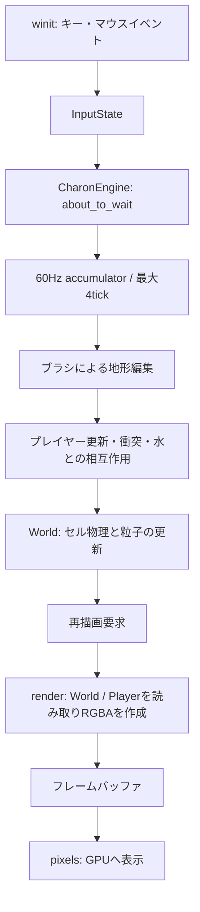

# Charon Engine

**ピクセルごとの物理と、破壊できる地形を持つ2Dサンドボックスエンジン。**

Rustで開発する Falling Sand（セル・オートマトン）方式のゲームエンジンです。水が流れ、砂が積もり、削った地形が崩れる世界に、プレイヤーの移動と水との相互作用を組み合わせています。

Noitaのピクセル物理、Terrariaの探索・クラフト、Celesteのアクションを参考に、拡張可能な2Dゲーム基盤を目指しています。Rustの学習と、開発者自身が理解・保守できる設計もプロジェクトの目的です。

> [!NOTE]
> 現在は開発初期のプロトタイプです。このREADMEは2026年10月15日時点のソースを基準にしています。`gemini/` の設計資料には未実装の構想や旧仕様も含まれます。

## 現在できること

| 機能 | 実装内容 |
| --- | --- |
| 地形生成 | 固定シードのノイズによる土・石の地形と空洞の生成 |
| セル物理 | 水の落下・水平流動、砂の落下、固体の支持状態に基づく崩落 |
| シミュレーション時計 | 壁時計の経過時間から整数60Hz tickを進め、1回の処理で最大4tickまで実行。余剰tickは保持 |
| コマンド編集 | 有限worldのブラシ編集を検証し、material・半径・最大候補セル数を確認してから適用 |
| Game API | 有界slot inventory、atomic recipe craft、採掘報酬とWorld cell除去のcapacity-safe連携、敵HP/攻撃、game state codecとWorld+game+Player bundle codec。GUI・AIは未実装 |
| World snapshotと世代保存 | 明示little-endian versioned codecで有限領域、remote resident/active chunks、有限領域のactive set、lease、有限/remote熱energy sidecar、tickと視覚粒子を復元。`GenerationStore`はWorld単体とWorld+GameSession+Player bundleをchecksum付き世代ファイルに保存し、同一ディレクトリrenameで公開、直近3世代を保持、破損・注入したwrite/flush/rename失敗時に旧世代を保持。stable-name辞書、directory fsyncを含む電源断保証、migrationは未実装 |
| Replayと正規状態hash | version/content/初期stateを検証し、Q16.16 Player入力と現在のWorldCommand（brush、chunk lease、visible plan）をtick/source/sequence順に再生。未来tick commandはWorld snapshotへ保存。World+PlayerのFNV-1a canonical hashは視覚particleを除くsimulation projectionを使用（非暗号）。将来導入するsystem/gameplay commandのreplay対応、stable-name辞書、暗号学的hashは未実装 |
| 物質変換台帳とEntityId | materialごとのissued/consumedを原子的に追跡し、snapshot load時にworld人口と照合。World所有のgenerational EntityId allocatorは世代・free orderをcheckpoint/hashへ含め、stale参照と容量超過を拒否 |
| 固定小数点 | overflow/divide-by-zeroを返すQ16.16値型をPlayerの位置・速度・寸法・水しぶき距離状態に接続。Playerは1/16セル刻みでfractional movementと衝突判定を行う。描画と視覚粒子だけfloat |
| 熱計算 | 等熱容量セルの整数energy拡散scalar referenceをWorldの有限セルsidecarへ接続し、tick・移動・snapshot/hashへ含めた。material別容量/導電率、remote側、phase change・燃焼反応は未実装 |
| Headless実行 | `cargo run --locked --bin headless -- 600`でウィンドウなしにtickを進行 |
| Gameplay sample | `cargo run --locked --bin gameplay_sample`で採掘→craft→戦闘→World/game/Player save bundle→復元を実行 |
| セル格納 | 有限worldを64×64チャンクで保持。符号付き座標の矩形storeを実装（初期resident上限512 chunks）。inactive chunkはresidentのままfreezeしsnapshotへ保存 |
| Remote chunk更新 | Engine既定で可視chunkから全方向1chunkをactive、2chunkをresident/prefetchとして計画し、容量事前検証後にP0で適用。未来tick lease commandはWorld queue/snapshot/replayに含み、指定tickのP0で領域準備とactivationを同期commit。inactive chunkはresidentのままfreezeし、視覚particleは停止・再開。次状態が恒等となる十分条件を満たすchunkはsleepし、編集・移動・熱入力で近傍ごとwake。remote熱sidecarはcellと共に移動し、snapshot/hashに含む。粉体・液体はfinite/remote継ぎ目を同じ座標規則で越える。非同期IO provider、remote熱solver、位置を持つWorld entityは未実装 |
| 地形編集 | マウスブラシによる注水・砂の配置・掘削 |
| プレイヤー | 左右移動、ジャンプ、4×4領域の密度に基づく衝突判定 |
| 水との相互作用 | 水中の移動抵抗・浮力、水の攪拌、水しぶき粒子 |
| マテリアル | 空気・土・石・水・砂の標準定義と、名前・重複・ID上限を検証するRust登録API。freeze時は永続名順でIDを確定。Rust builder/TOML schema v1からゲーム質量、typed property/attachment、燃焼宣言を登録可能（schema範囲検証、instance state、燃焼solverは未実装）。[TOML例](../content/examples/light_wood.toml) |
| 描画 | `pixels`による640×360の論理フレームバッファ描画 |
| ウィンドウ | YAML設定の読み込み、リサイズ処理、F11でのフルスクリーン切替 |

## 起動する

Rust 2024 Editionに対応したRust/Cargoと、GUIウィンドウを表示できる環境が必要です。初回ビルドには依存クレートの取得が必要です。

リポジトリのルート（`Cargo.toml`と`conf.yml`のあるディレクトリ）で実行します。

```sh
cargo run --locked
```

最適化したビルドで試す場合：

```sh
cargo run --release --locked
```

起動すると地形とプレイヤーが表示されます。まず左クリックで水を注ぎ、右クリックで地形を削ると、流動と崩落を確認できます。

### 操作

| 入力 | 動作 |
| --- | --- |
| `A` / `←` | 左へ移動 |
| `D` / `→` | 右へ移動 |
| `W` / `Space` / `↑` | ジャンプ。水中では上方向へ移動 |
| 左クリック長押し | 水を配置 |
| `Shift` + 左クリック長押し | 砂を配置 |
| 中クリック長押し | 砂を配置 |
| 右クリック長押し | 地形を削除 |
| `F11` | フルスクリーン切替。変更を`conf.yml`に保存 |
| ウィンドウを閉じる | 終了 |

## 設定

設定はルートの[`conf.yml`](../conf.yml)で管理します。初期ウィンドウサイズは1280×720、論理解像度はコード内で640×360に固定されています。

| 設定 | 現在の扱い |
| --- | --- |
| `engine.name` | ウィンドウタイトルに使用 |
| `engine.window.width` / `height` | 初期ウィンドウサイズに使用 |
| `engine.window.resizable` | ウィンドウのサイズ変更可否に使用 |
| `engine.window.fullscreen` | 起動時の表示モードに使用。F11操作で更新・保存 |
| `vsync` / `framerate-target` | 設定項目は存在しますが、現在のループで制御に使用していません |
| `engine.debug` / `game.player` / `game.camera` | 設定項目は存在しますが、現在の描画・移動処理には未接続です |

プレイヤーの速度・重力などは[`player.rs`](../src/entities/player.rs)に定義されています。位置・速度はQ16.16で、衝突と水判定は負座標でもfloor準拠の整数範囲を使います。描画と視覚particle生成時のみfloatへ変換します。シミュレーションは60Hzの固定tickへ進み、ジャンプのpressed edgeはtickごとに一度だけ消費します。`ReplayLog`は入力と現在定義済みのWorldCommandを記録し、候補World/Playerが全frame通過した後にcommitします。future tick command queue、material ledger、generational EntityId allocatorは停止snapshotとhashへ含みます。`GenerationStore`は停止World snapshotの世代保存を提供します。World/game/Player bundleのfilesystem adapter、永続辞書・migration、directory durability保証はありません。Engineは論理viewportをvisibleとして、policyに基づくremote chunkのresident/active計画を各tick前に適用します。lease lifecycleは同期request/releaseで、remote entity/sidecarは未実装です。フォーカス喪失中はtickを止め、復帰時に壁時計差を取り込みません。

## コードの構成

```text
charon-engine/
├── Cargo.toml          # パッケージと依存クレート
├── Cargo.lock          # 依存バージョンの固定
├── conf.yml            # 実行時設定
├── src/
│   ├── lib.rs          # 再利用可能なエンジンAPI
│   ├── main.rs         # winit hostのエントリーポイント
│   ├── bin/headless.rs # ウィンドウなしのsimulation runner
│   ├── render.rs       # world/entityからフレームを作成
│   ├── core/           # イベントループ・入力・設定・描画の接続
│   ├── simulation/     # セル・物性・地形生成・物理・粒子
│   └── entities/       # プレイヤーと地形・水の相互作用
├── content/examples/   # TOML material authoring sample
├── AGENTS.md           # Codex向けプロジェクト規約
├── .agents/skills/     # 再利用するエンジン変更手順
├── .github/workflows/  # GitHub Actionsの品質チェック
├── gemini/             # 既存の設計・学習・引継ぎ資料
└── codex/
    └── README.md       # プロジェクト概要とドキュメントの入口
```

### 更新と描画の流れ



セルは`material: u16`、`flags: u8`、`data: u8`からなる4バイト構造体です。物質の種類と崩落などの状態を分離し、`MaterialRegistry`がIDから物性を参照します。現在のワールドは単一のセル配列で、更新時に全域を走査します。

主要な依存クレートは[`Cargo.toml`](../Cargo.toml)で確認できます。

| クレート | 指定バージョン | 用途 |
| --- | --- | --- |
| `winit` | `0.30.13` | ウィンドウとイベント処理 |
| `pixels` | `0.17.2` | ピクセルバッファの描画 |
| `noise` | `0.9.0` | ノイズ地形生成 |
| `serde` | `1.0` | 設定データのシリアライズ |
| `serde_yaml` | `0.9` | YAML設定の読み書き |

## 開発時の確認

以下はリポジトリのルートで実行する基本コマンドです。

```sh
cargo check --locked
cargo test --locked
cargo fmt --check
cargo clippy --locked
```

リポジトリでは[`AGENTS.md`](../AGENTS.md)にCodex向けの作業規約を置き、`.agents/skills/engine-system-change/SKILL.md`でシミュレーションや保存形式を変更するときの横断確認を再利用します。PRとpushでは[GitHub Actions](../.github/workflows/rust.yml)がRust 1.98.1を使ってformat、compile、Clippy、unit testを実行します。Actionsがリポジトリ設定で有効になっている必要があります。

ローカルでもCIと同じRust版を使うには、RustupでRust 1.98.1と`rustfmt`・`clippy`を導入してください。ターミナルから`cargo +1.98.1 check --locked`のように実行すると、別の既定Rust版との混在を避けられます。

既存の単体テストはセルのサイズ・フラグ、マテリアル登録、固定tick、コマンド拒否、プレイヤーの初期状態を対象にしています。描画、操作感、流体の挙動は起動して確認してください。マテリアル名は`namespace:name`形式です。未知IDは空気に化けず、紫色の不透明な`engine:missing`定義として参照されます。

GUIを起動せずsimulationを動かすには、tick数を指定します（省略時600tick）。

```sh
cargo run --locked --bin headless -- 600
```

M0向けの小規模固定sceneを測るには、`b0`〜`b3`の全scene、または個別sceneを指定します。拒否経路fixtureは`failure`です。

```sh
cargo run --locked --bin m0_baseline -- all 120
cargo run --locked --bin m0_baseline -- failure
```

測定条件と結果は[M0ベースライン](design/13_M0_BASELINE.md)を参照してください。これはM6の性能計測を代替しません。

## 今後の開発テーマ

製品版ロードマップ上の未達項目です。各ゲートの合格条件と依存関係は[ロードマップ](design/09_ROADMAP.md)を参照してください。

- M1: 完了（86 unit tests pass、V01〜V04/V06 fixtureと30/60/144Hz同tick一致を確認）
- M2: 完了（V07〜V09、99 unit tests、tick指定activation、finite/remote境界、実sleepと起床後の参照一致、世代保存fault injectionを確認）。非同期IO provider、World entity統合、remote熱solver、OS別directory fsync・電源断保証は後続工程 |
- M3: property schema制約、instance attachment state、浮力/drag/hardness、swept terrain collisionと作者sample
- M4: remoteを含むenergy sidecar、material heat capacity/conductivity、phase change、燃焼・反応出力予約
- M5: biome/cave/ore/prefab生成、AI保存、UI/audio/accessibility、作者向け遠隔工場sample
- M6以降: 固定負荷性能測定、fuzz/soak、API凍結、migration、SDK/RC/出荷準備

60 FPS安定動作、ゼロアロケーション、商用品質などは設計上の目標です。現時点で達成を保証するベンチマークや対応環境の検証結果はありません。

## ドキュメントを読む

製品版までの全体構想・共通契約・技術設計・ロードマップは、[製品版設計の入口](design/00_INDEX.md)から参照してください。これらは将来の実装仕様であり、このREADMEの実装済み機能とは区別しています。

| 製品版設計 | 内容 |
| --- | --- |
| [製品構想](design/01_PRODUCT.md) | 1.0の範囲と対象環境 |
| [共通契約](design/02_CONTRACTS.md) | 単位、状態、更新順、保存則、再現性 |
| [アーキテクチャ](design/03_ARCHITECTURE.md) | 所有権、モジュール、tick pipeline |
| [セル物理](design/04_SIMULATION.md) | chunk、流動、崩落、熱、反応、sleep |
| [作者向けブロック定義](design/11_MATERIAL_AUTHORING.md) | 重さ・浮力・可燃性、独自属性の定義とアタッチ |
| [画面外chunk API](design/12_OFFSCREEN_CHUNK_API.md) | 既定ONのロード、遠隔lease、作者の制限変更 |
| [研究と実験](design/08_RESEARCH.md) | 一次資料と適用条件、安定性・効率化の検証 |
| [ロードマップ](design/09_ROADMAP.md) | M0〜M8の依存関係と合格条件 |
| [整合性監査](design/10_DECISIONS_AND_AUDIT.md) | 設計判断、旧資料からの是正、未確定事項 |

開発背景や学習資料は、既存の`gemini/`資料を参照できます。

| 資料 | 内容 |
| --- | --- |
| [既存README](../gemini/docs/readme.md) | 初期の概要 |
| [人間向けガイドの目次](../gemini/human_doc/00_INDEX.md) | Rust学習、設計解説、実装手順 |
| [設計書のマスターインデックス](../gemini/ai_design_doc/00_MASTER_INDEX.md) | エンジン全体とゲームシステムの将来設計 |
| [製品ビジョン](../gemini/ai_design_doc/01_PRODUCT_VISION_AND_REQUIREMENTS.md) | 目指す体験と品質目標 |
| [アーキテクチャ設計](../gemini/ai_design_doc/02_ARCHITECTURE_OVERVIEW.md) | 将来のサブシステムとデータフロー |
| [引継ぎ資料](../gemini/docs/AI_HANDOVER.md) | 開発背景と設計意図 |

資料とコードに差がある場合、現在の挙動は`src/`、依存関係は`Cargo.toml`と`Cargo.lock`を基準に確認してください。

## ライセンス

リポジトリの[`LICENSE`](../LICENSE)に記載されたMIT Licenseを適用します。
