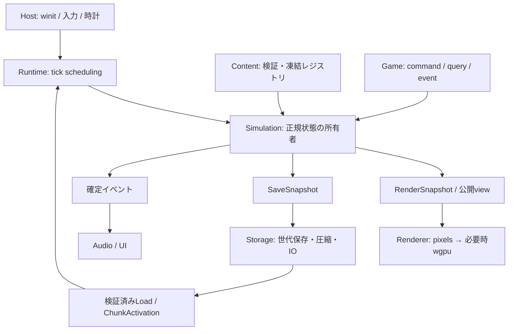

# アーキテクチャと更新パイプライン

前提は[共通契約](02_CONTRACTS.md)。`World::render_to_frame`と`Player`相互依存は解消し、描画処理を`render` moduleへ移しました。現在のrendererは`World`を直接読み取っています。将来はimmutable view/snapshotを境界にして保存・描画を分離します。

## 所有権とモジュール



現在のcrateは`lib.rs`を持ち、winit hostとheadless binaryから共通のsimulation libraryを利用します。`World`自身はwinit・pixels・audio・`Player`を参照しません。rendererは`World`と`Player`のread-only参照からフレームを作ります。将来の`game`はsimulationのquery/command型に依存し、セル配列へ可変参照を持たない設計です。イベントの購読先をsimulationが呼び返す方式にしません。

Worldのセルは64×64固定chunkを並べた`ChunkedCells`で保持します。worldは有限矩形を初期確保し、512 resident chunkを初期上限とします。追加のsigned chunkをall-or-nothingでresident storageへ確保/解放できます。`StreamingPolicy`は既定ON marginとcreatorの容量値を検証し、visible/remote範囲のactive/resident/byte予算を事前計算します。Engineは論理viewportのvisible chunk矩形からplanを作り、各tickのP0で適用します。初期矩形内chunkもactive setを持ち、inactive chunkはresidentで凍結しsnapshot/hash対象です。stable lease ID/source/region/modeの同期request/releaseとsnapshot保存を実装しました。非同期prepared request/確定activation tick、remote entity/sidecar、全物理ruleの共通境界処理、Dirty/sleepは未実装です。movement stampはflat sidecarとして残っています。

| 将来モジュール | 責務・所有データ |
| --- | --- |
| `content` | TOML schema、物性、反応、画像参照、content hash |
| `streaming` | 画面外policy、予約、遠隔lease、prepared chunk。commitはsimulationが所有 |
| `simulation` | World、chunk store、セルphase、正規粒子、空間query |
| `entities` | 世代付きslot、controller、敵状態、投射物 |
| `game` | アイテム、レシピ、戦闘、クエリから作るコマンド |
| `runtime` | 固定tick、入力量子化、開始・停止・ロード |
| `render` | snapshotからの描画、カメラ、光、UI合成 |
| `storage` | 明示codec、世代、検証、移行 |
| `diagnostics` | 正規状態hash、性能計測、再現bundle |
| 実行バイナリ | OS接続、sandbox/sample選択、ユーザー設定 |

`game::inventory`には有界slot inventoryとatomic recipe craftingの基礎があります。既存のGUIで採掘・配置・戦闘と一巡するsampleへはまだ接続していません。

現在実装済みのcommand境界は`WorldCommand::PaintBrush`です。material登録済み、radius 0〜64、最大候補セル数を検証してからwriteし、`CommandResult`で実際に変更したセル数を返します。`CommandEnvelope` batchは次tickを検証し、target/source/sequence順に適用、各結果を`CommandEvent`として返します。将来tickのqueue、再送/replay、一般query/viewは未実装です。

最初は1つのcrate内で`lib.rs`とバイナリを分けます。並行ビルドや独立配布の必要が出るまでworkspaceを過剰分割しません。API 1.0の凍結はM7です。

## 1tickの順序

tick nは状態S(n)をS(n+1)へ進めます。ゲーム操作はこの順序の意味に従います。

| phase | 処理 | 読み取りとcommit |
| --- | --- | --- |
| P0 | domain変更、検証済みロード、tick入力の確定 | domain準備不足ならtickを開始しない |
| P1 | UI/入力/前tickイベントからのコマンド | 安定ソートして順次トランザクションcommit |
| P2 | controller・敵AI・entityの移動と接触 | P1後の地形。EntityId昇順。相互作用を収集 |
| P3 | 採掘・攻撃・投射物・爆発・液体押し退け | P2出力を順次commit。ダメージも正規eventへ |
| P4 | 局所支持・崩落判定 | P3後の状態からflag変更を収集し一括commit |
| P5 | 粉体・崩落固体・液体・気体の移動 | C04の全域順でin-place交換。stampで二重移動防止 |
| P6 | 熱、相転移、接触反応、状態timer | 熱は対称flux、反応は予約付きcommit |
| P7 | 正規粒子、地形に埋まったentityの補正 | 正規粒子の移動と着地は保存則を守る |
| P8 | inventory等の確定、death、event、tick増分 | view・hash・save snapshotを公開 |

P7で発生した地形変更はDirtyを付けますが、P4〜P6で再処理するのは次tickです。接触補正はP7の全地形commit後に行います。イベントからの再帰的な同tick変更は禁止し、購読先の応答は次tick以降のコマンドになります。

`CommandEnvelope`は`target_tick, source_id, sequence, payload`。ソートキーはこの順。sourceはsession内固定、sequenceは単調増加で重複を拒否します。AI等の内部コマンドにも安定sourceと順序を割り当てます。P1の順序付きコマンドは後のものが前の結果を読むため、同一地点への配置競合が曖昧になりません。

## 固定tickと入力

実時間accumulatorを使い、1/60秒ごとに整数tickを進めます。1描画で最大4tickまで進め、過負荷時もtickを飛ばさず余りを保持します。遅れが250msを超えたら装飾を減らし、継続する場合は明示的に一時停止・診断します。focus喪失・OS suspend中は停止し、復帰時の壁時計差を物理へ投入しません。

キーheldとpressed/released edgeを分離。ジャンプ押下は1度だけ消費、ジャンプ保持は別のcontroller入力です。マウス位置はカメラ・整数倍率・letterboxを逆変換し、描画領域外は無効とします。

入力は次の未開始tickへ割り当て、リプレイは確定したtick列を使用します。時間計測値をhashへ入れません。rendererの補間はentityだけを対象とし、セルの物質状態を補間しません。

## API境界

以下は責務を示す案で、実装済みAPIではありません。

```rust
pub fn step(&mut self, input: TickInput) -> Result<TickResult, SimError>;
pub fn query(&self) -> WorldView<'_>;
pub fn enqueue(&mut self, command: CommandEnvelope) -> Result<(), CommandError>;
pub fn snapshot(&self) -> Result<SaveSnapshot, SaveError>;
```

`WorldView`は`CellQuery::{Loaded, Unavailable, WorldBoundary}`、raycast、AABB queryを返します。提出時の構文検証とcommit時の状態検証は別です。`enqueue`成功は操作成功を意味せず、確定eventで結果を通知します。

大きな操作は最大セル数を事前計算します。M1では超過を拒否し、M5以降で必要な生成等に限って、保存可能なジョブへ分割します。個々のジョブstepは容量を予約してatomicにcommitし、未完了区域は操作不能にします。

## 並列化

正規CPU実装は単一threadです。asset/生成候補/圧縮はworkerで実行でき、結果はP0で検証して取り込みます。保存workerはimmutable snapshotのみ読みます。

正規セル移動をチャンクごと並列in-place更新しません。対角接触、多段探索、haloを考慮しない赤黒走査は競合を除去しません。候補評価の並列化は、読み取りsnapshot、完全なread/write set、安定した競合解決、参照実装との一致試験を満たしてから別ADRで採否を決めます。同期モデルを変更するならsimulation versionを更新します。
