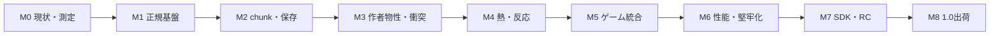

# 製品版までのロードマップ

日付による納期ではなく、合格条件で進める工程です。現時点では全工程未完了。既存コードはM0のprototypeとして扱います。

## M1〜M5ゲート状況

2026-10-14時点で、M1〜M5の出口条件を満たしたゲートはありません。下表は「先行実装」を「ゲート通過」と誤読しないための状態表です。

| Gate | 状態 | 出口を阻む代表的な未達項目 |
| --- | --- | --- |
| M1 | 未通過 | 物質台帳、全command/domain replay、認定state hash、V01〜V06 fixture matrix |
| M2 | 未通過 | activation tick準備queue、finite/remote rule統合、remote sidecar、sleep differential、保存fault injection |
| M3 | 未通過 | instance property/attachment state、浮力・drag・hardness、swept collision、作者sample |
| M4 | 未通過 | active boundary対応・remote熱sidecar、材質熱容量/導電率、phase/reaction reservation、fuel timer |
| M5 | 未通過 | stable world generation、AI、UI/audio/accessibility、通常APIだけを使う遠隔工場sample |

## M0 — 現状の固定と設計の基準化

既存source、dependencies、既知不具合、起動操作を記録。開発機、toolchain、build再現性を確認し、B0〜B3に相当する小さなbaselineを準備します。現行コードを無条件にフォーマットし直して設計変更と混ぜません。

**出口:** 現状のcheck/test結果、baseline測定、設計ID一覧、失敗sceneが記録される。現在の資料作成だけでM0完了とはしません。

## M1 — 正規simulationと再現基盤

- libとhost分離、headless runner、view/command/event
- 固定60Hz、入力edge、固定小数点entity、C04の走査順
- ID予約・上限・参照検証、hot/cold分離
- 原子交換、stamp、物質台帳、容量拒否
- Philox候補検証・mapping固定、state codec/hash、in-memory checkpoint

2026-10-14の実装記録: `MaterialRegistry`に空気/missing予約定義、`namespace:name`検証、重複拒否、65534件の作者ID上限、freeze時の名前順IDを追加。整数時間accumulatorで60Hz固定tick、1回最大4tick・余剰保持・focus停止を実装。`lib.rs`、描画分離、GUIなしrunner、検証付きbrush command、同tickのtarget/source/sequence batch dispatchとresult event、tick入力edge、Cell外u64 movement stamp、Philox4x32-10 test vectorを追加。Player位置・速度・寸法・歩行距離タイマーをchecked Q16.16へ移行し、1/16セル刻みのfractional collision、離散水平入力、演算失敗時Player rollbackを実装。World+GameSession+Player bundleはv2に更新しPlayerのraw stateを保存・検証する。Worldにはversion/content fingerprintを含む明示little-endian停止snapshotを追加し、有限矩形・remote stored chunks・視覚粒子を復元できる。`ReplayLog`は初期state/content/tickと照合しながらQ16.16 Player入力＋PaintBrush commandをcandidateへ再生し、全frame成功時だけcommitする。これは全command/domain replay、安定した製品hash、stable-name辞書codec、全metadata、atomic filesystem generationではない。物質台帳、command queue、V01〜V06 fixture/target matrix、Playerを含む認定hash比較は残るためM1は未完了。

M2着手: `ChunkedCells`をWorldの有限セル格納として統合し、64×64割当て、負座標Euclidean mapping、`Available/Unavailable/WorldBoundary` query、resident上限、fallible constructorを実装。Engineの論理viewportからactive/resident planをP0適用し、同期lease request/release、pinned上限、snapshot復元も実装（World snapshot v4/simulation v5）。`GenerationStore`はchecksum付きWorld snapshotまたはWorld/game/Player bundle世代を最大3つ保持し、旧世代fallbackを持つ。未実装は非同期request queue/確定activation tick、finite↔remote全ruleの統合、remote entity/particle/thermal sidecar、sleep/Dirty、directory durabilityとdisk fault injection、M2 differential fixture。従ってM2未完了。

再現性の是正: playerの水しぶき演出に残っていたthread-local xorshiftをPhilox由来のtick/座標/domain/sample値へ置換。Playerのcanonical stateはQ16.16へ移行済み。残項目は入力replay、物質台帳、Player/world/game統合hashおよび契約fixture。

M3先行実装: `mass_per_cell`をセル交換rankへ接続し、typed Rust property/attachment・flammability dataとfreeze時のmaterial product参照検証、64KiB上限/unknown-field拒否付きTOML schema v1を追加。軽量な浮力係数・標準property schema、instance attachment state、精密swept/camera対応、物質台帳は未実装。M2の遠隔lease/save exitを通過するまではM3完了扱いにしない。

M5先行実装: `game::inventory`に容量付きslot、namespaced item stack、atomic craftを追加。`GameSession`に採掘（inventory容量を先行予約してからcellを除去）、敵2体のHP/攻撃、game state codecとWorld+game+Player save bundleを追加。`gameplay_sample`実行binで採掘→craft→戦闘→tick→bundle保存/復元を確認する。これはallocator/AI/UI/audioを含む遊べるsampleではなく、M2/M3/M4依存も未完了。M5出口は未通過。

M4先行実装: `simulation::thermal::diffuse_energy`の等熱容量整数flux solverを有限Worldのenergy sidecarへ接続。tick前に確保したscratchを使いP5移動後にenergyを拡散し、移動・snapshot・diagnostic fingerprintへ追従させる。energy保存とsnapshot roundtripをtestする。material別heat capacity/conductivity、inactive domain間の熱境界遮断、remote sidecar、phase change、燃焼timer・atomic exhaust reaction・物質台帳、thermal differential fixtureが未実装のためM4未完了。

## M1の実装順

1. 安全なmaterial registryと固定tick時計（freezeと名前順IDを実装）
2. simulationをlibrary化し、rendererを`World`から分離、headless実行経路を作る（World直読みviewは残る）
3. command/event境界とtickごとの入力確定を導入する（brush validation、tick/source/sequence順のbatch dispatch、result event、held/edge入力、Player+PaintBrush限定ReplayLogまで実装。future queueと全command/domain replayは未実装）
4. cell交換・stamp・物質台帳を原子的にする（2-cell/3-cell移動stampまで実装、台帳未実装）
5. stable ID freeze、Philox tuple、状態codec/hash、checkpointを加える（stable ID/Philox/World codec+fingerprint/Player Q16.16+bundle v2は実装。replay/full hash/物質台帳は未実装）
6. V01〜V04/V06を満たす契約ベースの小世界fixtureを固定する

各項目は1〜5を終えてから次へ進み、検証を通過しない項目の後続依存は開始しない。現プロトタイプのID割当てや保存互換性はまだ公開契約として扱わない。

**出口:** V01〜V04、V06の小世界版が合格。30/60/144Hz表示で同tick状態一致。空registry/上限でpanicしない。旧操作の水・砂・掘削が新APIで動く。

## M2 — 空間管理と早期保存

- chunk store、世界座標、Unavailable/WorldBoundary query
- 画面外ONの既定policy、範囲要求、遠隔lease、容量予約、P0 activation
- finite world生成、domain外freeze、凍結entity/粒子の再開
- 停止snapshotによる世代保存とload、request/leaseの復元
- sleep/Dirtyのdifferential検証、fallback全走査

**出口:** V07/V08、V09の保存fault基礎版が合格。画面外・遠隔regionを実際にロード/更新でき、上限縮小やdisk fullでデータを失わない。chunk端でlegacyと比較ではなく参照基盤と比較する。

## M3 — 作者定義と安定した操作

- TOML物性、mass・浮力・drag・hardness・cohesion、behavior別対応表
- typed property/attachment schema、instance transfer/hash/codec
- burning等の将来fieldはschemaのみ先行可能だが、未有効を明示
- swept terrain query、精密衝突、auto-step、埋まり対処
- 配置item・採掘・inventory取引、最小作者sample

**出口:** V03/V09/V11/V12が合格。軽い/重い材の交換が定義通り。独自属性が登録・参照・保存でき、instance移動で失われない。1px壁、高速弾で壁抜けしない。

## M4 — 物理相互作用

- Gas、energy sidecar、熱flux、enthalpy phase、fuel/wet timer
- 可燃性、反応の疎索引、出力予約、連鎖次tick
- 爆発上限と正規物質粒子、視覚粒子分離
- sleep条件を熱・反応・独自systemへ拡張

**出口:** V04/V05/V06/V07を拡張して合格。燃料/出力不足時に片方だけ消費しない。断熱領域でenergy漂流なし。save途中再開で反応結果一致。

## M5 — 遊べる統合sample

- biome/cave/ore/prefabの安定anchor生成
- recipe・道具・近接/遠隔・魔法effect、敵2種、ボス1例
- AI探索状態の保存方式を確定
- hotbar/inventory/HP UI、入力設定、audio、アクセシビリティ
- 遠隔工場等をleaseで動かすcreator sample

**出口:** 採掘→craft→戦闘→保存→復元の一巡が成立。すべて通常APIを経由し、ゲーム別のWorld直書きがない。V06/V08/V12をゲーム状態まで拡張。

## M6 — 計測による最適化と堅牢化

B0〜B5を固定し、下位機を含む実機計測。profileに基づき、E2/E3/E5/E7、必要ならrenderer移行を評価します。snapshot方式・memory予算・既定chunk数を確定。fault injection、fuzz、soakを実行します。

**出口:** 標準性能予算、容量劣化、保存fault、長時間試験が合格。SIMDや並列が不採用でもよい。純粋な速度向上より保存・再現契約を優先。

## M7 — SDKとRelease Candidate

公開Rust API、content schema、save migration、作者guide、実行sampleを凍結。ライセンス・依存SBOM・配布方式・対応環境・サポートするsave versionを明示します。候補buildから第三者相当の手順で導入確認。

**出口:** 全V項目の証拠が揃い、文書とAPIが一致。未解決P0/P1なし。製品の価格・販売先・ライセンス判断を出荷前に確定する。

## M8 — 1.0出荷と保守基盤

RCの修正後に必要試験を再実行し、version/tag、配布artifact、checksum、release notes、既知制約、再現bundle手順を準備します。公開・販売・配布はその時点のユーザー指示に従います。

**出口:** 認定artifactと対応環境で全ゲートを満たす。以後はsave互換、回帰fixture、障害対応を維持します。

## 変更を小さく進める

各工程は1つの巨大変更にせず、契約・pure function・adapter・統合の順で小さなreview可能単位へ分けます。新旧のworldは移行中だけ並存可能ですが、同一session内で混ぜません。baselineと新仕様の差は意図した変更として説明します。

未確定パラメータは担当工程の入口で決め、その工程の出口を通過するまで後続依存を凍結しません。設計変更は共通契約、保存形式、検証、作者文書の影響を同時に更新します。
