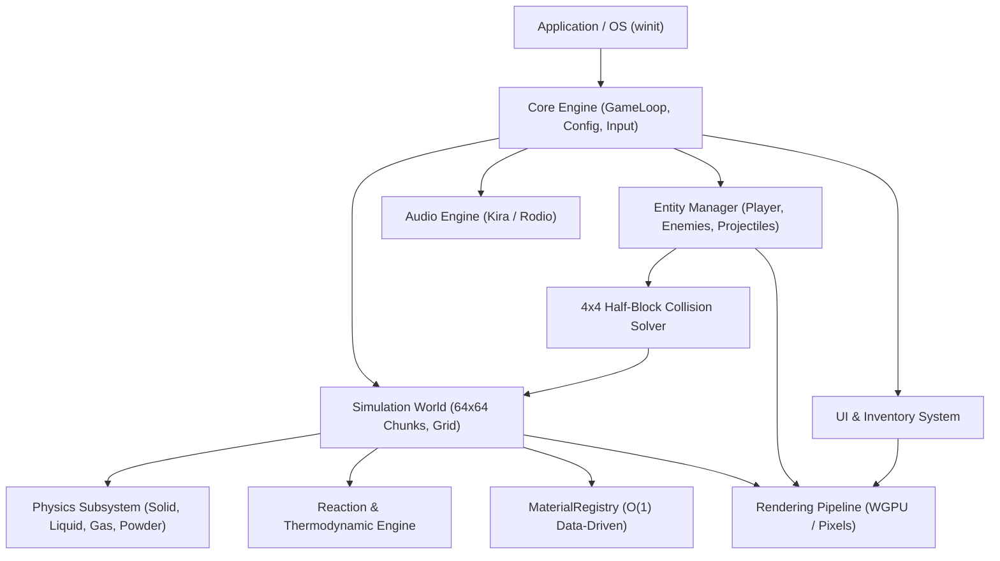
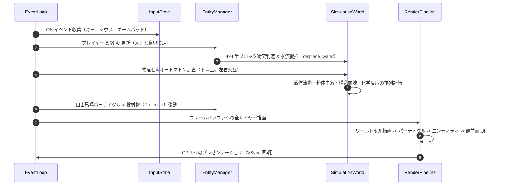

# エンジン全体アーキテクチャ & データフロー (`ai_design_doc/02_ARCHITECTURE_OVERVIEW.md`)

> **本書の目的**  
> Charon Engine を構成する主要サブシステム（コア、シミュレーション、グラフィックス、エンティティ、オーディオ、UI）の全体結合構造と、1 tick（1/60 秒）内の完全なデータフローを定義します。

---

## 1. サブシステム全体結合図

---

## 2. 1 Tick（1/60 秒）の完全データフロー・シーケンス

---

## 3. モジュール間依存性逆転と疎結合の原則

1. **シミュレーション層の自律性**:
   `SimulationWorld` はレンダリングバックエンド（wgpu 等）や入力デバイスの存在を知らない。純粋なメモリバッファと数値計算のみで完結する。
2. **エンティティ層のインターフェース結合**:
   エンティティ（プレイヤー、敵、弾丸）は `World` の直接の内部配列を直接書き換えず、`world.get_cell()`、`world.paint_brush()`、`world.create_explosion()` などの明確に定義されたパブリック API を経由してワールドへ影響を与える。
3. **データ駆動とレジストリの一方向依存**:
   物理処理コードは `MaterialDef` の静的構造体のみに依存し、ハードコードされたマテリアル ID（`if id == 1`）に依存しない。
