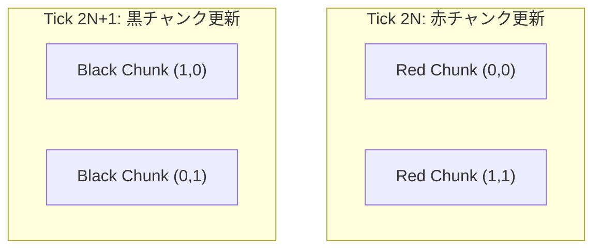

# 64x64 チャンクシステム & L1D 最適化 (`ai_design_doc/05_CHUNK_SYSTEM_AND_L1D_OPTIMIZATION.md`)

> **本書の目的**  
> 巨大な世界全体（数千×数千ピクセル）を 64x64 セル単位のチャンクに分割し、CPU の 1 次キャッシュ（L1D 32KiB〜48KiB）に完全に収めて 60 FPS / 144 FPS を達成する商用空間分割アーキテクチャを定義します。

---

## 1. なぜ 64x64（16KiB）なのか？ 数理的根拠

### L1 データキャッシュ適合性の計算
* チャンク 1 個あたりのセル数: $64 \times 64 = 4,096 \text{ セル}$
* チャンク 1 個あたりの生データ容量:
  $$ 4,096 \text{ cells} \times 4 \text{ bytes} = 16,384 \text{ bytes} = \mathbf{16 \text{ KiB}} $$
* 現代の CPU（Intel Core, AMD Zen, Apple Silicon）のコアあたり L1D 容量は **32 KiB 〜 48 KiB** です。
* **16 KiB** であれば、**「現在更新中のチャンク」が L1D キャッシュ内にまるごと常駐** します。
* 外部 DRAM や L3 キャッシュへのメモリアクセスレイテンシ（50〜200 サイクル）がほぼゼロになり、L1D の超高速アクセス（1〜4 サイクル）だけで物理演算ループが回転します。

---

## 2. チャンク境界問題の解決（パディング & 境界セル同期）

セルオートマトンでは、隣接セル（左下、右下、左右）を参照するため、チャンクの端（Border）で別のチャンクメモリを参照するとキャッシュミスが発生します。

```text
┌──────────────────────┬──────────────────────┐
│  Chunk (CX, CY)      │  Chunk (CX+1, CY)    │
│  [64x64 Cells]       │  [64x64 Cells]       │
│                Border│Border                │
└──────────────────────┴──────────────────────┘
```

### 解決策: チェッカーボード並列走査
チャンクを市松模様（赤・黒）に分割し、隣接しないチャンク同士を並列・独立して更新することで、データ競合（Data Race）を回避しつつキャッシュ親和性を維持します。



---

## 3. チャンク構造体の完全仕様

```rust
pub const CHUNK_SIZE: usize = 64;
pub const CHUNK_CELLS: usize = CHUNK_SIZE * CHUNK_SIZE; // 4096

#[repr(C, align(64))] // キャッシュラインアライメント
pub struct Chunk {
    /// 4096 個のセル生データ（厳密に 16 KiB）
    pub cells: [Cell; CHUNK_CELLS],
    /// チャンクのスリープ状態フラグ
    pub is_sleeping: bool,
    /// 最後に動いたセルの矩形範囲（Dirty Rect）
    pub min_active_x: u8,
    pub max_active_x: u8,
    pub min_active_y: u8,
    pub max_active_y: u8,
    /// スリープタイマー（静止状態が続いたフレーム数）
    pub sleep_timer: u8,
}
```
