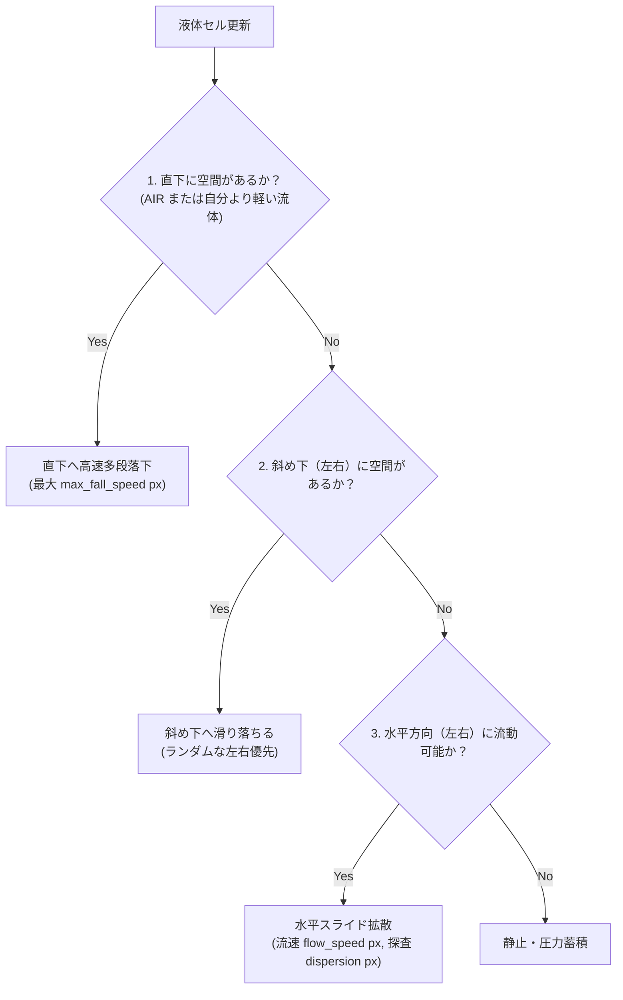

# 流体シミュレーション & 圧力モデル (`ai_design_doc/09_LIQUID_SIMULATION_AND_PRESSURE.md`)

> **本書の目的**  
> 水や溶岩、酸などの液体が「砂のように山を作らず、高速に水平へ広がり、滝のように多段落下し、水圧によって水面を平らにする」流体オートマトンの完全数理を定義します。

---

## 1. 3段階流体移動パイプライン（Gravity $\to$ Diagonal $\to$ Horizontal）

各液体セルは、1 tick 内で以下の 3 段階の優先順位で移動先を探索します。

---

## 2. 水平高速スライド拡散（Lateral Flow Momentum）

液体が砂と決定的に異なるのは**「水平方向への強い表面張力と拡散力」**です。
* `dispersion`（探査距離）: 1 tick で左右に探索する最大セル数（例: 水は 4）。
* `flow_speed`（流速）: 障害物にぶつかるまでに 1 tick で滑り込める最大セル数（例: 水は 3）。
* この 2 段階探索により、水滴が地面に落ちた瞬間に「左右へサーッと勢いよく広がる」心地よい水流表現が実現されます。

---

## 3. 密度成層と浮力（Density Stratification）

異なる液体（例: 水と溶岩、水と油）が混ざり合った場合、密度の高い液体が下へ沈み、密度の低い液体が上へ押し上げられます。

$$ \text{CanDisplace}(A, B) \iff \text{Density}(A) > \text{Density}(B) $$

| 液体マテリアル | 密度（Density） | 挙動 |
|---|---|---|
| **空気 (AIR)** | 0 | すべての物質が落下可能 |
| **油 (OIL)** | 80 | 水の上に浮く |
| **水 (WATER)** | 100 | 標準流体 |
| **溶岩 (LAVA)** | 180 | 水より重く、水底に沈む（接触時に黒曜石化） |
| **水銀 (MERCURY)** | 250 | 最も重く、砂や小石すら浮き上がらせる |

---

## 4. 局所圧力伝播（Pressure Equalization）

閉じた U 字管や深い水底において、水面が自然に水平に揃うよう、下層のセルは `data` フィールドに蓄積された圧力（Pressure）に応じて、空いている上位・側方セルへと押し戻される逆流物理をサポートします。
