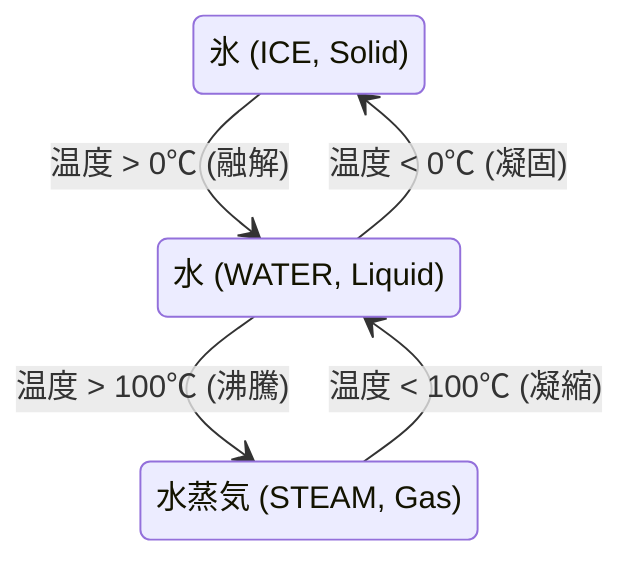

# 熱力学 & セル化学反応マトリクス (`ai_design_doc/12_THERMODYNAMICS_AND_REACTIONS.md`)

> **本書の目的**  
> 熱の伝導、氷から水、水から蒸気への相転移、および物質同士の接触による化学反応（Noita 方式の創発的物理）を O(1) で処理する熱力学・反応エンジンの完全仕様を定義します。

---

## 1. 物質の相転移（State of Matter Phase Transitions）

温度の閾値によって、同一物質が三態変化します。



---

## 2. セル間化学反応マトリクス（2D Reaction Table）

商用エンジンにおいて、何千通りもの化学反応を `if-else` で書くと破綻します。  
**対称マトリクス（ハッシュテーブルまたは疎配列）** を用いて、隣接する 2 つのマテリアル ID から反応結果を O(1) で即時判定します。

```rust
#[derive(Clone, Copy)]
pub struct ReactionResult {
    pub new_mat_a: u16,
    pub new_mat_b: u16,
    pub spawn_particle: bool,
    pub heat_delta: i16,
}
```

### コア定義済み反応一覧
1. **水（WATER） + 溶岩（LAVA）**:
   * $\to$ **黒曜石（OBSIDIAN） + 水蒸気（STEAM）** + 激しい水蒸気爆発音
2. **火（FIRE） + 木材（WOOD）**:
   * $\to$ **火（FIRE） + 灰（ASH） + 煙（SMOKE）**（延焼連鎖）
3. **酸（ACID） + 岩石（STONE）**:
   * $\to$ **有毒ガス（TOXIC_GAS） + 空気（AIR）**（溶解貫通）
4. **雷（LIGHTNING） + 水（WATER）**:
   * $\to$ **帯電水（CHARGED_WATER）**（水域全体に瞬間ダメージ拡散）
5. **火（FIRE） + 可燃性ガス（FLAMMABLE_GAS）**:
   * $\to$ **大爆発（EXPLOSION）**（引火誘爆）

---

## 3. 熱伝導シミュレーション（Thermal Conduction）

* 熱源（マグマ、炎）に隣接するセルの温度は、熱伝導率 $k$ に従って指数関数的に上昇します。
* プレイヤーが氷の魔法を撃つと周囲の温度が急冷され、水たまりが一瞬で凍りついて足場に変わるなどの戦術的ゲームプレイが自然に成立します。
