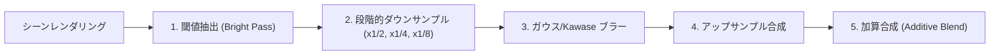

# ポストプロセス & シェーダーエフェクト (`ai_design_doc/17_POST_PROCESSING_AND_SHADERS.md`)

> **本書の目的**  
> 爆発や溶岩の眩しい光（ブルーム）、水中の波打つ屈折、熱気による蜃気楼ディストーション、およびレトロ CRT/スキャンラインフィルターを実現する商用 GPU シェーダーパイプラインを定義します。

---

## 1. ブルーム・エフェクト（Kawase Bloom / Dual Kawase）

溶岩、魔法の弾丸、発光鉱石が高輝度（HDR値 > 1.0）を持つ場合、周囲に光が柔らかく滲み出るエフェクトです。



* 通常のガウシアンブラーよりも 5 倍以上高速な **Dual Kawase Blur** を採用し、統合 GPU（Intel Iris / AMD APU）でも負荷ゼロで実行します。

---

## 2. 水中・熱気の屈折ディストーション（Screen-Space UV Distortion）

水中に潜った際、または溶岩や炎の真上の空間で、背景がゆらゆらと波打つ演出です。

```wgsl
// 屈折ディストーションシェーダー (WGSL)
@fragment
fn fs_distortion(@location(0) uv: vec2<f32>) -> @location(0) vec4<f32> {
    let time = uniforms.time * 2.0;
    // 水中サイン波オフセット
    let offset_x = sin(uv.y * 30.0 + time) * 0.003;
    let offset_y = cos(uv.x * 20.0 + time) * 0.002;
    
    let distorted_uv = uv + vec2<f32>(offset_x, offset_y);
    return textureSample(screen_texture, screen_sampler, distorted_uv);
}
```

---

## 3. レトロ CRT & 色収差フィルター（Chromatic Aberration）

爆発の瞬間やダメージを受けた際、RGB チャンネルをわずかにズラす（色収差）ことで、強烈な打撃感を演出します。
* オプションとして、微細な走査線（スキャンライン）や画面の四隅の丸み（CRT 湾曲）をフラグメントシェーダーでトグル可能です。
