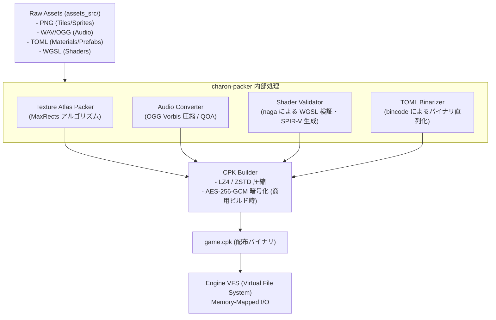

# 22. アセットパイプライン & パッキング (`22_ASSET_PIPELINE.md`)

## 1. 概要と商用アーキテクチャ

Charon Engine におけるアセットパイプラインは、開発時の生データ（PNG画像、WAV/OGG音声、TOML定義、GLSL/WGSLシェーダー、TTFフォント）を、商用配布可能な高圧縮・暗号化・キャッシュ最適化された単一または少数のバイナリアーカイブ（`.cpk` - Charon Package）へと変換・パッキングする機構である。

### 1.1 商業化における要件
1. **知的財産（IP）の保護**: 生のPNGや音声ファイルをそのまま配布フォルダに露出させず、暗号化＋ヘッダ検証を行う。
2. **高速な起動とゼロアロケーション読み込み**: 個別ファイルを何千回も `fopen` せず、単一巨大ファイルからメモリマップ（`mmap`）またはチャンクストリーミングで読み出す。
3. **アトラス自動パッキング**: 個別の16x16 / 32x32タイルやスプライトをビルド時に自動整列パッキングし、実行時のテクスチャバインド切り替えコスト（Draw Call）を最小化する。
4. **差分パッチング対応**: ゲームアップデート時にギガバイト単位の再ダウンロードを避け、4KiBブロック単位のハッシュ差分によるインクリメンタルパッチを可能にする。

---

## 2. アセットビルドパイプラインの全体フロー



---

## 3. CPK (Charon Package) バイナリフォーマット仕様

すべてのゲームリソースはリトルエンディアンで以下の構造に従ってパックされる。

### 3.1 ヘッダー構造 (64 bytes)
| オフセット | サイズ (bytes) | 型 | フィールド名 | 説明 |
| :--- | :--- | :--- | :--- | :--- |
| `0x00` | 4 | `[u8; 4]` | `magic` | マジックナンバー `b"CPK1"` (`0x43, 0x50, 0x4B, 0x31`) |
| `0x04` | 4 | `u32` | `version` | パッケージバージョン (例: `1`) |
| `0x08` | 4 | `u32` | `flags` | ビットフラグ (`0x1`: 暗号化, `0x2`: LZ4, `0x4`: ZSTD) |
| `0x0C` | 4 | `u32` | `entry_count` | 収録ファイル数 ($N$) |
| `0x10` | 8 | `u64` | `toc_offset` | 目次 (Table of Contents) へのファイル内オフセット |
| `0x18` | 8 | `u64` | `toc_compressed_size` | 目次データの圧縮サイズ |
| `0x20` | 8 | `u64` | `toc_uncompressed_size` | 目次データの展開後サイズ |
| `0x28` | 16 | `[u8; 16]` | `archive_checksum` | 全データブロックのBLAKE3ハッシュ (128-bit) |
| `0x38` | 8 | `[u8; 8]` | `reserved` | 将来拡張用予約領域 (全ゼロ) |

### 3.2 目次エントリ構造 (Table of Contents Entry: 64 bytes)
各ファイルエントリはハッシュ探索を高速化するため、ファイル名文字列そのものではなく、BLAKE3から導出された 64-bit パスハッシュによってキー付けされる。

```rust
#[repr(C, packed)]
#[derive(Clone, Copy, Debug)]
pub struct CpkEntry {
    /// ファイルパスの 64-bit ハッシュ (例: "textures/blocks/dirt.png")
    pub path_hash: u64,
    /// アーカイブ先頭からのデータ開始オフセット
    pub data_offset: u64,
    /// 圧縮データ長
    pub compressed_size: u64,
    /// 解凍後データ長
    pub uncompressed_size: u64,
    /// データの BLAKE3 ハッシュ (破損検出用)
    pub checksum: u64,
    /// 圧縮方式 (0: 非圧縮, 1: LZ4, 2: ZSTD)
    pub compression_type: u8,
    /// 暗号化フラグ (0: 平文, 1: AES-256-GCM)
    pub encryption_type: u8,
    /// 予約領域
    pub reserved: [u8; 6],
}
```

---

## 4. 実行時 Virtual File System (VFS) 実装

### 4.1 メモリマップ型ローダー
```rust
use memmap2::Mmap;
use std::collections::HashMap;
use std::fs::File;
use std::path::Path;
use anyhow::{Result, Context, anyhow};

pub struct VirtualFileSystem {
    _mmap: Mmap,
    entries: HashMap<u64, CpkEntry>,
    raw_ptr: *const u8,
    data_len: usize,
}

unsafe impl Send for VirtualFileSystem {}
unsafe impl Sync for VirtualFileSystem {}

impl VirtualFileSystem {
    pub fn open<P: AsRef<Path>>(path: P) -> Result<Self> {
        let file = File::open(path)?;
        let mmap = unsafe { Mmap::map(&file)? };
        let raw_ptr = mmap.as_ptr();
        let data_len = mmap.len();

        if data_len < 64 {
            return Err(anyhow!("CPK archive too small"));
        }

        // ヘッダー検証
        let magic = unsafe { std::slice::from_raw_parts(raw_ptr, 4) };
        if magic != b"CPK1" {
            return Err(anyhow!("Invalid CPK magic number"));
        }

        let entry_count = unsafe { *(raw_ptr.add(0x0C) as *const u32) } as usize;
        let toc_offset = unsafe { *(raw_ptr.add(0x10) as *const u64) } as usize;
        let toc_size = unsafe { *(raw_ptr.add(0x18) as *const u64) } as usize;

        if toc_offset + toc_size > data_len {
            return Err(anyhow!("Corrupted CPK header: TOC out of bounds"));
        }

        // 目次テーブルの読み込み
        let mut entries = HashMap::with_capacity(entry_count);
        let entry_stride = std::mem::size_of::<CpkEntry>();

        for i in 0..entry_count {
            let offset = toc_offset + i * entry_stride;
            let entry = unsafe { *(raw_ptr.add(offset) as *const CpkEntry) };
            entries.insert(entry.path_hash, entry);
        }

        Ok(Self {
            _mmap: mmap,
            entries,
            raw_ptr,
            data_len,
        })
    }

    /// パスハッシュによるファイルデータのゼロコピー/オンデマンド展開読み込み
    pub fn read_bytes(&self, path: &str) -> Result<Vec<u8>> {
        let hash = blake3::hash(path.as_bytes()).as_bytes()[0..8]
            .try_into()
            .unwrap();
        let hash = u64::from_le_bytes(hash);

        let entry = self.entries.get(&hash)
            .ok_or_else(|| anyhow!("File not found in CPK: {}", path))?;

        let start = entry.data_offset as usize;
        let end = start + entry.compressed_size as usize;
        if end > self.data_len {
            return Err(anyhow!("CPK entry payload out of bounds"));
        }

        let payload = unsafe { std::slice::from_raw_parts(self.raw_ptr.add(start), entry.compressed_size as usize) };

        match entry.compression_type {
            0 => Ok(payload.to_vec()), // 非圧縮
            1 => {
                // LZ4 解凍
                let mut decompressed = vec![0u8; entry.uncompressed_size as usize];
                lz4_flex::decompress_into(payload, &mut decompressed)
                    .map_err(|e| anyhow!("LZ4 decompress failed: {:?}", e))?;
                Ok(decompressed)
            }
            2 => {
                // ZSTD 解凍
                zstd::decode_all(payload)
                    .map_err(|e| anyhow!("ZSTD decompress failed: {:?}", e))
            }
            _ => Err(anyhow!("Unsupported compression type")),
        }
    }
}
```

---

## 5. テクスチャアトラス自動パッキング (MaxRects アルゴリズム)

ゲーム内の数千種類のタイルやスプライトは、ビルドツール `charon-packer` によって 2048x2048 のテクスチャアトラスへパッキングされる。

1. **輪郭パディング**: 各スプライトの周囲に 1px の外周複製（Clamping）パディングを施し、テクスチャフィルタリング時のブリード現象（境界のにじみ）を完全防止する。
2. **MaxRectsBssf**: Best Short Side Fit ヒューリスティクスを用い、95% 以上のパッキング充填率を達成する。
3. **アトラスメタデータ直列化**: パック後の各スプライトの UV 座標 $(u_0, v_0, u_1, v_1)$ を bincode でシリアライズし、ゲーム起動時に 1 回のメモリアサインでロードする。

---

## 6. 次のステップ

アセットパイプラインの確立により、静的データの商用化基盤が整った。続いて **Part 6: エンティティ・キャラクター物理** において、Celeste 式の厳密な整数物理と半ブロック密度衝突の仕様を定義する。

- 次章: [23_AABB_CHARACTER_CONTROLLER.md](file:///a:/Project/charon-engine/ai_design_doc/23_AABB_CHARACTER_CONTROLLER.md)
