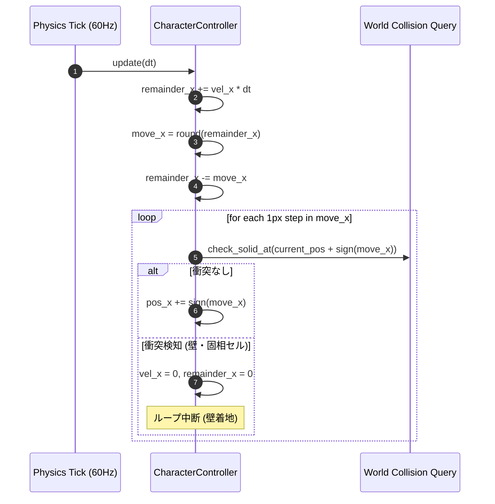

# 23. AABBキャラクターコントローラー & サブピクセル物理 (`23_AABB_CHARACTER_CONTROLLER.md`)

## 1. 概要と基本哲学

Charon Engine におけるキャラクターおよびエンティティの移動制御は、『Celeste』や『Super Mario World』等の伝説的2Dプラットフォーマーに倣った**完全確定論的・整数ベースのサブピクセル蓄積方式 (Sub-pixel Remainder Accumulation)** を採用する。

浮動小数点数（`f32`）による直接的な座標更新（`pos += vel * dt`）は、丸め誤差による壁すり抜け、フレームレート依存の挙動ブレ、およびネットワークマルチプレイ時の非決定論を引き起こす。Charon Engine では、座標および判定を**整数ピクセル座標**と**サブピクセル剰余**に完全分離する。

---

## 2. 数理モデル: サブピクセル蓄積法

### 2.1 座標表現の構造
キャラクターの位置は、グリッド上の厳密な整数ピクセル位置 $(X, Y) \in \mathbb{Z}^2$ と、1ピクセル未満の微小移動量を蓄積するサブピクセル剰余 $(R_x, R_y) \in [-0.5, 0.5]$ または $[0.0, 1.0)$ によって表現される。

$$
X_{\text{total}} = X + R_x, \quad Y_{\text{total}} = Y + R_y
$$

### 2.2 移動更新アルゴリズム (1 Tick: $\Delta t = \frac{1}{60} \text{ s}$)
各ティックにおける更新は以下の手順で厳密に行われる：

1. **速度の加算と剰余蓄積**:
   $$
   R_x' = R_x + V_x \cdot \Delta t
   $$
2. **整数ピクセル移動量の抽出**:
   $$
   M_x = \text{round}(R_x') \quad \text{または} \quad M_x = \lfloor R_x' \rfloor
   $$
   $$
   R_x = R_x' - M_x
   $$
3. **1ピクセルごとのステップ移動 (Step-by-Step Swept Movement)**:
   $|M_x|$ ピクセル分だけ、1ピクセルずつ `sign(M_x)` 方向に移動し、各ステップで衝突判定（Collision Query）を行う。
   障害物に衝突した場合、その場で移動を停止し、残りの $M_x$ を破棄して $V_x = 0, R_x = 0$ とする。



---

## 3. Rust 実装: AABB と キャラクターコントローラー

### 3.1 AABB (Axis-Aligned Bounding Box) の定義
```rust
#[derive(Clone, Copy, Debug, PartialEq, Eq)]
pub struct RectI {
    pub min_x: i32,
    pub min_y: i32,
    pub max_x: i32, // 排他的境界 (min_x + width)
    pub max_y: i32, // 排他的境界 (min_y + height)
}

impl RectI {
    pub fn new(x: i32, y: i32, width: i32, height: i32) -> Self {
        Self {
            min_x: x,
            min_y: y,
            max_x: x + width,
            max_y: y + height,
        }
    }

    pub fn offset(&self, dx: i32, dy: i32) -> Self {
        Self {
            min_x: self.min_x + dx,
            min_y: self.min_y + dy,
            max_x: self.max_x + dx,
            max_y: self.max_y + dy,
        }
    }

    pub fn intersects(&self, other: &RectI) -> bool {
        self.min_x < other.max_x && self.max_x > other.min_x &&
        self.min_y < other.max_y && self.max_y > other.min_y
    }
}
```

### 3.2 コントローラー構造体
```rust
pub struct CharacterController {
    // 整数ピクセルワールド座標 (左上原点)
    pub x: i32,
    pub y: i32,
    pub width: i32,  // 例: 12px
    pub height: i32, // 例: 20px

    // 速度 (pixels/sec)
    pub vel_x: f32,
    pub vel_y: f32,

    // サブピクセル剰余蓄積バッファ
    pub remainder_x: f32,
    pub remainder_y: f32,

    // 接地フラグ
    pub on_ground: bool,
    pub on_wall_left: bool,
    pub on_wall_right: bool,
    pub on_ceiling: bool,
}

impl CharacterController {
    pub fn new(x: i32, y: i32, width: i32, height: i32) -> Self {
        Self {
            x,
            y,
            width,
            height,
            vel_x: 0.0,
            vel_y: 0.0,
            remainder_x: 0.0,
            remainder_y: 0.0,
            on_ground: false,
            on_wall_left: false,
            on_wall_right: false,
            on_ceiling: false,
        }
    }

    pub fn aabb(&self) -> RectI {
        RectI::new(self.x, self.y, self.width, self.height)
    }

    /// 水平・垂直移動の完全確定論的更新
    pub fn update<F>(&mut self, dt: f32, mut is_solid_at: F)
    where
        F: FnMut(&RectI) -> bool,
    {
        // 1. 水平移動の蓄積とステップ実行
        self.remainder_x += self.vel_x * dt;
        let move_x = self.remainder_x.round() as i32;
        self.remainder_x -= move_x as f32;

        self.on_wall_left = false;
        self.on_wall_right = false;

        let sign_x = move_x.signum();
        for _ in 0..move_x.abs() {
            let next_box = self.aabb().offset(sign_x, 0);
            if is_solid_at(&next_box) {
                // 衝突: 速度と剰余をクリア
                if sign_x > 0 { self.on_wall_right = true; }
                if sign_x < 0 { self.on_wall_left = true; }
                self.vel_x = 0.0;
                self.remainder_x = 0.0;
                break;
            } else {
                self.x += sign_x;
            }
        }

        // 2. 垂直移動の蓄積とステップ実行
        self.remainder_y += self.vel_y * dt;
        let move_y = self.remainder_y.round() as i32;
        self.remainder_y -= move_y as f32;

        self.on_ground = false;
        self.on_ceiling = false;

        let sign_y = move_y.signum();
        for _ in 0..move_y.abs() {
            let next_box = self.aabb().offset(0, sign_y);
            if is_solid_at(&next_box) {
                // 衝突: 天井または床
                if sign_y > 0 { self.on_ground = true; }
                if sign_y < 0 { self.on_ceiling = true; }
                self.vel_y = 0.0;
                self.remainder_y = 0.0;
                break;
            } else {
                self.y += sign_y;
            }
        }

        // 接地状態の再検証 (静止中も床があるか判定)
        let ground_check_box = self.aabb().offset(0, 1);
        self.on_ground = is_solid_at(&ground_check_box);
    }
}
```

---

## 4. コーナースムージング & アシスト力学

Celeste 風の極めて手触りの良い操作感を商用ゲームとして実現するため、以下の2つの機構を必須実装とする。

### 4.1 コーナー補正 (Corner Slip / Ledge Forgiveness)
ジャンプ時に頭部が天井の角（1〜3px）に引っかかった場合、頭を打ち付けて落下するのではなく、自動的に水平方向へ1〜3pxスライドさせてスムーズに通り抜けさせる。

```rust
// 天井衝突時に左右どちらかに数ピクセルずらせば抜けられるか判定
if self.on_ceiling && self.vel_y < 0.0 {
    const LEDGE_SLIP_DIST: i32 = 3;
    for offset in 1..=LEDGE_SLIP_DIST {
        // 右にずらすと抜けられるか
        if !is_solid_at(&self.aabb().offset(offset, -1)) {
            self.x += 1;
            break;
        }
        // 左にずらすと抜けられるか
        if !is_solid_at(&self.aabb().offset(-offset, -1)) {
            self.x -= 1;
            break;
        }
    }
}
```

### 4.2 コヨーテタイム & 先行入力 (Coyote Time & Jump Buffering)
- **Coyote Time (約5〜6フレーム / 0.1秒)**: 足場から空中に落下した後でも、数フレーム以内であればジャンプ入力を受け付ける。
- **Jump Buffer (約4〜5フレーム / 0.08秒)**: 着地する寸前にジャンプボタンを押した場合、着地した瞬間に自動でジャンプを発動させる。

---

## 5. 次のステップ

セルオートマトン型破壊可能世界において、セルは完全な 1x1 のブロックだけでなく、4x4 の半ブロック密度（Half-block density）構造を持つ。次章では、この密度マップと AABB の高精度衝突数理を定義する。

- 次章: [24_HALF_BLOCK_COLLISION_MATH.md](file:///a:/Project/charon-engine/ai_design_doc/24_HALF_BLOCK_COLLISION_MATH.md)
