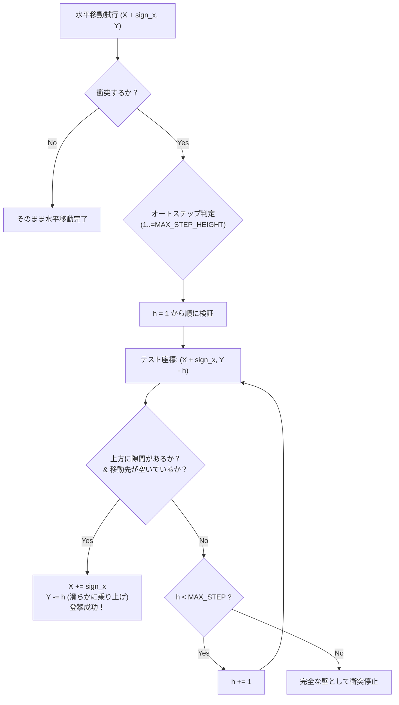

# 24. 半ブロック密度衝突数理 & オートステップ (`24_HALF_BLOCK_COLLISION_MATH.md`)

## 1. 概要と問題提起

Charon Engine におけるセルは、単なる 1x1 のオン/オフ（空気または完全なブロック）だけでなく、**4-bit 密度値（0〜15）** または 4x4 サブピクセルビットマスクによる「半ブロック」「削り取られた地形」「粉体の傾斜」を表現できる。

従来のボクセルエンジンでは、粗いグリッド（例: 8x8 や 16x16）に対して階段状の衝突判定しか行えず、キャラクターが微小な瓦礫や斜面を歩く際に激しい引っかかり（Jittering）が発生する。
商用アクションゲームの品質を保証するため、Charon Engine では以下の2つのアルゴリズムを数学的に結合する：
1. **密度積分型衝突判定 (Density-Integrated Collision Query)**: セル内の質量分布に応じた衝突境界の抽出。
2. **オートステップ登攀力学 (Auto-step / Staircase Stepping)**: 1〜3ピクセルの微小な段差や瓦礫を、ジャンプ入力なしで連続的・滑らかに乗り越える機構。

---

## 2. 密度セルと衝突境界の数理

### 2.1 セル密度と固相判定
セル $C(x, y)$ の物性が固相（Solid / Powder）である場合、そのセルは 4-bit の密度 $D \in [0, 15]$ を保持する。
- $D = 0$: 空洞（衝突なし）
- $1 \le D < 8$: 軟弱な瓦礫または薄い層（物理衝突なし、または速度減衰のみ）
- $8 \le D \le 15$: 剛体（AABB衝突判定対象）

4x4 サブピクセルマスク $M \in \text{u16}$ を使用する場合、各ビット $b_{i, j}$ ($i, j \in [0, 3]$) が $1\text{px} \times 1\text{px}$ のサブピクセル占有を表す。

```rust
/// ワールド内の点 (px, py) が剛体として衝突するか判定 (O(1))
#[inline(always)]
pub fn is_point_solid(world: &World, px: i32, py: i32) -> bool {
    let cell = match world.get_cell_at(px, py) {
        Some(c) => c,
        None => return true, // ワールド境界外は壁として扱う
    };

    if !cell.is_solid() {
        return false;
    }

    // セル内サブピクセルオフセット (0..4)
    let sub_x = (px.rem_euclid(4)) as u32;
    let sub_y = (py.rem_euclid(4)) as u32;
    let bit_index = sub_y * 4 + sub_x;

    let sub_mask = cell.get_subpixel_mask();
    (sub_mask & (1 << bit_index)) != 0
}
```

### 2.2 AABB 全体の高速矩形スキャン (AABB Overlap Test)
キャラクターの AABB $R = [x_{\min}, x_{\max}) \times [y_{\min}, y_{\max})$ が地形と重なっているか判定する場合、セル単位の粗い判定（Broad-phase）と、外周ピクセルの精密判定（Narrow-phase）を分離する。

```rust
pub fn is_rect_solid(world: &World, rect: &RectI) -> bool {
    // 粗いチャンク/セル境界チェック
    let start_x = rect.min_x;
    let end_x = rect.max_x;
    let start_y = rect.min_y;
    let end_y = rect.max_y;

    // 外周（底面、両側面、上面）のみを効率的にサンプリング
    // 移動方向に応じた面のみをチェックすることで計算量を O(Perimeter) に抑制
    for y in start_y..end_y {
        for x in start_x..end_x {
            if is_point_solid(world, x, y) {
                return true;
            }
        }
    }
    false
}
```

---

## 3. オートステップ（段差自動登攀）力学

### 3.1 段差登攀のアルゴリズム
キャラクターが水平方向（例: 右方向 $+1\text{px}$）に移動しようとした際、足元に $H_{\text{step}} \le 3\text{px}$ の段差が存在する場合、そのままでは横方向衝突として移動がブロックされてしまう。
オートステップでは、「上方に $h \text{px}$ 移動した状態で横移動が可能か」を試行し、可能であれば垂直位置を自動で引き上げる。



### 3.2 完全な実装コード
```rust
pub const MAX_STEP_HEIGHT: i32 = 3; // 登攀可能な最大ピクセル段差 (1〜3px)

impl CharacterController {
    /// オートステップ対応の水平移動処理
    pub fn move_horizontal_with_step<F>(&mut self, sign_x: i32, mut is_solid_at: F) -> bool
    where
        F: FnMut(&RectI) -> bool,
    {
        let next_box = self.aabb().offset(sign_x, 0);

        // 1. 直進できる場合はそのまま移動
        if !is_solid_at(&next_box) {
            self.x += sign_x;
            return true;
        }

        // 2. 直進が遮られた場合、段差登攀を試みる (接地中のみ許可)
        if self.on_ground {
            for step_h in 1..=MAX_STEP_HEIGHT {
                // まず頭上に空間があるか (Y - step_h)
                let headroom_box = self.aabb().offset(0, -step_h);
                if is_solid_at(&headroom_box) {
                    // 頭上が塞がれているためこれ以上登れない
                    break;
                }

                // 上に登った状態で水平方向に進めるか (X + sign_x, Y - step_h)
                let stepped_box = self.aabb().offset(sign_x, -step_h);
                if !is_solid_at(&stepped_box) {
                    // 登攀成功: 座標を更新して移動
                    self.x += sign_x;
                    self.y -= step_h;
                    return true;
                }
            }
        }

        // 3. 登れない壁に衝突
        false
    }
}
```

---

## 4. 下り坂追従 (Slope Snapping / Step Down)

階段や下り坂を歩行する際、水平移動によって足元が空中に浮いてしまい、「落下 $\to$ 接地」を繰り返すことで歩行アニメーションがバタつく現象（Stair Flutter）を防止する。

水平移動が成功した後、直前フレームで接地していた場合は、下方向に最大 `MAX_STEP_HEIGHT` ピクセルまでレイキャストを行い、足元に床が見つかれば即座にスナップ（吸着）させる。

```rust
pub fn snap_to_ground<F>(&mut self, mut is_solid_at: F)
where
    F: FnMut(&RectI) -> bool,
{
    if self.on_ground && self.vel_y >= 0.0 {
        for down_h in 1..=MAX_STEP_HEIGHT {
            let snap_box = self.aabb().offset(0, down_h);
            if is_solid_at(&snap_box) {
                // 1ピクセル手前で吸着
                self.y += down_h - 1;
                self.on_ground = true;
                return;
            }
        }
    }
}
```

---

## 5. 次のステップ

物理移動と段差衝突の基盤が確立された。次章では、これらを統合し、プレイヤーの多彩なアクション（歩行、ダッシュ、壁キック、水中浮遊、被弾硬直）を破綻なく制御する階層型ステートマシンを定義する。

- 次章: [25_PLAYER_STATE_MACHINE.md](file:///a:/Project/charon-engine/ai_design_doc/25_PLAYER_STATE_MACHINE.md)
