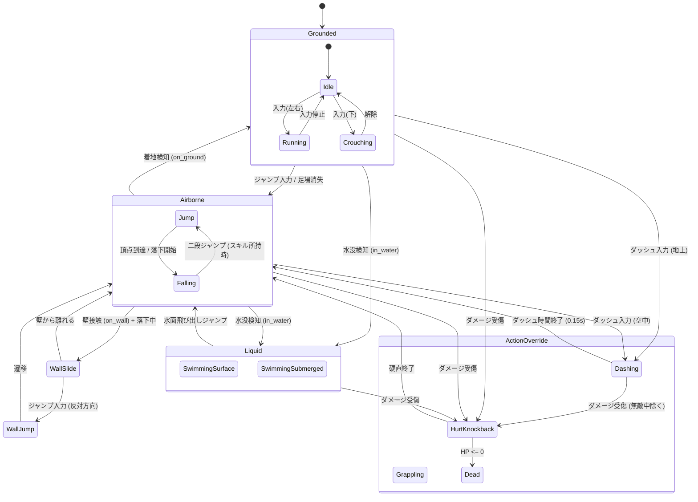

# 25. 階層型プレイヤーステートマシン (`25_PLAYER_STATE_MACHINE.md`)

## 1. 概要とアーキテクチャ

Charon Engine におけるプレイヤーキャラクターの挙動制御は、**階層型有限状態マシン (Hierarchical State Machine: HSM)** に基づいて構築される。

プラットフォーマーゲームにおいて、状態管理が乱雑な `if-else` フラグ（`is_jumping`, `is_swimming`, `is_dashing` など）の組み合わせに依存すると、「水中なのに壁キックができる」「被弾中なのにダッシュでキャンセルできる」といった致命的な状態爆発バグを引き起こす。
本エンジンでは、状態を厳密な Rust の `enum` で型安全にモデル化し、排他的かつ決定論的な遷移を保証する。

---

## 2. 状態遷移図 (HSM 構造)



---

## 3. Rust 型定義とステート列挙体

```rust
#[derive(Clone, Copy, Debug, PartialEq, Eq)]
pub enum PlayerState {
    // 地上状態
    Idle,
    Running,
    Crouching,

    // 空中状態
    Jumping,
    Falling,

    // 壁アクション
    WallSlide,
    WallJump { frames_left: u8 },

    // 水中物理
    Swimming,

    // 特殊アクション (割り込み不可または排他)
    Dashing {
        dir_x: i8,
        dir_y: i8,
        timer_ticks: u8,
    },
    HurtKnockback {
        timer_ticks: u8,
    },
    Dead,
}

#[derive(Clone, Debug, Default)]
pub struct InputBuffer {
    pub move_x: f32,       // -1.0 ..= 1.0
    pub move_y: f32,       // -1.0 ..= 1.0
    pub jump_down: bool,   // 押下瞬間
    pub jump_held: bool,   // 押しっぱなし (可変ジャンプ高さ用)
    pub dash_down: bool,   // ダッシュ押下瞬間
    pub attack_down: bool, // 攻撃押下
}

#[derive(Clone, Debug)]
pub struct PlayerTimers {
    pub coyote_timer: u8,       // 接地外脱出猶予 (6 ticks = 0.1s)
    pub jump_buffer_timer: u8,  // 先行ジャンプ入力猶予 (5 ticks)
    pub dash_cooldown: u8,      // 次のダッシュまでのクールダウン
    pub invincibility_timer: u8,// 被弾後の無敵点滅時間
}
```

---

## 4. 状態ごとの物理パラメーターと力学更新

各状態における速度・加速度定数は、ピクセルパーフェクトな快感を保証するよう以下のように数学的にチューニングされる。

| パラメーター | 値 (pixels / sec または $\text{px/s}^2$) | 説明 |
| :--- | :--- | :--- |
| `RUN_ACCEL` | $1200.0$ | 地上歩行・走行加速度 |
| `RUN_MAX_SPEED` | $140.0$ | 地上最高移動速度 |
| `GROUND_FRICTION`| $1800.0$ | 入力なし時の地上減速摩擦 |
| `GRAVITY` | $900.0$ | 通常落下重力加速度 |
| `MAX_FALL_SPEED` | $240.0$ | 終端落下速度 |
| `JUMP_VELOCITY` | $-260.0$ | 初速ジャンプ速度 (上方向負) |
| `DASH_SPEED` | $360.0$ | ダッシュ直線速度 |
| `DASH_DURATION` | $9 \text{ ticks}$ ($0.15\text{ s}$) | ダッシュ持続時間 |
| `WATER_DRAG` | $0.85$ | 水中速度減衰率 (Tick毎) |
| `WATER_BUOYANCY` | $-300.0$ | 水中上向き浮力 |

### 4.1 状態マシン更新関数 (Tick: 60Hz)
```rust
impl PlayerState {
    pub fn update(
        &mut self,
        ctrl: &mut CharacterController,
        input: &InputBuffer,
        timers: &mut PlayerTimers,
        in_water: bool,
        dt: f32,
    ) {
        // タイマー減算
        if timers.coyote_timer > 0 { timers.coyote_timer -= 1; }
        if timers.jump_buffer_timer > 0 { timers.jump_buffer_timer -= 1; }
        if timers.dash_cooldown > 0 { timers.dash_cooldown -= 1; }
        if timers.invincibility_timer > 0 { timers.invincibility_timer -= 1; }

        if input.jump_down {
            timers.jump_buffer_timer = 5;
        }

        // 接地中はコヨーテタイム回復
        if ctrl.on_ground {
            timers.coyote_timer = 6;
        }

        // 状態別ロジック
        match self {
            PlayerState::Idle | PlayerState::Running => {
                // 地上移動
                if input.move_x.abs() > 0.1 {
                    ctrl.vel_x += input.move_x * 1200.0 * dt;
                    ctrl.vel_x = ctrl.vel_x.clamp(-140.0, 140.0);
                    *self = PlayerState::Running;
                } else {
                    // 摩擦減速
                    let sign = ctrl.vel_x.signum();
                    let speed = (ctrl.vel_x.abs() - 1800.0 * dt).max(0.0);
                    ctrl.vel_x = speed * sign;
                    if ctrl.vel_x.abs() < 1.0 {
                        ctrl.vel_x = 0.0;
                        *self = PlayerState::Idle;
                    }
                }

                // ジャンプ判定
                if timers.jump_buffer_timer > 0 && timers.coyote_timer > 0 {
                    ctrl.vel_y = -260.0;
                    timers.jump_buffer_timer = 0;
                    timers.coyote_timer = 0;
                    *self = PlayerState::Jumping;
                } else if !ctrl.on_ground {
                    *self = PlayerState::Falling;
                }

                // ダッシュ割り込み
                if input.dash_down && timers.dash_cooldown == 0 {
                    let dir_x = if input.move_x.abs() > 0.1 { input.move_x.signum() as i8 } else { 1 };
                    *self = PlayerState::Dashing { dir_x, dir_y: 0, timer_ticks: 9 };
                    timers.dash_cooldown = 30; // 0.5s クールダウン
                }
            }

            PlayerState::Jumping | PlayerState::Falling => {
                // 空中横移動 (地上よりわずかに低い加減速)
                if input.move_x.abs() > 0.1 {
                    ctrl.vel_x += input.move_x * 900.0 * dt;
                    ctrl.vel_x = ctrl.vel_x.clamp(-140.0, 140.0);
                } else {
                    ctrl.vel_x *= 0.95;
                }

                // 可変ジャンプ制御: ボタンを離したら即座に上昇をカット
                if *self == PlayerState::Jumping && !input.jump_held && ctrl.vel_y < 0.0 {
                    ctrl.vel_y *= 0.5; // ジャンプカットオフ
                }

                // 重力加速
                ctrl.vel_y = (ctrl.vel_y + 900.0 * dt).min(240.0);

                if ctrl.vel_y > 0.0 {
                    *self = PlayerState::Falling;
                }

                // 壁スライド検知
                if (ctrl.on_wall_left && input.move_x < -0.1) || (ctrl.on_wall_right && input.move_x > 0.1) {
                    if ctrl.vel_y > 0.0 {
                        ctrl.vel_y = ctrl.vel_y.min(40.0); // 壁滑走減速
                        *self = PlayerState::WallSlide;
                    }
                }

                // 着地検知
                if ctrl.on_ground {
                    *self = if ctrl.vel_x.abs() > 1.0 { PlayerState::Running } else { PlayerState::Idle };
                }
            }

            PlayerState::WallSlide => {
                ctrl.vel_y = (ctrl.vel_y + 300.0 * dt).min(50.0); // 緩やかに落下

                // 壁キック
                if timers.jump_buffer_timer > 0 {
                    let kick_dir = if ctrl.on_wall_left { 1.0 } else { -1.0 };
                    ctrl.vel_x = kick_dir * 180.0;
                    ctrl.vel_y = -240.0;
                    timers.jump_buffer_timer = 0;
                    *self = PlayerState::WallJump { frames_left: 12 };
                } else if ctrl.on_ground {
                    *self = PlayerState::Idle;
                } else if !ctrl.on_wall_left && !ctrl.on_wall_right {
                    *self = PlayerState::Falling;
                }
            }

            PlayerState::WallJump { frames_left } => {
                *frames_left -= 1;
                // 一定フレームは入力無効で斜め上へ吹き飛ぶ
                ctrl.vel_y = (ctrl.vel_y + 900.0 * dt).min(240.0);
                if *frames_left == 0 {
                    *self = PlayerState::Falling;
                }
            }

            PlayerState::Dashing { dir_x, dir_y, timer_ticks } => {
                *timer_ticks -= 1;
                // 重力無視の超高速直線移動
                ctrl.vel_x = (*dir_x as f32) * 360.0;
                ctrl.vel_y = (*dir_y as f32) * 360.0;

                if *timer_ticks == 0 {
                    // ダッシュ終了: 慣性を残して空中落下または走りに戻る
                    ctrl.vel_x *= 0.5;
                    ctrl.vel_y *= 0.5;
                    *self = if ctrl.on_ground { PlayerState::Idle } else { PlayerState::Falling };
                }
            }

            PlayerState::Swimming => {
                // 水中物理: 抵抗 + 入力推進 + 浮力
                ctrl.vel_x *= 0.88;
                ctrl.vel_y *= 0.88;

                ctrl.vel_x += input.move_x * 400.0 * dt;
                ctrl.vel_y += input.move_y * 400.0 * dt;

                // 自然浮力 (何もしなければ微かに浮き上がる)
                ctrl.vel_y -= 40.0 * dt;

                if !in_water {
                    // 水面から脱出
                    ctrl.vel_y = -180.0; // 飛び出し跳躍
                    *self = PlayerState::Falling;
                }
            }

            PlayerState::HurtKnockback { timer_ticks } => {
                *timer_ticks -= 1;
                ctrl.vel_y = (ctrl.vel_y + 900.0 * dt).min(240.0);
                if *timer_ticks == 0 {
                    *self = if ctrl.on_ground { PlayerState::Idle } else { PlayerState::Falling };
                }
            }

            PlayerState::Dead => {
                ctrl.vel_x = 0.0;
                ctrl.vel_y = 0.0;
            }
        }

        // 水中突入判定 (ダッシュや死亡以外)
        if in_water && !matches!(self, PlayerState::Swimming | PlayerState::Dead) {
            *self = PlayerState::Swimming;
        }
    }
}
```

---

## 5. 次のステップ

キャラクターの物理とステートマシンが完成した。次章では、このステートと連動するスプライトシート・アニメーション制御および、武器を構える手足の2Dインバースキネマティクス（IK）を定義する。

- 次章: [26_ANIMATION_AND_SPRITES.md](file:///a:/Project/charon-engine/ai_design_doc/26_ANIMATION_AND_SPRITES.md)
