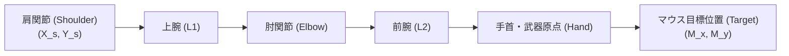

# 26. アニメーション & 2Dスプライト・IK力学 (`26_ANIMATION_AND_SPRITES.md`)

## 1. 概要と目標

ピクセルアートを採用する商用2Dアクションゲームにおいて、キャラクター表現の品質を決定づけるのは「単なるパラパラマンガ的スプライト切り替え」ではなく、以下の3つの融合である：
1. **フレームベースのスプライトアニメーション**: 走行、ジャンプ、待機などの手描きドット絵シーケンス。
2. **スカッシュ＆ストレッチ (Squash & Stretch) プロシージャル変形**: 着地衝撃やジャンプ初速に応じたリアルタイムの拡縮歪み。
3. **2D 照準インバースキネマティクス (2-Bone IK / Aiming)**: マウスカーソルやコントローラー右スティックの方向へ武器や腕を無段階に追従させる回転・関節力学。

---

## 2. スプライトアニメーション定義とデータ構造

### 2.1 アニメーションクリップ構造
```rust
#[derive(Clone, Debug)]
pub struct AnimationFrame {
    pub uv_min: [f32; 2],
    pub uv_max: [f32; 2],
    pub duration_ticks: u8, // このフレームの表示期間 (例: 4 ticks = 1/15s)
    pub event_id: Option<u8>, // 足音、攻撃ヒット判定発生等のイベント通知
}

#[derive(Clone, Debug)]
pub struct AnimationClip {
    pub name: String,
    pub frames: Vec<AnimationFrame>,
    pub is_looping: bool,
}

pub struct SpriteAnimator {
    pub current_clip_id: usize,
    pub current_frame_idx: usize,
    pub tick_accumulator: u8,
    pub is_finished: bool,
}

impl SpriteAnimator {
    pub fn update(&mut self, clips: &[AnimationClip]) -> Option<u8> {
        let clip = &clips[self.current_clip_id];
        let current_frame = &clip.frames[self.current_frame_idx];

        self.tick_accumulator += 1;
        let mut triggered_event = None;

        if self.tick_accumulator >= current_frame.duration_ticks {
            self.tick_accumulator = 0;
            self.current_frame_idx += 1;

            if self.current_frame_idx >= clip.frames.len() {
                if clip.is_looping {
                    self.current_frame_idx = 0;
                } else {
                    self.current_frame_idx = clip.frames.len() - 1;
                    self.is_finished = true;
                }
            }

            triggered_event = clip.frames[self.current_frame_idx].event_id;
        }

        triggered_event
    }

    pub fn play(&mut self, clip_id: usize) {
        if self.current_clip_id != clip_id {
            self.current_clip_id = clip_id;
            self.current_frame_idx = 0;
            self.tick_accumulator = 0;
            self.is_finished = false;
        }
    }
}
```

---

## 3. スカッシュ＆ストレッチ (プロシージャル弾性変形)

物理的な体積保存則を近似したスケール変形数理モデルを実装する。
$$
S_x \cdot S_y = 1.0 \implies S_x = \frac{1.0}{S_y}
$$

キャラクターが着地した瞬間や急加速した瞬間、バネ・ダンパーモデル（スプリングマス振動系）によって滑らかに変形・復元する。

### 3.1 変形スプリングの数理と実装
```rust
pub struct SquashStretchSpring {
    pub scale_x: f32,
    pub scale_y: f32,
    vel_x: f32,
    vel_y: f32,
    tension: f32,  // バネの硬さ (例: 240.0)
    damping: f32,  // 減衰率 (例: 16.0)
}

impl SquashStretchSpring {
    pub fn new() -> Self {
        Self {
            scale_x: 1.0,
            scale_y: 1.0,
            vel_x: 0.0,
            vel_y: 0.0,
            tension: 240.0,
            damping: 16.0,
        }
    }

    /// 着地時の衝撃注入 (横に広がり、縦に潰れる)
    pub fn apply_impact(&mut self, impact_vel_y: f32) {
        let amount = (impact_vel_y.abs() / 400.0).clamp(0.0, 0.4);
        self.scale_x += amount * 1.2;
        self.scale_y -= amount;
    }

    /// ジャンプ時の伸張注入 (縦に伸び、横に縮む)
    pub fn apply_jump_stretch(&mut self) {
        self.scale_x -= 0.2;
        self.scale_y += 0.25;
    }

    /// 60Hz ティック更新 (平衡状態 1.0, 1.0 への復元)
    pub fn update(&mut self, dt: f32) {
        let force_x = (1.0 - self.scale_x) * self.tension - self.vel_x * self.damping;
        let force_y = (1.0 - self.scale_y) * self.tension - self.vel_y * self.damping;

        self.vel_x += force_x * dt;
        self.vel_y += force_y * dt;

        self.scale_x += self.vel_x * dt;
        self.scale_y += self.vel_y * dt;
    }
}
```

---

## 4. 2D 照準エイミング & 手足 IK (Inverse Kinematics)

プレイヤーが銃や杖、ツルハシを構える際、腕と武器はマウスカーソル $(M_x, M_y)$ の方向へ滑らかに向く必要がある。



### 4.1 2関節 IK (2-Bone IK) 解析解数理
肩の位置 $\mathbf{P}_0$ から目標点 $\mathbf{P}_t$ までの距離を $D$、上腕長を $L_1$、前腕長を $L_2$ とする。
余弦定理より、肩の屈曲角 $\alpha$ と肘の屈曲角 $\beta$ は代数的に導出される：

$$
\cos(\beta) = \frac{D^2 - L_1^2 - L_2^2}{2 L_1 L_2} \implies \beta = \arccos\left(\text{clamp}\left(\frac{D^2 - L_1^2 - L_2^2}{2 L_1 L_2}, -1.0, 1.0\right)\right)
$$

$$
\cos(\theta_1) = \frac{L_1^2 + D^2 - L_2^2}{2 L_1 D} \implies \theta_1 = \arccos\left(\text{clamp}\left(\frac{L_1^2 + D^2 - L_2^2}{2 L_1 D}, -1.0, 1.0\right)\right)
$$

$$
\alpha = \text{atan2}(P_{t, y} - P_{0, y}, P_{t, x} - P_{0, x}) \pm \theta_1
$$

```rust
pub struct TwoBoneIK2D {
    pub length_1: f32, // 上腕長 (例: 5.0px)
    pub length_2: f32, // 前腕長 (例: 5.0px)
}

impl TwoBoneIK2D {
    pub fn solve(&self, shoulder: [f32; 2], target: [f32; 2], flip_elbow: bool) -> (f32, f32) {
        let dx = target[0] - shoulder[0];
        let dy = target[1] - shoulder[1];
        let dist = (dx * dx + dy * dy).sqrt().max(0.001);

        // 到達不能距離の場合は最大伸張
        let d = dist.min(self.length_1 + self.length_2 - 0.001);

        let l1 = self.length_1;
        let l2 = self.length_2;

        let cos_beta = ((d * d - l1 * l1 - l2 * l2) / (2.0 * l1 * l2)).clamp(-1.0, 1.0);
        let beta = cos_beta.acos(); // 肘の角度

        let cos_theta1 = ((l1 * l1 + d * d - l2 * l2) / (2.0 * l1 * d)).clamp(-1.0, 1.0);
        let theta1 = cos_theta1.acos();

        let base_angle = dy.atan2(dx);
        let alpha = if flip_elbow {
            base_angle - theta1
        } else {
            base_angle + theta1
        };

        (alpha, if flip_elbow { -beta } else { beta })
    }
}
```

---

## 5. 次のステップ

キャラクター物理・ステート・描画表現が完成した。
続いて **Part 7: 武器・採掘ツール & 戦闘システム** に突入し、セル破壊力学、ツルハシ硬度、近接武器アークコライダー、および弾道物理の完全設計を定義する。

- 次章: [27_TOOL_MINING_SYSTEM.md](file:///a:/Project/charon-engine/ai_design_doc/27_TOOL_MINING_SYSTEM.md)
