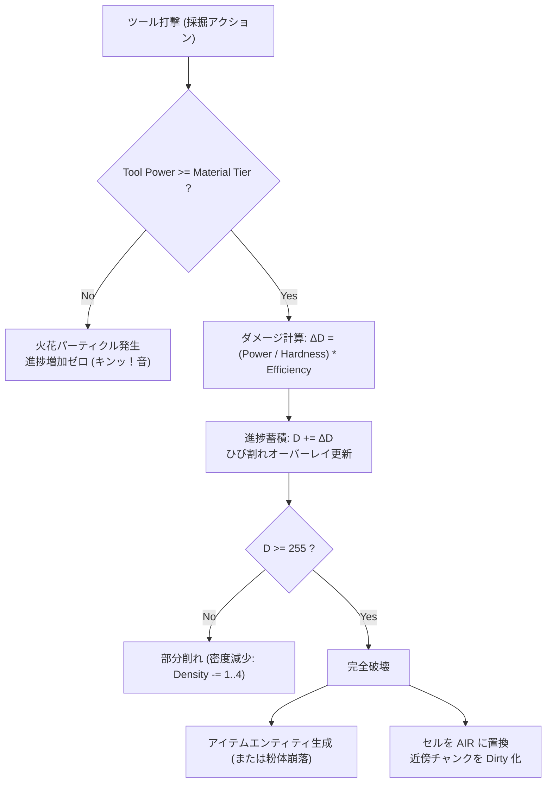

# 27. 採掘ツールシステム & 地形破壊力学 (`27_TOOL_MINING_SYSTEM.md`)

## 1. 概要とコア力学

Charon Engine における採掘・破壊システムは、Minecraft や Terraria のような「ブロック単位の一括破壊」と、Noita のような「ピクセル単位の削り取り」を統一した**二層破壊力学 (Two-Tier Mining Mechanics)** を採用する。

プレイヤーやツールがセルに加える破壊力は、マテリアル固有の硬度（Hardness）および結合強度（Structural Bond）と競合し、段階的にセル密度を削り取る。

---

## 2. 採掘破壊の数理モデル

### 2.1 硬度と破壊進捗 (Mining Progress)
各セル $(x, y)$ は破壊ダメージを受けると、内部の一時的進捗バッファ `damage_accumulator`（0〜255）にダメージが蓄積される。

ツールの採掘力 $P_{\text{tool}}$、採掘効率 $E_{\text{tool}}$、マテリアルの硬度 $H_{\text{mat}}$ に対する1ティックあたりの破壊進捗増加量 $\Delta D$ は以下の数理で定義される：

$$
\Delta D = \begin{cases}
0 & \text{if } P_{\text{tool}} < H_{\text{req}} \\
\max\left(1, \; \left\lfloor \frac{P_{\text{tool}}}{H_{\text{mat}}} \cdot E_{\text{tool}} \right\rfloor \right) & \text{if } P_{\text{tool}} \ge H_{\text{req}}
\end{cases}
$$

- $H_{\text{req}}$: マテリアル破壊に必要な最低ツールティア（例: 黒曜石を採掘するにはダイヤモンド以上のツルハシが必要）。
- 進捗値 $D \ge 255$ に達した瞬間、セルは完全に破壊され、対応するドロップアイテムエンティティが生成されるか、崩落粉体へと相転移する。



---

## 3. Rust 実装: 採掘マネージャーとひび割れキャッシュ

広大なワールド内のすべてのセルに `damage_accumulator`（u8）を持たせるとメモリが肥大化（2048x2048で4MiB）するため、**現在ダメージを受けているセルのみをハッシュマップまたは小規模配列で保持するスパースキャッシュ**を採用する。

```rust
use std::collections::HashMap;

#[derive(Clone, Copy, Debug)]
pub struct MiningProgress {
    pub accumulated_damage: u8,
    pub last_hit_tick: u64, // 一定時間放置されたらひび割れが自然回復
}

pub struct MiningSystem {
    // 座標 (x, y) -> 破壊進捗
    damaged_cells: HashMap<(i32, i32), MiningProgress>,
}

impl MiningSystem {
    pub fn new() -> Self {
        Self {
            damaged_cells: HashMap::with_capacity(128),
        }
    }

    /// 採掘打撃を適用
    pub fn apply_mining_hit(
        &mut self,
        world: &mut World,
        registry: &MaterialRegistry,
        x: i32,
        y: i32,
        tool_power: u16,
        tool_efficiency: f32,
        current_tick: u64,
    ) -> Option<ItemDrop> {
        let cell = world.get_cell_at(x, y)?;
        if cell.is_air() {
            return None;
        }

        let props = registry.get_fast_props(cell.material_id);
        
        // 採掘ティア判定
        if tool_power < props.required_tool_tier {
            // 火花エフェクト発生通知
            return None;
        }

        // ダメージ計算
        let hardness = props.hardness.max(1) as f32;
        let delta = ((tool_power as f32 / hardness) * tool_efficiency).max(1.0) as u8;

        let entry = self.damaged_cells.entry((x, y)).or_insert(MiningProgress {
            accumulated_damage: 0,
            last_hit_tick: current_tick,
        });

        entry.last_hit_tick = current_tick;
        let (new_dmg, overflow) = entry.accumulated_damage.overflowing_add(delta);

        if overflow || new_dmg >= 255 {
            // 完全破壊
            self.damaged_cells.remove(&(x, y));
            
            let drop_item = props.drop_item_id.map(|item_id| ItemDrop {
                item_id,
                world_x: x as f32 + 0.5,
                world_y: y as f32 + 0.5,
                vel_x: (rand::random::<f32>() - 0.5) * 40.0,
                vel_y: -60.0, // 上方向に跳ねる
            });

            // セルを空気に置換
            world.set_cell_at(x, y, Cell::AIR);
            drop_item
        } else {
            entry.accumulated_damage = new_dmg;
            // 段階的に密度を削る
            if new_dmg % 64 == 0 {
                let current_density = cell.density();
                if current_density > 1 {
                    world.set_cell_density(x, y, current_density - 1);
                }
            }
            None
        }
    }

    /// ひび割れの自然治癒 (300 ticks = 5秒間打撃がなければ消去)
    pub fn cleanup_stale_damage(&mut self, current_tick: u64) {
        self.damaged_cells.retain(|_, v| current_tick.saturating_sub(v.last_hit_tick) < 300);
    }
}
```

---

## 4. 半径採掘 (Area of Effect Mining / 爆発採掘)

大型ハンマーや爆薬による円形破壊は、ブレゼンハムの円アルゴリズムまたは距離関数を用いて O(R^2) で一括処理される。

```rust
pub fn mine_radius(
    mining: &mut MiningSystem,
    world: &mut World,
    registry: &MaterialRegistry,
    center_x: i32,
    center_y: i32,
    radius: i32,
    power: u16,
    current_tick: u64,
) -> Vec<ItemDrop> {
    let mut drops = Vec::new();
    let r_sq = radius * radius;

    for dy in -radius..=radius {
        for dx in -radius..=radius {
            if dx * dx + dy * dy <= r_sq {
                let tx = center_x + dx;
                let ty = center_y + dy;
                if let Some(drop) = mining.apply_mining_hit(world, registry, tx, ty, power, 2.0, current_tick) {
                    drops.push(drop);
                }
            }
        }
    }
    drops
}
```

---

## 5. 次のステップ

採掘による地形破壊の仕組みが定義された。次章では、近接武器（剣、槍、斧）による攻撃判定、スイング円弧（Arc Colliders）、および痛快な打撃感を生む「ヒットストップ力学」を定義する。

- 次章: [28_MELEE_COMBAT_AND_SWING_ARCS.md](file:///a:/Project/charon-engine/ai_design_doc/28_MELEE_COMBAT_AND_SWING_ARCS.md)
