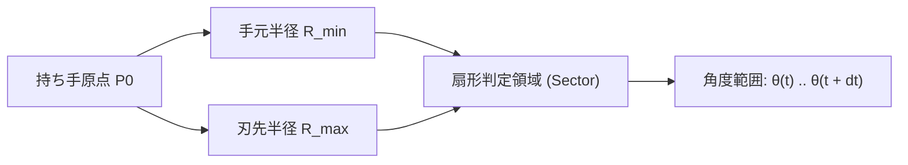
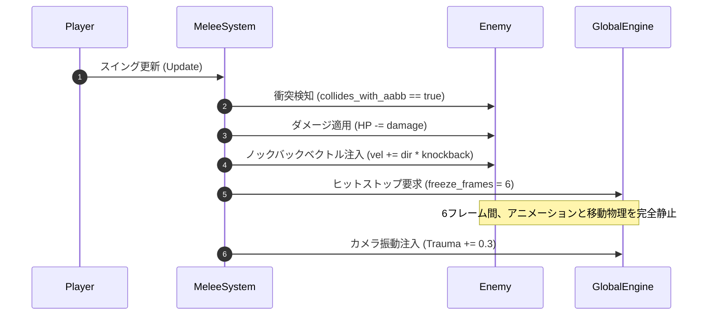

# 28. 近接戦闘 & スイング円弧コライダー (`28_MELEE_COMBAT_AND_SWING_ARCS.md`)

## 1. 概要と打撃快感の原則

商用2Dアクションにおいて、近接攻撃（剣、大剣、斧、槍、短剣）の手触りを決定づけるのは、単なる「四角い当たり判定の発生」ではなく、以下の3要素である：
1. **スイング円弧（Arc Collider）の精密な時間補間**: 武器の軌道（扇形・弧）に沿った連続的な衝突判定。高速スイングでもすり抜けない Swept Arc。
2. **打撃ヒットストップ（Freeze Frame / Hitstop）**: 刃が肉や甲冑を捉えた瞬間にアニメーションと物理更新を数フレーム（3〜8フレーム）完全静止させ、強烈な手応えを演出する。
3. **ノックバック伝播と画面振動**: 攻撃ベクトルに応じた運動量付与と、カメラ Trauma 注入。

---

## 2. スイング円弧 (Swept Arc) の数理モデル

近接武器の刃先は、持ち手を回転中心 $\mathbf{P}_0 = (x_0, y_0)$ とし、開始角度 $\theta_{\text{start}}$ から終了角度 $\theta_{\text{end}}$ まで半径 $R$ で回転する。



### 2.1 扇形コライダーの点包含判定
任意の敵エンティティの AABB 中心または頂点 $\mathbf{P} = (x, y)$ が、武器の扇形攻撃範囲内にあるか判定する条件は以下の連立不等式で表される：

1. **距離条件**:
   $$
   R_{\min}^2 \le (x - x_0)^2 + (y - y_0)^2 \le R_{\max}^2
   $$
2. **角度条件**:
   $$
   \theta_{\text{start}} \le \text{atan2}(y - y_0, x - x_0) \le \theta_{\text{end}}
   $$

---

## 3. Rust 実装: 近接攻撃コンポーネントと判定

```rust
use std::f32::consts::PI;

#[derive(Clone, Debug)]
pub struct MeleeSwing {
    pub origin: [f32; 2],
    pub radius_min: f32, // 手元判定半径 (例: 4.0px)
    pub radius_max: f32, // 刃先判定半径 (例: 24.0px)
    pub angle_current: f32,
    pub angle_previous: f32,
    pub damage: u32,
    pub knockback_force: f32,
    pub hitstop_frames: u8,
    pub hit_entities: Vec<u32>, // 1スイング中に同じ敵を多重ヒットさせないためのIDリスト
}

impl MeleeSwing {
    /// 敵の AABB とのスイング円弧衝突判定
    pub fn collides_with_aabb(&self, aabb: &RectI) -> bool {
        // AABB の4頂点および中心点をテスト
        let test_points = [
            [aabb.min_x as f32, aabb.min_y as f32],
            [aabb.max_x as f32, aabb.min_y as f32],
            [aabb.min_x as f32, aabb.max_y as f32],
            [aabb.max_x as f32, aabb.max_y as f32],
            [(aabb.min_x + aabb.max_x) as f32 * 0.5, (aabb.min_y + aabb.max_y) as f32 * 0.5],
        ];

        let r_min_sq = self.radius_min * self.radius_min;
        let r_max_sq = self.radius_max * self.radius_max;

        let a_start = self.angle_previous.min(self.angle_current);
        let a_end = self.angle_previous.max(self.angle_current);

        for p in test_points {
            let dx = p[0] - self.origin[0];
            let dy = p[1] - self.origin[1];
            let dist_sq = dx * dx + dy * dy;

            if dist_sq >= r_min_sq && dist_sq <= r_max_sq {
                let angle = dy.atan2(dx);
                // 角度を [-PI, PI] から連続範囲に正規化して包含判定
                let diff = (angle - a_start).rem_euclid(2.0 * PI);
                let span = (a_end - a_start).rem_euclid(2.0 * PI);
                if diff <= span {
                    return true;
                }
            }
        }
        false
    }
}
```

---

## 4. ヒットストップ力学 (Hitstop / Freeze Frames)

打撃が成功した瞬間に、グローバルまたはエンティティ単位で一定フレームの更新を停止させる。



```rust
pub struct HitstopManager {
    pub freeze_ticks_remaining: u8,
}

impl HitstopManager {
    pub fn new() -> Self {
        Self { freeze_ticks_remaining: 0 }
    }

    pub fn trigger(&mut self, frames: u8) {
        self.freeze_ticks_remaining = self.freeze_ticks_remaining.max(frames);
    }

    /// メインゲームループの物理更新前に呼び出す
    pub fn should_update_physics(&mut self) -> bool {
        if self.freeze_ticks_remaining > 0 {
            self.freeze_ticks_remaining -= 1;
            false // このフレームは物理更新をスキップ (完全静止)
        } else {
            true
        }
    }
}
```

---

## 5. スイング軌跡（トレイルメッシュ）生成

武器が空を切り裂く美しい光の軌跡（Trail）を描画するため、スイング中の頂点履歴から WGPU 頂点バッファを動的生成する。

- 毎フレーム、刃元 $\mathbf{P}_{\text{inner}}$ と刃先 $\mathbf{P}_{\text{outer}}$ の2頂点をリングバッファに追加。
- 過去 8 フレームの履歴を繋いだトライアングルストリップ（Triangle Strip）を作成。
- アルファ値を時間減衰させ、加算合成シェーダー（Additive Blending）でレンダリング。

---

## 6. 次のステップ

近接攻撃の判定と打撃手応えが確立された。次章では、弓矢や銃弾、手裏剣などの遠距離投射物（Projectiles）におけるブレゼンハム弾道追跡、重力放物線、および跳弾・突き刺さり物理を定義する。

- 次章: [29_RANGED_PROJECTILES_AND_BALLISTICS.md](file:///a:/Project/charon-engine/ai_design_doc/29_RANGED_PROJECTILES_AND_BALLISTICS.md)
