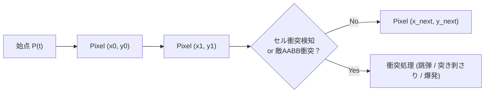

# 29. 遠距離投射物 & 弾道物理学 (`29_RANGED_PROJECTILES_AND_BALLISTICS.md`)

## 1. 概要と弾道課題

Charon Engine における遠距離武器（弓矢、銃弾、スローイングナイフ、火球）の挙動は、**高速投射物のすり抜け（Tunneling）防止** と **リアルタイム弾道放物線** を完全に両立するよう設計される。

1秒間に 600 ピクセル以上で飛翔する高速弾は、1フレーム（16.6ms）で 10 ピクセル以上ジャンプするため、点サンプリングによる単純な判定では 1px〜4px の薄い壁や敵をすり抜けてしまう。
Charon Engine では、**DDA (Digital Differential Analyzer) / ブレゼンハム線分走査** を投射物の移動ベクトル全体に対して毎フレーム実行し、1ピクセルのすり抜けも許さない。

---

## 2. 弾道物理数理モデル

### 2.1 運動方程式
投射物の位置 $\mathbf{P}(t)$、速度 $\mathbf{V}(t)$、重力加速度 $g$、空気抵抗係数 $k_{\text{drag}}$ に対する更新式は以下の通りである：

$$
\mathbf{V}(t + \Delta t) = \mathbf{V}(t) \cdot (1 - k_{\text{drag}} \cdot \Delta t) + \begin{pmatrix} 0 \\ g \end{pmatrix} \Delta t
$$

$$
\mathbf{P}_{\text{next}} = \mathbf{P}(t) + \mathbf{V}(t + \Delta t) \cdot \Delta t
$$

### 2.2 DDA レイキャストによる連続衝突判定 (Continuous Collision Detection)
現在位置 $\mathbf{P}_{\text{start}}$ から次回位置 $\mathbf{P}_{\text{next}}$ までの線分を、ピクセル単位で走査する。



---

## 3. Rust 実装: 投射物マネージャー

```rust
#[derive(Clone, Copy, Debug, PartialEq)]
pub enum ProjectileBehavior {
    StickToWall,              // 矢のように壁に突き刺さる
    Bounce { elasticity: f32, max_bounces: u8 }, // ゴム弾・跳弾
    ExplodeOnImpact,          // ロケット・榴弾
    Pierce { pierce_count: u8 }, // レールガン・貫通弾
}

#[derive(Clone, Debug)]
pub struct Projectile {
    pub x: f32,
    pub y: f32,
    pub vel_x: f32,
    pub vel_y: f32,
    pub gravity: f32,
    pub drag: f32,
    pub damage: u32,
    pub behavior: ProjectileBehavior,
    pub current_bounces: u8,
    pub is_dead: bool,
}

impl Projectile {
    /// 1ティック (1/60s) の完全衝突判定更新
    pub fn update<FWorld, FEnemy>(
        &mut self,
        dt: f32,
        mut check_world_solid: FWorld,
        mut check_enemy_hit: FEnemy,
    ) where
        FWorld: FnMut(i32, i32) -> bool,
        FEnemy: FnMut(&RectI) -> Option<u32>, // 衝突した敵IDを返す
    {
        if self.is_dead { return; }

        // 速度更新
        self.vel_x *= 1.0 - (self.drag * dt);
        self.vel_y = (self.vel_y * (1.0 - (self.drag * dt))) + (self.gravity * dt);

        let start_x = self.x;
        let start_y = self.y;
        let end_x = self.x + self.vel_x * dt;
        let end_y = self.y + self.vel_y * dt;

        // DDA 線分走査 (すり抜け防止)
        let x0 = start_x.round() as i32;
        let y0 = start_y.round() as i32;
        let x1 = end_x.round() as i32;
        let y1 = end_y.round() as i32;

        let dx = (x1 - x0).abs();
        let dy = (y1 - y0).abs();
        let sx = if x0 < x1 { 1 } else { -1 };
        let sy = if y0 < y1 { 1 } else { -1 };
        let mut err = dx - dy;

        let mut curr_x = x0;
        let mut curr_y = y0;

        loop {
            // 1. 地形衝突判定
            if check_world_solid(curr_x, curr_y) {
                match self.behavior {
                    ProjectileBehavior::StickToWall => {
                        self.x = curr_x as f32;
                        self.y = curr_y as f32;
                        self.vel_x = 0.0;
                        self.vel_y = 0.0;
                        // 突き刺さり状態へ移行
                        return;
                    }
                    ProjectileBehavior::Bounce { elasticity, max_bounces } => {
                        if self.current_bounces < max_bounces {
                            self.current_bounces += 1;
                            // 法線反射 (簡易: 直前ピクセルとの差分から軸判定)
                            if (curr_x - (self.x.round() as i32)).abs() > 0 {
                                self.vel_x = -self.vel_x * elasticity;
                            } else {
                                self.vel_y = -self.vel_y * elasticity;
                            }
                            break;
                        } else {
                            self.is_dead = true;
                            return;
                        }
                    }
                    ProjectileBehavior::ExplodeOnImpact => {
                        self.is_dead = true;
                        // 爆発トリガー
                        return;
                    }
                    ProjectileBehavior::Pierce { .. } => {
                        self.is_dead = true;
                        return;
                    }
                }
            }

            // 2. 敵エンティティ衝突判定
            let bullet_box = RectI::new(curr_x - 1, curr_y - 1, 2, 2);
            if let Some(enemy_id) = check_enemy_hit(&bullet_box) {
                // ダメージ適用処理
                match &mut self.behavior {
                    ProjectileBehavior::Pierce { pierce_count } => {
                        if *pierce_count > 0 {
                            *pierce_count -= 1;
                        } else {
                            self.is_dead = true;
                            return;
                        }
                    }
                    _ => {
                        self.is_dead = true;
                        return;
                    }
                }
            }

            if curr_x == x1 && curr_y == y1 {
                break;
            }

            let e2 = 2 * err;
            if e2 > -dy {
                err -= dy;
                curr_x += sx;
            }
            if e2 < dx {
                err += dx;
                curr_y += sy;
            }
        }

        self.x = end_x;
        self.y = end_y;
    }
}
```

---

## 4. 跳弾法線と反射計算

セルグリッドにおける法線ベクトル $\mathbf{N} = (n_x, n_y)$ を求めるため、衝突したピクセルの周囲 4 近傍の固相密度勾配（Gradient）を計算する：

$$
n_x = \text{Solid}(x - 1, y) - \text{Solid}(x + 1, y)
$$
$$
n_y = \text{Solid}(x, y - 1) - \text{Solid}(x, y + 1)
$$
$$
\mathbf{V}_{\text{reflected}} = \mathbf{V} - 2(\mathbf{V} \cdot \hat{\mathbf{N}})\hat{\mathbf{N}}
$$

これにより、平坦な床だけでなく、斜めに削られた地形や洞窟の丸い天井に対しても自然な角度で跳弾する。

---

## 5. 次のステップ

物理的な投射物の挙動が定義された。次章では、Noita のような自由な呪文合成を実現する「魔法システム & モディファイア（Modifiers）合成力学」を定義する。

- 次章: [30_MAGIC_SYSTEM_AND_MODIFIERS.md](file:///a:/Project/charon-engine/ai_design_doc/30_MAGIC_SYSTEM_AND_MODIFIERS.md)
