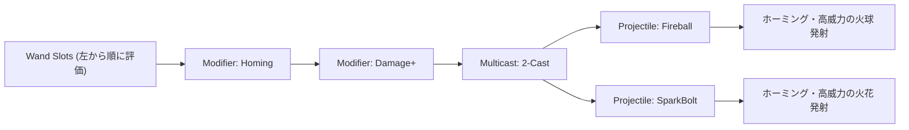

# 30. 魔法システム & 呪文モディファイア合成 (`30_MAGIC_SYSTEM_AND_MODIFIERS.md`)

## 1. 概要と Noita 方式の呪文評価哲学

Charon Engine における魔法システムは、『Noita』にインスパイアされた**スタックマシン型プログラマブル呪文評価エンジン (Stack-based Spell Evaluation Engine)** を採用する。

プレイヤーはスロット付きの杖（Wand）に「投射物（Projectile）」「修飾子（Modifier）」「マルチキャスト（Multicast）」「トリガー（Trigger）」の呪文カードを自由に組み込むことができ、エンジンはこれをコンパイラ/インタープリタのように左から順に評価して、無数のシナジーを生み出す。

---

## 2. 杖のスペックと評価パイプライン

### 2.1 杖のデータ構造
```rust
#[derive(Clone, Debug)]
pub struct Wand {
    pub max_mana: f32,
    pub current_mana: f32,
    pub mana_charge_rate: f32,   // 1秒あたりのマナ回復量
    pub cast_delay: f32,         // 呪文間の詠唱遅延 (秒)
    pub recharge_time: f32,      // デッキ1巡後のリチャージ待ち時間 (秒)
    pub capacity: usize,         // スロット数 (例: 4〜26)
    pub spread_degrees: f32,     // 弾の拡散角ブレ
    pub spells_per_cast: usize,  // 1回のトリガーで引く基本枚数
    pub shuffle_deck: bool,      // シャッフル型か順序固定型か
    pub slots: Vec<Option<SpellCard>>,
}
```

### 2.2 呪文カードの種類 (Action Types)
```rust
#[derive(Clone, Copy, Debug, PartialEq, Eq)]
pub enum SpellType {
    Projectile,  // 実体弾 (火球、電撃ボルト、氷の矢)
    Modifier,    // 次の投射物の属性を変更 (ホーミング、ダメージ増加、軌道変更)
    Multicast,   // 次の複数の呪文を同時に引く (2連装、3連散弾)
    Trigger,     // 衝突または時間切れ時に内包する呪文を詠唱
    Utility,     // テレポート、採掘爆破、シールド生成
}
```



---

## 3. スタックマシン型呪文評価器 (Cast State)

詠唱時に一時的な「詠唱コンテキスト（Cast State）」を生成し、修飾子が後続の投射物へ属性を累積注入する。

```rust
#[derive(Clone, Debug, Default)]
pub struct CastState {
    pub damage_multiplier: f32,
    pub extra_damage: u32,
    pub speed_multiplier: f32,
    pub homing_strength: f32,
    pub bounce_count: u8,
    pub explosion_radius: f32,
    pub cast_delay_delta: f32,
    pub recharge_time_delta: f32,
}

impl Wand {
    /// 杖のトリガーを引いた際の一括評価
    pub fn cast(
        &mut self,
        spawn_pos: [f32; 2],
        aim_angle: f32,
        projectiles_out: &mut Vec<Projectile>,
    ) -> bool {
        if self.current_mana < 1.0 {
            return false; // マナ枯渇
        }

        let mut cast_state = CastState {
            damage_multiplier: 1.0,
            speed_multiplier: 1.0,
            ..Default::default()
        };

        let mut queue = Vec::new();
        // スロットから実行可能カードを収集
        for slot in &self.slots {
            if let Some(card) = slot {
                queue.push(card.clone());
            }
        }

        let mut idx = 0;
        let mut cast_count = 0;
        let target_casts = self.spells_per_cast;

        while idx < queue.len() && cast_count < target_casts {
            let card = &queue[idx];
            idx += 1;

            // マナ消費
            if self.current_mana < card.mana_cost {
                continue;
            }
            self.current_mana -= card.mana_cost;

            match card.spell_type {
                SpellType::Modifier => {
                    // 修飾子の効果を累積
                    cast_state.damage_multiplier *= card.props.damage_mult;
                    cast_state.extra_damage += card.props.extra_damage;
                    cast_state.homing_strength += card.props.homing_strength;
                    cast_state.bounce_count += card.props.bounce_count;
                }
                SpellType::Projectile => {
                    // 投射物を実体化してワールドに放出
                    let final_damage = ((card.props.base_damage as f32) * cast_state.damage_multiplier) as u32 + cast_state.extra_damage;
                    let speed = card.props.base_speed * cast_state.speed_multiplier;
                    
                    let spread = (rand::random::<f32>() - 0.5) * self.spread_degrees.to_radians();
                    let final_angle = aim_angle + spread;

                    projectiles_out.push(Projectile {
                        x: spawn_pos[0],
                        y: spawn_pos[1],
                        vel_x: final_angle.cos() * speed,
                        vel_y: final_angle.sin() * speed,
                        gravity: card.props.gravity,
                        drag: 0.0,
                        damage: final_damage,
                        behavior: if cast_state.bounce_count > 0 {
                            ProjectileBehavior::Bounce { elasticity: 0.8, max_bounces: cast_state.bounce_count }
                        } else {
                            ProjectileBehavior::StickToWall
                        },
                        current_bounces: 0,
                        is_dead: false,
                    });

                    cast_count += 1;
                    // 単一投射物消費ごとに一部修飾子をリセット
                }
                SpellType::Multicast => {
                    // 同時詠唱数を動的に拡張
                    // card.props.extra_draw 分だけ target_casts を増やす
                }
                _ => {}
            }
        }

        true
    }
}
```

---

## 4. 誘導ホーミング力学 (Homing Math)

修飾子によってホーミングが付与された投射物は、最も近い敵 $\mathbf{P}_{\text{target}}$ に向けて毎フレーム角速度制限付きで方向修正される。

$$
\theta_{\text{current}} = \text{atan2}(V_y, V_x), \quad \theta_{\text{target}} = \text{atan2}(P_{\text{target}, y} - P_y, P_{\text{target}, x} - P_x)
$$
$$
\Delta \theta = \text{clamp}\left(\text{angle\_diff}(\theta_{\text{target}}, \theta_{\text{current}}), -\omega_{\max} \Delta t, \omega_{\max} \Delta t\right)
$$
$$
\theta_{\text{new}} = \theta_{\text{current}} + \Delta \theta
$$

急激な直角ターンを防ぎ、滑らかで美しい追尾軌道を描く。

---

## 5. 次のステップ

武器・採掘・弾道・魔法のすべての戦闘力学が完成した。
続いて **Part 8: 敵・ボス AI & パスファインディング** に突入し、破壊可能ボクセル世界における高速階層型パスファインディング、ビヘイビアツリー、多節ワーム、および巨大ボスのフレームワークを定義する。

- 次章: [31_PIXEL_GRID_PATHFINDING.md](file:///a:/Project/charon-engine/ai_design_doc/31_PIXEL_GRID_PATHFINDING.md)
