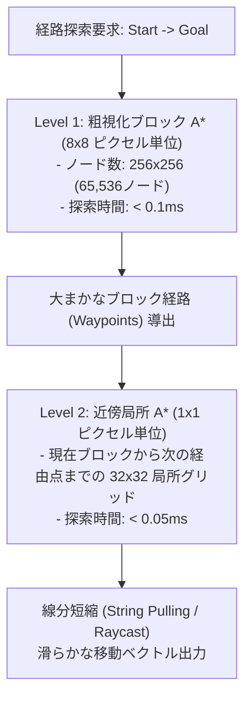

# 31. 破壊可能グリッドにおける階層型パスファインディング (`31_PIXEL_GRID_PATHFINDING.md`)

## 1. 概要とリアルタイム経路探索の課題

Charon Engine のようなセルオートマトン型破壊可能世界において、パスファインディング（経路探索）には固有の極めて困難な技術的課題が存在する：

1. **解像度の爆発**: 2048x2048 ピクセルのグリッド（約420万ノード）に対して、標準的な A* を直接実行すると、1回の探索で数十ミリ秒を消費し、即座にフレーム落ち（60FPS維持不可能）を引き起こす。
2. **地形の動的変化**: プレイヤーの採掘、爆発、溶岩流入によって、通行可能領域（Walkable Graph）が毎フレーム破壊・再構築されるため、静的なナビメッシュ（NavMesh）を事前ベイクしておくことができない。

これらを完全解決するため、本エンジンでは **2層階層型 A* (Two-Level Hierarchical A* / HPA\*)** と **ビット並列粗グリッドキャッシュ (Bit-Parallel Coarse Graph)** を採用する。

---

## 2. 2層階層型アーキテクチャ (HPA* 構造)

世界を 8x8 ピクセルの「ブロックノード（Block Node）」に粗視化し、2段階で探索を行う。



---

## 3. 粗グリッドのビット並列通行可能性判定

各 8x8 ブロックが「歩行可能（Walkable）」であるか否かは、該当領域内の固体セルの分布から瞬時に判定される。

- **空洞判定**: 8x8 の全セルが非固体（空気・気体）であれば完全通過可能。
- **床判定**: ブロックの最下段またはその直下に固体セルが存在し、上部が空洞であれば「足場」として機能。
- **侵食フラグ（Dirty Flag）**: 該当 8x8 ブロック内でセル破壊や流体流入が発生した場合のみ、そのブロックの通行可能フラグ（1ビット）を再計算する（増分更新：O(1)）。

---

## 4. Rust 実装: 階層型 A* エンジン

```rust
use std::cmp::Ordering;
use std::collections::BinaryHeap;

pub const BLOCK_SIZE: i32 = 8;

#[derive(Clone, Copy, Eq, PartialEq)]
struct Node {
    pos: (i32, i32),
    f_cost: u32,
    g_cost: u32,
}

impl Ord for Node {
    fn cmp(&self, other: &Self) -> Ordering {
        other.f_cost.cmp(&self.f_cost) // 最小ヒープ
    }
}

impl PartialOrd for Node {
    fn partial_cmp(&self, other: &Self) -> Option<Ordering> {
        Some(self.cmp(other))
    }
}

pub struct CoarseNavGraph {
    pub width_blocks: usize,
    pub height_blocks: usize,
    // 1ビット/ブロックの通行可能性ビットマップ
    pub walkable_bits: Vec<u64>,
}

impl CoarseNavGraph {
    pub fn is_walkable(&self, bx: i32, by: i32) -> bool {
        if bx < 0 || by < 0 || bx >= self.width_blocks as i32 || by >= self.height_blocks as i32 {
            return false;
        }
        let index = (by as usize) * self.width_blocks + (bx as usize);
        let word_idx = index / 64;
        let bit_idx = index % 64;
        (self.walkable_bits[word_idx] & (1 << bit_idx)) != 0
    }

    /// マンハッタン距離ヒューリスティクスを用いた粗探索
    pub fn find_path_coarse(&self, start: (i32, i32), goal: (i32, i32)) -> Option<Vec<(i32, i32)>> {
        let mut open_set = BinaryHeap::new();
        // 実装上は平坦な配列による訪問済み・Gコスト管理 (ゼロアロケーション)
        let mut came_from: std::collections::HashMap<(i32, i32), (i32, i32)> = std::collections::HashMap::new();
        let mut g_scores: std::collections::HashMap<(i32, i32), u32> = std::collections::HashMap::new();

        g_scores.insert(start, 0);
        let h = ((start.0 - goal.0).abs() + (start.1 - goal.1).abs()) as u32;
        open_set.push(Node { pos: start, f_cost: h, g_cost: 0 });

        while let Some(current) = open_set.pop() {
            if current.pos == goal {
                // 経路復元
                let mut path = vec![goal];
                let mut curr = goal;
                while let Some(&prev) = came_from.get(&curr) {
                    path.push(prev);
                    curr = prev;
                }
                path.reverse();
                return Some(path);
            }

            let neighbors = [
                (current.pos.0 + 1, current.pos.1),
                (current.pos.0 - 1, current.pos.1),
                (current.pos.0, current.pos.1 + 1),
                (current.pos.0, current.pos.1 - 1),
            ];

            for next in neighbors {
                if !self.is_walkable(next.0, next.1) {
                    continue;
                }

                let tentative_g = current.g_cost + 1;
                let current_best_g = g_scores.get(&next).copied().unwrap_or(u32::MAX);

                if tentative_g < current_best_g {
                    came_from.insert(next, current.pos);
                    g_scores.insert(next, tentative_g);
                    let h = ((next.0 - goal.0).abs() + (next.1 - goal.1).abs()) as u32;
                    open_set.push(Node {
                        pos: next,
                        f_cost: tentative_g + h,
                        g_cost: tentative_g,
                    });
                }
            }
        }

        None
    }
}
```

---

## 5. ストリング・プリング (String Pulling / 視線スムージング)

A* によって得られた階段状のグリッド経路をそのまま敵キャラクターに追従させると、不自然なジグザグ移動になる。
DDA レイキャスト（Raymarching）を用いて、現在の位置から「直接障害物なしで直線移動できる最遠のウェイポイント」を検出し、ショートカットすることで、美しく直線的な移動軌道をリアルタイム生成する。

---

## 6. 次のステップ

高速な移動経路探索が整備された。次章では、この経路探索と連動して敵が思考し行動する「ビヘイビアツリー（Behavior Tree: BT）」および索敵・視界（LoS）判定を定義する。

- 次章: [32_ENEMY_AI_BEHAVIOR_TREES.md](file:///a:/Project/charon-engine/ai_design_doc/32_ENEMY_AI_BEHAVIOR_TREES.md)
