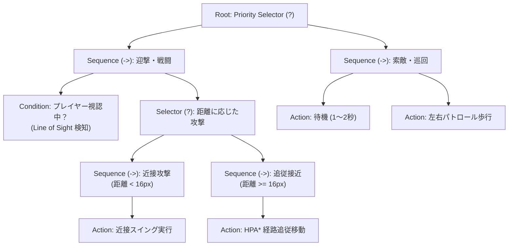

# 32. 敵AI & ビヘイビアツリーアーキテクチャ (`32_ENEMY_AI_BEHAVIOR_TREES.md`)

## 1. 概要と意思決定フレームワーク

Charon Engine における敵キャラクター（モンスター、NPC、人型エネミー）の人工知能は、AAAタイトルで標準的な**ビヘイビアツリー (Behavior Tree: BT)** と **ブラックボード (Blackboard)** パターンに基づいて構築される。

FSM（有限状態マシン）は小規模なエネミーには適しているが、敵が「パトロールしながら音を聞き分け、プレイヤーを発見したら遮蔽物を取りつつ間合いを測り、HPが低下したら逃走する」といった複合的・戦術的な判断を行う場合、状態爆発を起こして保守不能になる。ビヘイビアツリーはモジュール性と拡張性に優れ、複雑な戦術思考を階層的に記述できる。

---

## 2. ビヘイビアツリーの構造と評価サイクル



### 2.1 ノードのステータス値
各ノードの評価（`tick()`）は以下の3つの状態のいずれかを返す：
1. `Success`: 実行が成功した（Sequence は次へ進み、Selector は即座に終了する）。
2. `Failure`: 実行が失敗した（Sequence は即座に失敗終了し、Selector は次の選択肢を試す）。
3. `Running`: 実行が複数フレームにまたがって継続中（次フレームもこのノードから再開）。

---

## 3. Rust 実装: ゼロアロケーション・ビヘイビアツリー

### 3.1 ノードステータスとブラックボード
```rust
#[derive(Clone, Copy, Debug, PartialEq, Eq)]
pub enum BtStatus {
    Success,
    Failure,
    Running,
}

#[derive(Clone, Debug, Default)]
pub struct Blackboard {
    pub player_pos: Option<[f32; 2]>,
    pub player_seen: bool,
    pub last_known_pos: Option<[f32; 2]>,
    pub hearing_alert_pos: Option<[f32; 2]>,
    pub target_entity_id: Option<u32>,
    pub patrol_timer: u32,
    pub attack_cooldown: u32,
}
```

### 3.2 ノードのトレイトとコンポジット実装
```rust
pub trait BtNode {
    fn tick(&mut self, bb: &mut Blackboard, entity_id: u32, world: &mut World) -> BtStatus;
    fn reset(&mut self);
}

// Selector (?): いずれか1つが Success または Running になれば終了
pub struct Selector {
    children: Vec<Box<dyn BtNode>>,
    current_index: usize,
}

impl Selector {
    pub fn new(children: Vec<Box<dyn BtNode>>) -> Self {
        Self { children, current_index: 0 }
    }
}

impl BtNode for Selector {
    fn tick(&mut self, bb: &mut Blackboard, entity_id: u32, world: &mut World) -> BtStatus {
        while self.current_index < self.children.len() {
            match self.children[self.current_index].tick(bb, entity_id, world) {
                BtStatus::Success => {
                    self.reset();
                    return BtStatus::Success;
                }
                BtStatus::Running => {
                    return BtStatus::Running;
                }
                BtStatus::Failure => {
                    self.current_index += 1;
                }
            }
        }
        self.reset();
        BtStatus::Failure
    }

    fn reset(&mut self) {
        self.current_index = 0;
        for c in &mut self.children {
            c.reset();
        }
    }
}

// Sequence (->): すべてが Success になるまで順次実行
pub struct Sequence {
    children: Vec<Box<dyn BtNode>>,
    current_index: usize,
}

impl Sequence {
    pub fn new(children: Vec<Box<dyn BtNode>>) -> Self {
        Self { children, current_index: 0 }
    }
}

impl BtNode for Sequence {
    fn tick(&mut self, bb: &mut Blackboard, entity_id: u32, world: &mut World) -> BtStatus {
        while self.current_index < self.children.len() {
            match self.children[self.current_index].tick(bb, entity_id, world) {
                BtStatus::Success => {
                    self.current_index += 1;
                }
                BtStatus::Running => {
                    return BtStatus::Running;
                }
                BtStatus::Failure => {
                    self.reset();
                    return BtStatus::Failure;
                }
            }
        }
        self.reset();
        BtStatus::Success
    }

    fn reset(&mut self) {
        self.current_index = 0;
        for c in &mut self.children {
            c.reset();
        }
    }
}
```

---

## 4. 視覚 (Line of Sight: LoS) & 聴覚センシング数理

敵がプレイヤーを発見・警戒する仕組みは、以下の2つの感覚器モデルで評価される。

### 4.1 視野角と遮蔽レイキャスト
1. **距離制限**: $|\mathbf{P}_{\text{player}} - \mathbf{P}_{\text{enemy}}| \le R_{\text{sight}}$（例: 240px）。
2. **視野角 (FOV)**: 敵の向きベクトル $\mathbf{F}$ とプレイヤー方向ベクトル $\mathbf{D}$ の内積が $\cos(\theta_{\text{fov}} / 2)$ 以上であること（例: 前方 120度）。
3. **DDA 遮蔽チェック**: 敵の目からプレイヤーの中心を結ぶ線分上に、固相セル（Solid）が 1 つも存在しないこと。

```rust
pub fn check_line_of_sight(
    world: &World,
    eye_x: f32,
    eye_y: f32,
    target_x: f32,
    target_y: f32,
    facing_dir: f32, // -1.0 (左) or 1.0 (右)
    max_range: f32,
) -> bool {
    let dx = target_x - eye_x;
    let dy = target_y - eye_y;
    let dist_sq = dx * dx + dy * dy;

    if dist_sq > max_range * max_range {
        return false;
    }

    // 視野方向チェック (真後ろは見えない)
    if (dx * facing_dir) < -10.0 {
        return false;
    }

    // DDA 線分走査で不透明セルをチェック
    !world.raycast_solid(eye_x, eye_y, target_x, target_y)
}
```

### 4.2 聴覚・採掘音伝播 (Acoustic Perception)
プレイヤーが走る音（半径 60px）、ツルハシで岩を砕く音（半径 180px）、爆薬の爆轟（半径 500px）が発生した際、その音源を中心とするイベント通知が発行される。
範囲内の敵は Blackboard の `hearing_alert_pos` を更新し、視界外であっても音源方向を振り向いて調査に向かう。

---

## 5. 次のステップ

知能決定フレームワークが完成した。次章では、具体的な敵の運動種別（歩行ゾンビ、スライムの放物線跳躍、コウモリの浮遊旋回、および多節ワームのIK連動）の運動数理を定義する。

- 次章: [33_ENEMY_TYPES_AND_LOCOMOTION.md](file:///a:/Project/charon-engine/ai_design_doc/33_ENEMY_TYPES_AND_LOCOMOTION.md)
