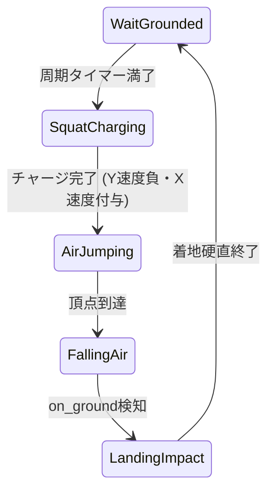
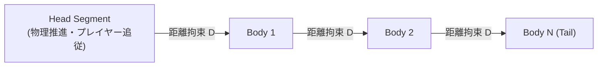

# 33. 敵タイプ & 運動力学アーキタイプ (`33_ENEMY_TYPES_AND_LOCOMOTION.md`)

## 1. 概要

商用2Dアクションゲームにおいて、プレイヤーを飽きさせない多彩なゲームプレイは、敵の運動様式（Locomotion）のバリエーションによって支えられる。

Charon Engine では、以下の4つの代表的運動アーキタイプを標準コンポーネントとして提供し、データ定義（TOML）からパラメーターを切り替えるだけで無数のモンスターを生成できるように設計する：
1. **地上歩行型 (Ground Walker)**: ゾンビ、スケルトン、兵士
2. **弾性跳躍型 (Slime Hopper)**: スライム、カエル、小型虫
3. **空中浮遊・急降下型 (Aerial Swooper)**: コウモリ、飛行目玉、ハーピー
4. **多節潜行ワーム型 (Segmented Burrowing Worm)**: 地中巨大ミミズ、ボーンサーペント

---

## 2. アーキタイプ別運動数理と実装

### 2.1 地上歩行型 (Ground Walker)
歩行敵は段差オートステップに加え、**「崖感知（Ledge Detection）」** を備える。

```rust
pub fn update_ground_walker(
    ctrl: &mut CharacterController,
    facing: &mut i32,
    avoids_cliffs: bool,
    world: &World,
    dt: f32,
) {
    // 崖感知: 前方足元に床があるか検査
    if avoids_cliffs && ctrl.on_ground {
        let forward_foot_x = if *facing > 0 { ctrl.aabb().max_x + 2 } else { ctrl.aabb().min_x - 2 };
        let floor_y = ctrl.aabb().max_y + 2;
        if !is_point_solid(world, forward_foot_x, floor_y) {
            // 崖を検知: 反転する
            *facing = -*facing;
            ctrl.vel_x = 0.0;
        }
    }

    // 壁衝突時も反転
    if ctrl.on_wall_left && *facing < 0 {
        *facing = 1;
    } else if ctrl.on_wall_right && *facing > 0 {
        *facing = -1;
    }

    ctrl.vel_x = (*facing as f32) * 60.0;
    ctrl.vel_y = (ctrl.vel_y + 900.0 * dt).min(240.0);
}
```

---

### 2.2 弾性跳躍型 (Slime Hopper)
スライムは常に跳ねるのではなく、「接地待機 $\to$ 予備動作（Squash） $\to$ 放物線大ジャンプ $\to$ 着地伸張（Stretch）」のサイクルを繰り返す。



$$
V_x = \text{sign}(X_{\text{player}} - X_{\text{slime}}) \cdot V_{\text{jump\_x}}, \quad V_y = -V_{\text{jump\_y}}
$$

---

### 2.3 空中浮遊・急降下型 (Aerial Swooper)
浮遊敵はレイノルズのステアリング行動（Reynolds Steering Behaviors）に従い、ターゲット周囲をサイン波（Sinusoidal Oscillation）で旋回しながら、急降下突進（Swoop）を行う。

$$
\mathbf{F}_{\text{steer}} = \text{clamp}\left(\frac{\mathbf{V}_{\text{desired}} - \mathbf{V}_{\text{current}}}{\tau}, -F_{\max}, F_{\max}\right)
$$
$$
y_{\text{hover}}(t) = y_{\text{base}} + A \cdot \sin(\omega t)
$$

---

### 2.4 多節潜行ワーム型 (Segmented Burrowing Worm)

『Terraria』のイーターオブワールド（Eater of Worlds）に代表される、頭部を先頭に数十個の体節（Segments）が数理的に連動して地中・空中をうねるワーム。



#### 逆運動学・距離拘束数理 (Verlet Distance Constraint)
頭部 $\mathbf{P}_0$ の位置が決定された後、各節 $\mathbf{P}_i$ は直前の節 $\mathbf{P}_{i-1}$ に対して常に一定距離 $L$（例: 12px）を保つように位置が拘束される：

$$
\Delta \mathbf{P} = \mathbf{P}_i - \mathbf{P}_{i-1}
$$
$$
\mathbf{P}_i' = \mathbf{P}_{i-1} + \frac{\Delta \mathbf{P}}{\|\Delta \mathbf{P}\|} \cdot L
$$
$$
\theta_i = \text{atan2}(P_{i-1, y} - P_{i, y}, P_{i-1, x} - P_{i, x})
$$

#### Rust 実装コード
```rust
pub struct WormSegment {
    pub x: f32,
    pub y: f32,
    pub angle: f32,
    pub hp: u32,
    pub is_head: bool,
    pub is_tail: bool,
}

pub struct SegmentedWorm {
    pub segments: Vec<WormSegment>,
    pub segment_distance: f32, // 各節の固定間隔 (例: 12.0px)
    pub head_vel_x: f32,
    pub head_vel_y: f32,
    pub turn_speed: f32,
}

impl SegmentedWorm {
    pub fn update(&mut self, target_x: f32, target_y: f32, dt: f32) {
        if self.segments.is_empty() { return; }

        // 1. 頭部の誘導 (ターゲットへ向けて旋回)
        let head = &self.segments[0];
        let dx = target_x - head.x;
        let dy = target_y - head.y;
        let target_angle = dy.atan2(dx);

        let current_angle = self.head_vel_y.atan2(self.head_vel_x);
        let angle_diff = (target_angle - current_angle).sin().atan2((target_angle - current_angle).cos());
        let new_angle = current_angle + angle_diff.clamp(-self.turn_speed * dt, self.turn_speed * dt);

        let speed = 180.0;
        self.head_vel_x = new_angle.cos() * speed;
        self.head_vel_y = new_angle.sin() * speed;

        // 頭部位置更新
        self.segments[0].x += self.head_vel_x * dt;
        self.segments[0].y += self.head_vel_y * dt;
        self.segments[0].angle = new_angle;

        // 2. 体節の距離拘束追従 (Verlet Constraint)
        for i in 1..self.segments.len() {
            let prev_x = self.segments[i - 1].x;
            let prev_y = self.segments[i - 1].y;

            let seg_dx = self.segments[i].x - prev_x;
            let seg_dy = self.segments[i].y - prev_y;
            let dist = (seg_dx * seg_dx + seg_dy * seg_dy).sqrt().max(0.001);

            // 前の節に向けて距離を segment_distance に固定
            let nx = seg_dx / dist;
            let ny = seg_dy / dist;

            self.segments[i].x = prev_x + nx * self.segment_distance;
            self.segments[i].y = prev_y + ny * self.segment_distance;
            self.segments[i].angle = (-ny).atan2(-nx);
        }
    }
}
```

---

## 3. 次のステップ

通常敵の運動バリエーションが確立された。次章では、これらを統括し、ドラマチックな演出・形態変化・地形破壊攻撃・弾幕を展開する「巨大ボス戦フレームワーク」を定義する。

- 次章: [34_BOSS_FIGHT_FRAMEWORK.md](file:///a:/Project/charon-engine/ai_design_doc/34_BOSS_FIGHT_FRAMEWORK.md)
