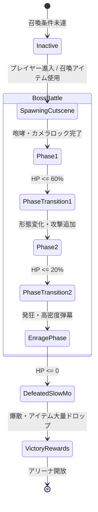

# 34. 巨大ボス戦フレームワーク & フェーズ進行 (`34_BOSS_FIGHT_FRAMEWORK.md`)

## 1. 概要と商用ボス体験

ボスバトルはアクションゲームにおける最大のハイライトであり、ゲームの販売評価（Steam レビュー等）を大きく左右する。
Charon Engine におけるボス戦フレームワークは、以下の4大要素を包括した包括的システムとして提供される：

1. **アリーナ制御とカメラロック**: ボス出現時にエリアを封鎖（霧の壁・瓦礫封鎖）し、カメラを専用矩形領域内に固定する。
2. **多段階フェーズ遷移 (Multi-Phase Transition)**: HP残量（100% $\to$ 60% $\to$ 20%）に応じた形態変化、行動パターンの激化、BGMのクロスフェード。
3. **動的地形破壊攻撃 (Terrain-Carving Attacks)**: 壁や足場を薙ぎ払い粉砕する巨大突進やレーザー照射。
4. **ドラマチック演出**: 出現時の咆哮カットイン、被撃破時のスローモーション演出（Slow-mo）、およびドロップアイテム噴出。

---

## 2. ボスフェーズ進行とステートマシン



---

## 3. Rust 実装: ボスコントローラー構造体

```rust
#[derive(Clone, Copy, Debug, PartialEq, Eq)]
pub enum BossPhase {
    Spawning,
    Phase1,
    Transitioning { timer: u16 },
    Phase2,
    Enrage,
    Dying { timer: u16 },
}

#[derive(Clone, Debug)]
pub struct BossArena {
    pub bounds: RectI,
    pub is_locked: bool,
    pub wall_material: u16, // 封鎖用の特殊障壁マテリアル
}

pub struct BossEntity {
    pub entity_id: u32,
    pub name: String,
    pub max_hp: u32,
    pub current_hp: u32,
    pub phase: BossPhase,
    pub arena: BossArena,
    pub attack_pattern_timer: u16,
    pub current_attack_index: usize,
}

impl BossEntity {
    pub fn new(entity_id: u32, name: &str, max_hp: u32, arena_bounds: RectI) -> Self {
        Self {
            entity_id,
            name: name.to_string(),
            max_hp,
            current_hp: max_hp,
            phase: BossPhase::Spawning,
            arena: BossArena {
                bounds: arena_bounds,
                is_locked: false,
                wall_material: 999, // 特殊バリア
            },
            attack_pattern_timer: 0,
            current_attack_index: 0,
        }
    }

    /// ダメージ適用とフェーズ移行判定
    pub fn apply_damage(&mut self, damage: u32) {
        self.current_hp = self.current_hp.saturating_sub(damage);
        let hp_ratio = self.current_hp as f32 / self.max_hp as f32;

        match self.phase {
            BossPhase::Phase1 if hp_ratio <= 0.60 => {
                self.phase = BossPhase::Transitioning { timer: 120 }; // 2秒間の無敵変形硬直
            }
            BossPhase::Phase2 if hp_ratio <= 0.20 => {
                self.phase = BossPhase::Enrage;
            }
            _ => {}
        }

        if self.current_hp == 0 && !matches!(self.phase, BossPhase::Dying { .. }) {
            self.phase = BossPhase::Dying { timer: 180 }; // 3秒間の撃破スローモーション
        }
    }
}
```

---

## 4. 地形破壊突進攻撃 (Terrain-Carving Charge)

ボスが超巨大な体躯で突進する際、接触したセルを円形または矩形に掘削し、破砕パーティクルと粉体を噴出させる。

```rust
pub fn execute_boss_charge_destruction(
    world: &mut World,
    boss_aabb: &RectI,
    vel_x: f32,
    vel_y: f32,
    destruction_power: u16,
) {
    let speed_sq = vel_x * vel_x + vel_y * vel_y;
    if speed_sq < 100.0 * 100.0 {
        return; // 低速時は地形を削らない
    }

    // ボスの衝突矩形内のセルを破砕
    for y in boss_aabb.min_y..boss_aabb.max_y {
        for x in boss_aabb.min_x..boss_aabb.max_x {
            if let Some(cell) = world.get_cell_at(x, y) {
                if cell.is_solid() {
                    // 硬度に関わらず強制破砕（または粉体化）
                    world.set_cell_at(x, y, Cell::AIR);
                }
            }
        }
    }
}
```

---

## 5. 次のステップ

AI・敵・戦闘システムの全領域が完成した。
続いて **Part 9: プロシージャル世界生成 & 建造物** に突入し、垂直バイオーム、パーリンワーム洞窟掘削、プレハブ遺跡スタンプ、および鉱脈生成の数理を定義する。

- 次章: [35_VERTICAL_DEPTH_AND_BIOMES.md](file:///a:/Project/charon-engine/ai_design_doc/35_VERTICAL_DEPTH_AND_BIOMES.md)
