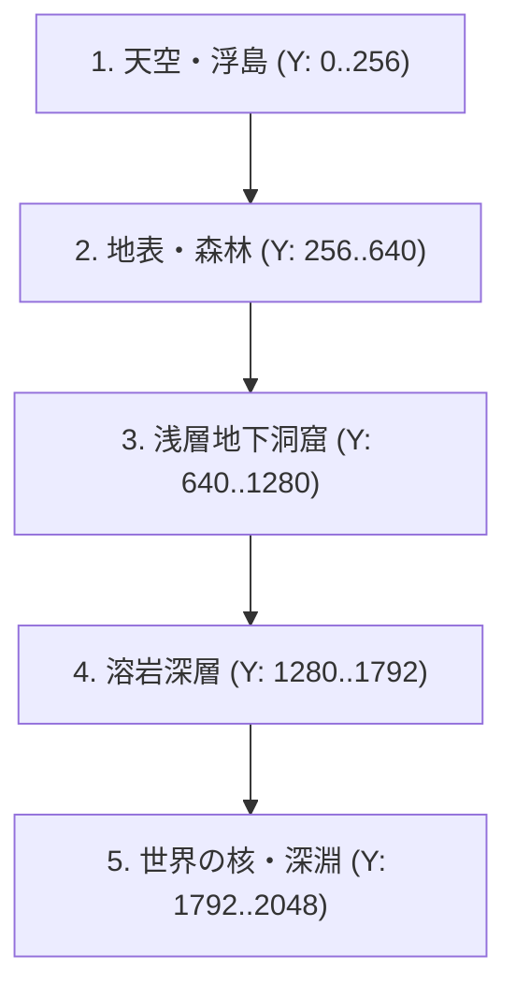

# 35. 垂直深度レイヤー & バイオーム合成数理 (`35_VERTICAL_DEPTH_AND_BIOMES.md`)

## 1. 概要とワールド構造

『Terraria』や『Noita』の魅力は、プレイヤーが地下深くに潜るにつれて環境、敵、鉱石、危険度が劇的に変化する**垂直深度進行（Vertical Depth Progression）** にある。

Charon Engine におけるプロシージャル世界生成は、単一の平坦なパーリンノイズではなく、以下の2つの直交する座標系を合成してバイオームを決定する：
1. **Y軸: 5大垂直深度レイヤー (Vertical Layers)**: 標高・深度に基づく基本環境の決定。
2. **X軸: 温度 (Temperature) × 湿度 (Humidity) ノイズ**: ウィタカーのバイオーム図（Whittaker Biome Model）に基づく地域環境の決定。

---

## 2. 5大垂直深度レイヤーの定義

ワールドの高さを $H = 2048 \text{ cells}$ とした場合、深度レイヤーは以下の比率で配分される：

| レイヤー名 | Y座標範囲 (0 = 天頂, 2047 = 底面) | 特徴マテリアル | 環境特性 |
| :--- | :--- | :--- | :--- |
| **1. 天空・浮島 (Space & Floating Islands)** | $0 \le Y < 256$ | 雲、星屑、浮島土、神殿大理石 | 低重力、薄い大気、強風 |
| **2. 地表・森林 (Surface & Hills)** | $256 \le Y < 640$ | 草、土、木材、水、砂 | 昼夜サイクル、降雨、日光 |
| **3. 浅層地下・洞窟 (Underground Caverns)** | $640 \le Y < 1280$ | 石、土、銅鉱石、鉄鉱石、地下湖 | 暗黒（要光源）、コウモリ、クモ |
| **4. 溶岩深層 (Lava Depths)** | $1280 \le Y < 1792$ | 花崗岩、黒曜石、金/白金鉱石、溶岩 | 高温（延焼危険）、酸性ガス |
| **5. 世界の核・深淵 (The Core / Underworld)** | $1792 \le Y < 2048$ | 灰、獄岩石、魂の炎、古代遺跡 | 極限環境、巨大溶岩海、最終ボス |



---

## 3. ウィタカー型バイオーム決定数理

地表および各深度レイヤーにおいて、横方向の気候変化を決定するため、低周波のシンプレックスノイズ（Simplex Noise）から温度 $T(x, y) \in [-1.0, 1.0]$ と湿度 $M(x, y) \in [-1.0, 1.0]$ をサンプリングする。

### 3.1 バイオーム分類マトリクス
```rust
#[derive(Clone, Copy, Debug, PartialEq, Eq)]
pub enum BiomeType {
    // 地表バイオーム
    Plains,
    Forest,
    Desert,
    Tundra,
    Jungle,
    Swamp,

    // 地下バイオーム
    MushroomGrotto,
    CrystalCave,
    GraniteChasm,
    MoltenHells,
}

pub fn sample_biome(
    y: i32,
    world_height: i32,
    temp: f32, // -1.0 .. 1.0
    moist: f32, // -1.0 .. 1.0
) -> BiomeType {
    let depth_ratio = y as f32 / world_height as f32;

    if depth_ratio > 0.85 {
        return BiomeType::MoltenHells;
    }

    if depth_ratio > 0.40 {
        // 地下特殊バイオーム
        if moist > 0.4 && temp > 0.0 {
            return BiomeType::MushroomGrotto;
        } else if temp < -0.3 {
            return BiomeType::CrystalCave;
        } else {
            return BiomeType::GraniteChasm;
        }
    }

    // 地表・浅層バイオーム (ウィタカー分類)
    if temp < -0.3 {
        BiomeType::Tundra
    } else if temp > 0.4 && moist < -0.2 {
        BiomeType::Desert
    } else if temp > 0.2 && moist > 0.3 {
        BiomeType::Jungle
    } else if moist > 0.5 {
        BiomeType::Swamp
    } else if moist > -0.1 {
        BiomeType::Forest
    } else {
        BiomeType::Plains
    }
}
```

---

## 4. 地表標高線の生成 (Terrain Elevation Spline)

地表の地平線 $Y_{\text{surface}}(x)$ は、複数のオクターブ（Octaves）を合成したフラクタルブラウン運動（fBm）によって計算される：

$$
Y_{\text{surface}}(x) = Y_{\text{base}} + \sum_{i=0}^{N-1} A_i \cdot \text{Simplex}\left(\frac{x}{\lambda_i}\right)
$$

- 大規模な丘陵・山岳（長波長 $\lambda_0 = 1024$, 振幅 $A_0 = 80$）
- 中規模の起伏（$\lambda_1 = 256$, $A_1 = 30$）
- 微小な凹凸（$\lambda_2 = 32$, $A_2 = 6$）

これにより、平原では緩やかな丘が広がり、山岳バイオームでは急峻な崖が形成される。

---

## 5. 次のステップ

基本深度レイヤーとバイオームの境界が定義された。次章では、地下空間を掘削する「パーリンワーム洞窟生成」および「セルラーオートマタ空洞化・連結性保証」の数理を定義する。

- 次章: [36_PERLIN_WORMS_AND_CAVES.md](file:///a:/Project/charon-engine/ai_design_doc/36_PERLIN_WORMS_AND_CAVES.md)
