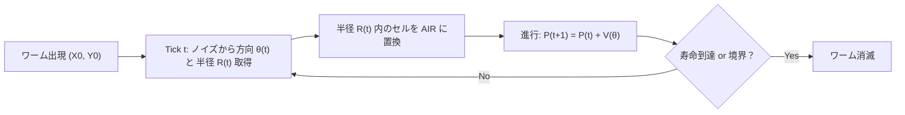
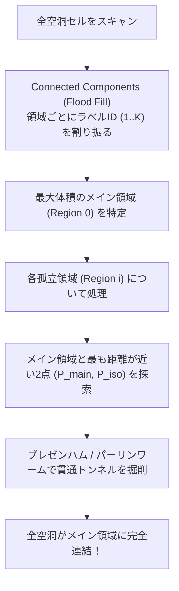

# 36. パーリンワーム & 洞窟生成・連結性保証 (`36_PERLIN_WORMS_AND_CAVES.md`)

## 1. 概要とハイブリッド洞窟生成

自然で冒険心を引き立てる地下洞窟網をプロシージャル生成するため、Charon Engine では以下の2つの異なる数理アルゴリズムを融合した**ハイブリッド洞窟パイプライン**を採用する：

1. **パーリンワーム (Perlin Worms)**: 連続的で曲がりくねった長大なトンネル・地下通路の掘削。
2. **セルラーオートマタ (Cellular Automata 4-5 Rule)**: 広大で有機的な鍾乳洞・大空洞（Caverns）の形成。
3. **フラッドフィル連結性保証 (Flood-Fill Connectivity Guarantee)**: 孤立した空洞同士を検出し、自動で通路を掘削して「行き止まりで進行不能になる」ワールド破綻を数学的に防止する。

---

## 2. パーリンワームの数理と掘削アルゴリズム

パーリンワームは、仮想のエージェント（ワーム）が地中を進みながら、その現在地を中心に半径 $R$ の円形領域を掘削（AIRに置換）していくアルゴリズムである。
ワームの進行方向 $\theta(t)$ は、1次元または2次元のシンプレックスノイズによって滑らかに変化する。

$$
\theta(t) = \theta_{\text{start}} + A_{\text{turn}} \cdot \text{Noise}\left(\frac{t}{\lambda_{\text{turn}}}\right)
$$
$$
R(t) = R_{\text{base}} + A_{\text{radius}} \cdot \text{Noise}\left(\frac{t}{\lambda_{\text{radius}}}\right)
$$
$$
\mathbf{P}(t + 1) = \mathbf{P}(t) + \begin{pmatrix} \cos\theta(t) \\ \sin\theta(t) \end{pmatrix} \cdot S_{\text{step}}
$$



---

## 3. セルラーオートマタによる大空洞形成 (4-5 ルール)

大空洞バイオームでは、まず指定領域を確率 $P_{\text{initial}} \approx 0.45$ で岩（Solid）、$0.55$ で空洞（Air）としてランダム初期化する。
その後、ムーア近傍（周囲 8 近傍 + 自身 = 9セル）の岩の数を $N_{\text{solid}}$ とし、以下の平滑化ステップを 4〜5 回反復適用する：

$$
C_{\text{new}}(x, y) = \begin{cases}
\text{Solid} & \text{if } N_{\text{solid}} \ge 5 \\
\text{Air} & \text{if } N_{\text{solid}} \le 3 \\
C_{\text{current}}(x, y) & \text{otherwise}
\end{cases}
$$

これにより、ノイズ状の乱数から、滑らかな岩壁と巨大な地下空洞が自律的に組織化される。

---

## 4. 連結性保証 (Flood Fill & Tunnel Stitching)

孤立した閉鎖空間が生成され、プレイヤーがツルハシを持たずに詰む事態を防止するため、洞窟網の連結性を検証する。



### 4.1 Rust 実装: 連結トンネル掘削
```rust
pub fn ensure_cave_connectivity(world: &mut World, bounds: RectI) {
    let mut visited = vec![false; (bounds.max_x - bounds.min_x) as usize * (bounds.max_y - bounds.min_y) as usize];
    let width = bounds.max_x - bounds.min_x;

    let get_idx = |x: i32, y: i32| -> usize {
        ((y - bounds.min_y) * width + (x - bounds.min_x)) as usize
    };

    let mut regions: Vec<Vec<(i32, i32)>> = Vec::new();

    // 1. Flood Fill による空洞領域のラベル付け
    for y in bounds.min_y..bounds.max_y {
        for x in bounds.min_x..bounds.max_x {
            let idx = get_idx(x, y);
            if !visited[idx] && world.get_cell_at(x, y).map_or(false, |c| c.is_air()) {
                let mut current_region = Vec::new();
                let mut queue = std::collections::VecDeque::new();
                queue.push_back((x, y));
                visited[idx] = true;

                while let Some((cx, cy)) = queue.pop_front() {
                    current_region.push((cx, cy));
                    let neighbors = [(cx+1, cy), (cx-1, cy), (cx, cy+1), (cx, cy-1)];
                    for (nx, ny) in neighbors {
                        if nx >= bounds.min_x && nx < bounds.max_x && ny >= bounds.min_y && ny < bounds.max_y {
                            let n_idx = get_idx(nx, ny);
                            if !visited[n_idx] && world.get_cell_at(nx, ny).map_or(false, |c| c.is_air()) {
                                visited[n_idx] = true;
                                queue.push_back((nx, ny));
                            }
                        }
                    }
                }
                regions.push(current_region);
            }
        }
    }

    if regions.len() <= 1 {
        return; // 既に単一の連結成分または空洞なし
    }

    // 2. 最大領域（メイン洞窟）の特定
    regions.sort_by_key(|r| std::cmp::Reverse(r.len()));
    let main_cave = &regions[0];

    // 3. 各孤立領域からメイン領域へ直通トンネルを掘削
    for isolated_cave in &regions[1..] {
        if isolated_cave.is_empty() { continue; }
        
        let p_iso = isolated_cave[0];
        // メイン領域の中から最も近い点を見つける
        let mut best_p_main = main_cave[0];
        let mut min_dist_sq = i32::MAX;

        for p_m in main_cave.iter().step_by(16) { // 高速化のため間引きサンプリング
            let dx = p_m.0 - p_iso.0;
            let dy = p_m.1 - p_iso.1;
            let d_sq = dx * dx + dy * dy;
            if d_sq < min_dist_sq {
                min_dist_sq = d_sq;
                best_p_main = *p_m;
            }
        }

        // ブレゼンハム線分に沿って幅 3px のトンネルを掘削
        carve_corridor(world, p_iso, best_p_main, 3);
    }
}

fn carve_corridor(world: &mut World, p0: (i32, i32), p1: (i32, i32), radius: i32) {
    let mut x0 = p0.0;
    let mut y0 = p0.1;
    let x1 = p1.0;
    let y1 = p1.1;

    let dx = (x1 - x0).abs();
    let dy = (y1 - y0).abs();
    let sx = if x0 < x1 { 1 } else { -1 };
    let sy = if y0 < y1 { 1 } else { -1 };
    let mut err = dx - dy;

    loop {
        // 半径内のセルを掘削
        for dy in -radius..=radius {
            for dx in -radius..=radius {
                if dx * dx + dy * dy <= radius * radius {
                    world.set_cell_at(x0 + dx, y0 + dy, Cell::AIR);
                }
            }
        }

        if x0 == x1 && y0 == y1 { break; }
        let e2 = 2 * err;
        if e2 > -dy { err -= dy; x0 += sx; }
        if e2 < dx { err += dx; y0 += sy; }
    }
}
```

---

## 5. 次のステップ

洞窟網の連結性が確立された。次章では、地下や地表に手作りのダンジョン、遺跡、宝箱部屋、神殿をプロシージャル配置する「プレハブ建造物スタンプ力学」を定義する。

- 次章: [37_PREFAB_STRUCTURE_STAMPING.md](file:///a:/Project/charon-engine/ai_design_doc/37_PREFAB_STRUCTURE_STAMPING.md)
