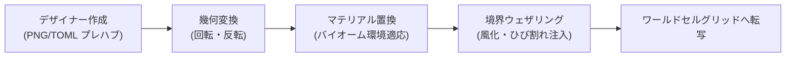

# 37. プレハブ建造物スタンプ & ダンジョン生成 (`37_PREFAB_STRUCTURE_STAMPING.md`)

## 1. 概要

フルプロシージャル生成の世界であっても、プレイヤーの探索体験を最高に盛り上げるのは「手作り感のある遺跡、廃坑、地下神殿、宝箱部屋」である。

Charon Engine におけるプレハブスタンプシステム（Prefab Structure Stamping System）は、レベルデザイナーがデザインした構造体テンプレートを、プロシージャル地形内の最適な位置へ自動配置・適応埋入する。

### 1.1 プレハブスタンプの商用要件
1. **変形バリエーション**: 単一のテンプレートから 90°/180°/270° 回転および水平・垂直反転を適用し、見た目の重複感を排除する。
2. **バイオーム適応マテリアル置換 (Material Swapping)**: 森林地下に配置される場合は「苔むした石レンガ」、砂漠地下なら「砂岩ブロック」、溶岩深層なら「黒曜石レンガ」へと自動変換する。
3. **戦利品テーブル (Loot Tables)**: チェスト（宝箱）の内容物を深度やバイオーム難易度に応じて重み付け抽選生成する。
4. **境界侵食ブレンド (Border Weathering)**: 建造物の外壁をプロシージャルにひび割れさせ、周囲の天然岩盤やツタと自然に融合させる。

---

## 2. プレハブデータの構造仕様

プレハブは、軽量な PNG 画像のカラーパレット（カラーキー方式）または TOML/JSON マトリクスとして定義される。

```rust
#[derive(Clone, Debug)]
pub struct PrefabTemplate {
    pub name: String,
    pub width: u32,
    pub height: u32,
    /// (x, y) ごとのマテリアル定義キー (例: 0=AIR, 1=WALL, 2=CHEST, 3=TORCH, 255=IGNORE/透明)
    pub cells: Vec<u8>,
    pub loot_table_id: Option<String>,
}

#[derive(Clone, Copy, Debug, PartialEq, Eq)]
pub enum PrefabTransform {
    Identity,
    Rotate90,
    Rotate180,
    Rotate270,
    FlipHorizontal,
    FlipVertical,
}
```



---

## 3. 幾何変換数理 (Rotation & Reflection Math)

サイズ $W \times H$ のプレハブにおけるローカル座標 $(u, v)$ ($0 \le u < W, 0 \le v < H$) を、ワールド転写時の座標 $(u', v')$ へ射影する数理変換：

$$
\begin{aligned}
\text{Identity}: & \quad u' = u, \quad v' = v \\
\text{Rotate90}: & \quad u' = H - 1 - v, \quad v' = u \quad (\text{サイズは } H \times W) \\
\text{Rotate180}: & \quad u' = W - 1 - u, \quad v' = H - 1 - v \\
\text{Rotate270}: & \quad u' = v, \quad v' = W - 1 - u \quad (\text{サイズは } H \times W) \\
\text{FlipH}: & \quad u' = W - 1 - u, \quad v' = v
\end{aligned}
$$

---

## 4. Rust 実装: スタンプ実行エンジン

```rust
pub struct PrefabStamper;

impl PrefabStamper {
    pub fn stamp_prefab(
        world: &mut World,
        template: &PrefabTemplate,
        origin_x: i32,
        origin_y: i32,
        transform: PrefabTransform,
        material_palette: &[u16], // プレハブ内キー -> 実MaterialId のマップ
    ) {
        let (out_w, out_h) = match transform {
            PrefabTransform::Rotate90 | PrefabTransform::Rotate270 => (template.height, template.width),
            _ => (template.width, template.height),
        };

        for v in 0..template.height {
            for u in 0..template.width {
                let cell_key = template.cells[(v * template.width + u) as usize];
                if cell_key == 255 {
                    // 255 は透明セル (既存地形を上書きせず保持)
                    continue;
                }

                // 幾何座標変換
                let (trans_u, trans_v) = match transform {
                    PrefabTransform::Identity => (u, v),
                    PrefabTransform::Rotate90 => (template.height - 1 - v, u),
                    PrefabTransform::Rotate180 => (template.width - 1 - u, template.height - 1 - v),
                    PrefabTransform::Rotate270 => (v, template.width - 1 - u),
                    PrefabTransform::FlipHorizontal => (template.width - 1 - u, v),
                    PrefabTransform::FlipVertical => (u, template.height - 1 - v),
                };

                let world_x = origin_x + trans_u as i32;
                let world_y = origin_y + trans_v as i32;

                // 風化ノイズ (外周部分が確率的に崩れる)
                let is_edge = u == 0 || u == template.width - 1 || v == 0 || v == template.height - 1;
                if is_edge && rand::random::<f32>() < 0.15 {
                    // 風化により配置スキップ（崩れた壁を演出）
                    continue;
                }

                let target_mat_id = material_palette[cell_key as usize];
                world.set_cell_at(world_x, world_y, Cell::new(target_mat_id));
            }
        }
    }
}
```

---

## 5. チェスト戦利品テーブル (Weighted Loot Table)

ダンジョン内の宝箱には、アイテムのレアリティに応じた重み付け抽選（Cumulative Weight Sampling）が実行される。

```rust
#[derive(Clone, Debug)]
pub struct LootEntry {
    pub item_id: u32,
    pub min_count: u32,
    pub max_count: u32,
    pub weight: u32, // 出現重み (例: 100=コモン, 5=レア, 1=レジェンダリー)
}

pub fn roll_loot(table: &[LootEntry], rolls: u32) -> Vec<(u32, u32)> {
    let mut items = Vec::new();
    let total_weight: u32 = table.iter().map(|e| e.weight).sum();
    if total_weight == 0 { return items; }

    for _ in 0..rolls {
        let mut pick = rand::random::<u32>() % total_weight;
        for entry in table {
            if pick < entry.weight {
                let count = rand::random::<u32>() % (entry.max_count - entry.min_count + 1) + entry.min_count;
                items.push((entry.item_id, count));
                break;
            }
            pick -= entry.weight;
        }
    }
    items
}
```

---

## 6. 次のステップ

構造体スタンプが完成した。次章では、世界全体に天然資源を散りばめる「鉱脈クラスタリング、水脈・溶岩溜まり、およびプロシージャル樹木成長」を定義する。

- 次章: [38_ORE_VEINS_AND_RESOURCES.md](file:///a:/Project/charon-engine/ai_design_doc/38_ORE_VEINS_AND_RESOURCES.md)
