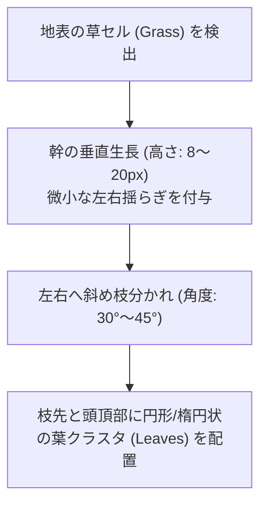

# 38. 鉱脈クラスタリング & 天然資源・樹木プロシージャル (`38_ORE_VEINS_AND_RESOURCES.md`)

## 1. 概要と資源配置哲学

ゲームの進行（プログレッション）の中核を握るのは、地下に眠る鉱物資源（石炭、銅、鉄、銀、金、ミスリル、アダマンタイト）と、地表を覆う植生（樹木、ツタ、巨大キノコ）である。

鉱脈が世界全体に均一に散らばっていると、採掘のワクワク感や「鉱脈を掘り当てた歓喜」が失われてしまう。
Charon Engine では、以下の数理モデルを組み合わせて、メリハリのある資源配置を行う：
1. **深度別ガウス確率分布 (Depth-Stratified Gaussian Distribution)**: 各鉱石が最も豊富に出現する最適深度と標準偏差の定義。
2. **ブロブクラスタリング (Blob Clustering / Ellipsoid Veins)**: 楕円・筋状の塊として鉱石が密集して生成される機構。
3. **L-System プロシージャル樹木生成**: 地表の草ブロックから幹と枝葉を有機的に生長させるアルゴリズム。

---

## 2. 鉱脈出現確率の数理モデル (Gaussian Layering)

深度 $Y \in [0, H]$ における鉱石 $m$ の生成確率 $P_m(Y)$ は、期待深度 $\mu_m$ と分散 $\sigma_m^2$ を持つ正規分布（ガウス関数）としてモデル化される：

$$
P_m(Y) = P_{\max, m} \cdot \exp\left( -\frac{(Y - \mu_m)^2}{2 \sigma_m^2} \right)
$$

### 2.1 鉱石ごとの深度分布パラメーター例
| 鉱石名 | 最適深度比率 $\mu$ | 標準偏差 $\sigma$ | クラスター規模 (半径) | 置換対象母岩 |
| :--- | :--- | :--- | :--- | :--- |
| **石炭 (Coal)** | 0.35 (地表直下〜浅層) | 0.15 | 4〜8 px | 土, 石 |
| **銅 (Copper)** | 0.45 (浅層地下) | 0.12 | 3〜6 px | 石 |
| **鉄 (Iron)** | 0.55 (中層洞窟) | 0.10 | 3〜5 px | 石, 花崗岩 |
| **金 (Gold)** | 0.70 (溶岩上層) | 0.08 | 2〜4 px | 石, 花崗岩 |
| **深淵鉱石 (Voidite)**| 0.95 (最深部溶岩海) | 0.04 | 2〜3 px | 黒曜石, 獄岩石 |

---

## 3. 鉱脈クラスタリング (Ellipsoid Blob Veins)

単一の点ではなく、ランダムな方向角 $\theta$ と長軸 $a$、短軸 $b$ を持つ楕円領域内の母岩セルを置換する。

```rust
pub fn generate_ore_vein(
    world: &mut World,
    center_x: i32,
    center_y: i32,
    ore_mat_id: u16,
    radius_a: f32, // 長軸 (例: 5.0)
    radius_b: f32, // 短軸 (例: 2.5)
    angle: f32,    // 回転角
) {
    let cos_a = angle.cos();
    let sin_a = angle.sin();
    let max_r = radius_a.max(radius_b).ceil() as i32;

    for dy in -max_r..=max_r {
        for dx in -max_r..=max_r {
            // 回転座標系への逆変換
            let rx = (dx as f32) * cos_a + (dy as f32) * sin_a;
            let ry = -(dx as f32) * sin_a + (dy as f32) * cos_a;

            let norm_dist = (rx * rx) / (radius_a * radius_a) + (ry * ry) / (radius_b * radius_b);

            // 境界にパーリンノイズを加えて有機的な形状にする
            let noise = (rand::random::<f32>() - 0.5) * 0.3;
            if norm_dist + noise <= 1.0 {
                let tx = center_x + dx;
                let ty = center_y + dy;

                if let Some(cell) = world.get_cell_at(tx, ty) {
                    // 母岩 (STONE 等) のみ置換し、空気や水は上書きしない
                    if cell.is_solid() && cell.material_id != ore_mat_id {
                        world.set_cell_at(tx, ty, Cell::new(ore_mat_id));
                    }
                }
            }
        }
    }
}
```

---

## 4. プロシージャル樹木成長 (L-System 幹・枝葉生成)

地表の草ブロック上には、プロシージャルな樹木が生成される。
一本調子の静的スプライトではなく、高さ、曲がり具合、枝の広がりが乱数シードによって1本1本異なる。



```rust
pub fn grow_tree(
    world: &mut World,
    root_x: i32,
    root_y: i32,
    wood_mat_id: u16,
    leaf_mat_id: u16,
) {
    let height = rand::random::<i32>().rem_euclid(10) + 12; // 12〜21px
    let mut curr_x = root_x;

    // 1. 幹の生長
    for dy in 0..height {
        let ty = root_y - dy;
        world.set_cell_at(curr_x, ty, Cell::new(wood_mat_id));

        // 稀に1px横に曲がる
        if dy > 4 && rand::random::<f32>() < 0.2 {
            curr_x += if rand::random::<bool>() { 1 } else { -1 };
            world.set_cell_at(curr_x, ty, Cell::new(wood_mat_id));
        }

        // 中腹からの枝分かれ
        if dy > height / 2 && rand::random::<f32>() < 0.25 {
            let branch_dir = if rand::random::<bool>() { 1 } else { -1 };
            let bx = curr_x + branch_dir;
            let by = ty - 1;
            world.set_cell_at(bx, by, Cell::new(wood_mat_id));
            // 枝先に小さな葉
            grow_leaf_blob(world, bx, by, leaf_mat_id, 3);
        }
    }

    // 2. 樹冠（頭頂部の巨大な葉の塊）
    grow_leaf_blob(world, curr_x, root_y - height, leaf_mat_id, 6);
}

fn grow_leaf_blob(world: &mut World, cx: i32, cy: i32, leaf_mat: u16, radius: i32) {
    let r_sq = radius * radius;
    for dy in -radius..=radius {
        for dx in -radius..=radius {
            if dx * dx + dy * dy <= r_sq {
                let tx = cx + dx;
                let ty = cy + dy;
                if let Some(cell) = world.get_cell_at(tx, ty) {
                    if cell.is_air() {
                        world.set_cell_at(tx, ty, Cell::new(leaf_mat));
                    }
                }
            }
        }
    }
}
```

---

## 5. 次のステップ

世界生成と自然環境の全パイプラインが完成した。
いよいよ最終パート **Part 10: UI・インベントリ・オーディオ・商用リリース** に突入し、ピクセルパーフェクトUI、50枠インベントリ/クラフト、空間音響、および Steam 統合・セーブ圧縮の完全設計を定義する。

- 次章: [39_PIXEL_PERFECT_UI_SYSTEM.md](file:///a:/Project/charon-engine/ai_design_doc/39_PIXEL_PERFECT_UI_SYSTEM.md)
