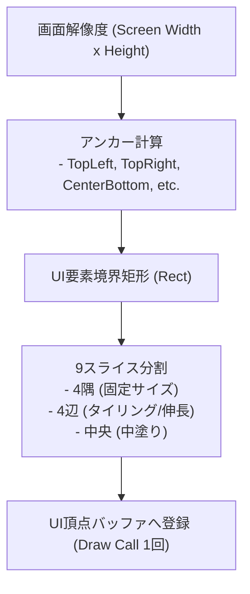

# 39. ピクセルパーフェクトUIシステム & HUD (`39_PIXEL_PERFECT_UI_SYSTEM.md`)

## 1. 概要とレンダリング分離原則

Charon Engine における UI（ユーザーインターフェース）および HUD（Head-Up Display）は、**ゲーム内ワールドカメラの振動・スケーリング・回転から完全に独立した「最前面直交オーバーレイレイヤー (Foremost Orthographic Overlay Layer)」** として描画される。

### 1.1 商用ピクセルアートUIの必須要件
1. **整数座標スナップ (Pixel Snapping)**: UIテキストやアイコンが 0.5px などのサブピクセル位置にレンダリングされてフォントが滲む（Blurring）現象をゼロにする。
2. **解像度非依存アンカー (Anchoring System)**: 16:9, 16:10, 21:9 ウルトラワイド等の異なる画面アスペクト比に対して、「画面右上（HPバー）」「画面下中央（ホットバー）」へ自動整列する。
3. **9スライス (9-Slice) スケーリング**: 枠線やダイアログウィンドウの角（コーナー）のドット絵を歪ませずに、任意の幅・高さに引き伸ばす。
4. **低遅延カスタムカーソル**: OS標準のマウスカーソルを非表示にし、ゲームの世界観に合った照準（クロスヘア）や手のアイコンをフレーム遅延なく描画する。

---

## 2. UIアンカーと9スライスの数理



### 2.1 9スライス矩形分割数理
元画像サイズ $W_0 \times H_0$、枠の境界幅 $(b_L, b_R, b_T, b_B)$ に対し、目標描画サイズ $W \times H$ への分割：
- 4つの角（Corners）: 変形なし（$1:1$ ドット比率保持）
- 上下辺: 幅 $W - (b_L + b_R)$ に合わせて水平タイリングまたは伸長
- 左右辺: 高さ $H - (b_T + b_B)$ に合わせて垂直タイリングまたは伸長
- 中央領域: 残りの矩形をタイリング充填

---

## 3. Rust 実装: UIコンテキストと要素レイアウト

```rust
#[derive(Clone, Copy, Debug, PartialEq, Eq)]
pub enum Anchor {
    TopLeft,
    TopCenter,
    TopRight,
    CenterLeft,
    Center,
    CenterRight,
    BottomLeft,
    BottomCenter,
    BottomRight,
}

#[derive(Clone, Debug)]
pub struct UiRect {
    pub anchor: Anchor,
    pub offset_x: i32,
    pub offset_y: i32,
    pub width: i32,
    pub height: i32,
}

impl UiRect {
    /// 画面解像度から絶対スクリーン整数ピクセル座標を算出
    pub fn resolve_to_screen(&self, screen_w: i32, screen_h: i32) -> RectI {
        let (base_x, base_y) = match self.anchor {
            Anchor::TopLeft => (0, 0),
            Anchor::TopCenter => (screen_w / 2, 0),
            Anchor::TopRight => (screen_w, 0),
            Anchor::BottomLeft => (0, screen_h),
            Anchor::BottomCenter => (screen_w / 2, screen_h),
            Anchor::BottomRight => (screen_w, screen_h),
            Anchor::Center => (screen_w / 2, screen_h / 2),
            Anchor::CenterLeft => (0, screen_h / 2),
            Anchor::CenterRight => (screen_w, screen_h / 2),
        };

        RectI::new(
            base_x + self.offset_x,
            base_y + self.offset_y,
            self.width,
            self.height,
        )
    }
}
```

---

## 4. HUD 主要コンポーネント仕様

### 4.1 ホットバー (Hotbar)
- **配置**: `Anchor::BottomCenter`、オフセット `( -width/2, -40px )`。
- **スロット数**: 10スロット（キーボード数字キー `1`〜`0`、およびマウスホイールで選択）。
- **選択枠アニメーション**: 選択されたスロット枠が金色に輝き、切り替え時に微小なポップ拡縮（1.15倍 $\to$ 1.0倍）。

### 4.2 ハートHPゲージ & マナスター (Life & Mana Bars)
- **配置**: `Anchor::TopRight`、オフセット `( -180px, 16px )`。
- **ハート表示**: 1ハート = 20 HP（『Terraria』スタイル）。ダメージ受傷時、失われたHP分が白いゴーストバー（Ghost Damage）として残り、0.5秒後に滑らかに縮小消滅する。

### 4.3 ツールチップ (Smart Tooltip)
- マウスカーソルがアイテムやUI要素上にホバーした際、カーソルの右下 $+12\text{px}$ に動的ポップアップ。
- アイテム名、レアリティ色（コモン: 白、レア: 青、エピック: 紫、レジェンダリー: 金）、攻撃力、攻撃速度、ツールチップ説明文を自動改行して表示。画面端に近づいた場合は自動で左上方向へ反転表示する（画面外はみ出し防止）。

---

## 5. 次のステップ

UIレンダリングの基盤が確立された。次章では、プレイヤーの所持品管理、チェストとの受け渡し、自動スタック、および近傍作業台によるクラフト（作成）システムを定義する。

- 次章: [40_INVENTORY_AND_CRAFTING.md](file:///a:/Project/charon-engine/ai_design_doc/40_INVENTORY_AND_CRAFTING.md)
