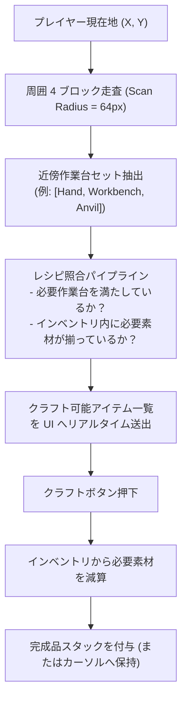

# 40. インベントリ & 近傍クラフトシステム (`40_INVENTORY_AND_CRAFTING.md`)

## 1. 概要とプレイヤーの所持品アーキテクチャ

『Terraria』スタイルの快適なインベントリ体験を実現するため、Charon Engine は以下の要素を備えた堅牢なインベントリ＆クラフト機構を提供する：

1. **50枠メインインベントリ + 特殊装備枠**:
   - ホットバー: 10スロット (0..9)
   - メインバッグ: 40スロット (10..49)
   - 装備枠: 兜、鎧、具足 (3スロット)
   - アクセサリー枠: 指輪、お守り、翼等 (5スロット)
   - ゴミ箱スロット (1スロット)
2. **直感的な操作系**: 左クリックで全移動、右クリックで1個ずつ配置、Shift+クリックでチェスト/ゴミ箱へ即座に一括転送。
3. **近傍作業台クラフト (Proximity Station Crafting)**: Minecraft のような複雑なグリッド配置を強制せず、プレイヤーの周囲 4 ブロック以内にある作業台（金床、かまど、錬金台等）を自動検知し、作成可能な全レシピを一覧表示・即時作成する。

---

## 2. データ構造仕様

```rust
#[derive(Clone, Debug, PartialEq, Eq)]
pub struct ItemStack {
    pub item_id: u32,
    pub count: u16,
    pub max_stack: u16, // 例: 武器・防具は 1, 鉱石・ブロックは 999
    pub durability: Option<u16>, // 耐久度 (ツール等)
    pub modifier_id: Option<u8>, // 接頭辞 (神々しい、頑丈な、俊敏な等)
}

#[derive(Clone, Debug)]
pub struct Inventory {
    pub slots: Vec<Option<ItemStack>>,
    pub selected_hotbar_idx: usize, // 0..9
}

impl Inventory {
    pub fn new(capacity: usize) -> Self {
        Self {
            slots: vec![None; capacity],
            selected_hotbar_idx: 0,
        }
    }

    /// アイテムの自動スタック格納 (空きスロットまたは既存スタックへマージ)
    pub fn insert_item(&mut self, mut item: ItemStack) -> Option<ItemStack> {
        // 1. 既存の同種スタックにマージ試行
        for slot in self.slots.iter_mut().flatten() {
            if slot.item_id == item.item_id && slot.modifier_id == item.modifier_id {
                let space = slot.max_stack.saturating_sub(slot.count);
                let to_add = space.min(item.count);
                slot.count += to_add;
                item.count -= to_add;

                if item.count == 0 {
                    return None; // 完全格納成功
                }
            }
        }

        // 2. 空きスロットへ配置
        for slot in self.slots.iter_mut() {
            if slot.is_none() {
                *slot = Some(item);
                return None; // 完全格納成功
            }
        }

        // 格納しきれなかった余りを返す (インベントリ満杯)
        Some(item)
    }
}
```

---

## 3. レシピ定義と近傍作業台クラフト



### 3.1 レシピのデータ構造
```rust
#[derive(Clone, Copy, Debug, PartialEq, Eq, Hash)]
pub enum CraftingStation {
    None,       // 手持ちクラフト (松明、作業台、木製ツール等)
    Workbench,  // 木の作業台 (家具、木の防具、弓)
    Furnace,    // かまど (インゴット精錬、ガラス)
    IronAnvil,  // 金床 (鉄・銀・金の武器防具)
    AlchemyLab, // 錬金台 (ポーション各種)
}

#[derive(Clone, Debug)]
pub struct CraftingIngredient {
    pub item_id: u32,
    pub count: u16,
}

#[derive(Clone, Debug)]
pub struct CraftingRecipe {
    pub result_item_id: u32,
    pub result_count: u16,
    pub required_station: CraftingStation,
    pub ingredients: Vec<CraftingIngredient>,
}
```

### 3.2 高速レシピ照合とクラフト実行
```rust
pub struct CraftingSystem {
    pub recipes: Vec<CraftingRecipe>,
}

impl CraftingSystem {
    /// 現在の所持品と周囲作業台から作成可能な全レシピを高速抽出 (O(R * I))
    pub fn get_available_recipes(
        &self,
        inventory: &Inventory,
        nearby_stations: &[CraftingStation],
    ) -> Vec<&CraftingRecipe> {
        self.recipes
            .iter()
            .filter(|recipe| {
                // 1. 作業台条件を満たしているか
                if recipe.required_station != CraftingStation::None
                    && !nearby_stations.contains(&recipe.required_station)
                {
                    return false;
                }

                // 2. 素材が揃っているか
                recipe.ingredients.iter().all(|ing| {
                    let total_owned: u16 = inventory
                        .slots
                        .iter()
                        .flatten()
                        .filter(|slot| slot.item_id == ing.item_id)
                        .map(|slot| slot.count)
                        .sum();
                    total_owned >= ing.count
                })
            })
            .collect()
    }

    /// クラフト実行: 素材を消費して完成品を生成
    pub fn craft_recipe(&self, inventory: &mut Inventory, recipe: &CraftingRecipe) -> Option<ItemStack> {
        // 素材消費
        for ing in &recipe.ingredients {
            let mut remaining = ing.count;
            for slot in inventory.slots.iter_mut().flatten() {
                if slot.item_id == ing.item_id {
                    let take = slot.count.min(remaining);
                    slot.count -= take;
                    remaining -= take;
                    if remaining == 0 { break; }
                }
            }
            // 空になったスロットを None にクリア
            for slot in inventory.slots.iter_mut() {
                if let Some(item) = slot {
                    if item.count == 0 {
                        *slot = None;
                    }
                }
            }
        }

        Some(ItemStack {
            item_id: recipe.result_item_id,
            count: recipe.result_count,
            max_stack: 999,
            durability: None,
            modifier_id: None,
        })
    }
}
```

---

## 4. 次のステップ

インベントリとクラフトが完成した。次章では、2D空間音響（パンニング・距離減衰）、水中ローパスフィルタ、およびBGMクロスフェードを司る「オーディオエンジン & 音響物理」を定義する。

- 次章: [41_AUDIO_ENGINE_AND_ACOUSTICS.md](file:///a:/Project/charon-engine/ai_design_doc/41_AUDIO_ENGINE_AND_ACOUSTICS.md)
