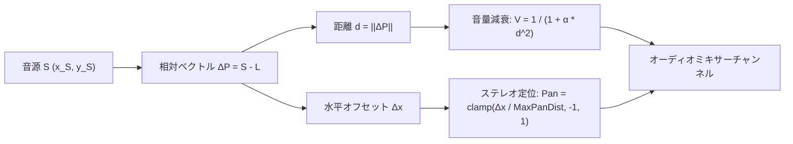

# 41. オーディオエンジン & 空間音響物理 (`41_AUDIO_ENGINE_AND_ACOUSTICS.md`)

## 1. 概要と商用ゲーム音響の要件

『Celeste』の繊細な環境音や『Terraria』の小気味よい採掘音、『Noita』の地中を揺るがす轟音のように、卓越した音響演出は2Dピクセルゲームの没入感を何倍にも高める。

Charon Engine におけるオーディオアーキテクチャは、以下の4大機能を提供する：
1. **2D 空間音響 (Spatial Panning & Attenuation)**: リスナー（プレイヤー位置）からの相対座標に応じたステレオパンニングと距離減衰。
2. **ピッチ微小揺らぎ (Pitch Detuning)**: 足音やツルハシ打撃音など、頻繁に再生される効果音（SFX）のピッチを $\pm 4\%$ ランダムに揺らし、機械的な不快感を完全排除する。
3. **音響環境フィルタ (Acoustic Filtering)**: プレイヤーが水没した際の動的ローパスフィルタ（Low-Pass Filter: 500Hz カットオフ）と、巨大洞窟内での環境リバーブ。
4. **シームレスな動的BGM遷移 (Dynamic Music Transitions)**: バイオーム移動時やボス戦闘突入時における等電力クロスフェード（Equal-Power Crossfading）。

---

## 2. 2D 空間音響の数理モデル

リスナー座標 $\mathbf{L} = (x_L, y_L)$、音源座標 $\mathbf{S} = (x_S, y_S)$ に対する相対位置ベクトルを $\Delta \mathbf{P} = \mathbf{S} - \mathbf{L}$ とする。



### 2.1 距離減衰式 (Distance Attenuation)
単純な線形減衰ではなく、逆二乗則を緩和した自然な減衰曲線を使用する：

$$
V(d) = \text{clamp}\left( \frac{1}{1 + \alpha \cdot \left(\frac{d}{R_{\min}}\right)^2}, \; 0.0, \; 1.0 \right)
$$

- $d \le R_{\min}$: 音量 $100\%$（減衰なし）
- $d > R_{\max}$: 音量 $0\%$（完全ミュート）

### 2.2 ステレオパンニング (Stereo Panning)
$$
\text{Pan} = \text{clamp}\left( \frac{x_S - x_L}{R_{\text{pan\_max}}}, \; -1.0, \; 1.0 \right)
$$
$$
V_{\text{left}} = \cos\left( \frac{\pi}{4} (\text{Pan} + 1) \right) \cdot V(d), \quad V_{\text{right}} = \sin\left( \frac{\pi}{4} (\text{Pan} + 1) \right) \cdot V(d)
$$

---

## 3. Rust 実装: オーディオマネージャー

Rust の高性能オーディオクレート `kira` または `rodio` をバックエンドとし、排他制御なしで呼び出せるイベントキュー方式を実装する。

```rust
#[derive(Clone, Copy, Debug)]
pub struct SoundPlayParams {
    pub sound_id: u32,
    pub world_x: Option<f32>, // None の場合は UI/BGM 等の 2D 非空間音
    pub world_y: Option<f32>,
    pub volume: f32,
    pub pitch_variance: f32, // 例: 0.04 (±4%)
    pub max_distance: f32,
}

pub struct AudioManager {
    listener_x: f32,
    listener_y: f32,
    is_underwater: bool,
    current_bgm_track: Option<u32>,
    bgm_volume: f32,
}

impl AudioManager {
    pub fn new() -> Self {
        Self {
            listener_x: 0.0,
            listener_y: 0.0,
            is_underwater: false,
            current_bgm_track: None,
            bgm_volume: 0.8,
        }
    }

    pub fn set_listener_position(&mut self, x: f32, y: f32, in_water: bool) {
        self.listener_x = x;
        self.listener_y = y;
        self.is_underwater = in_water;
    }

    /// 空間音響パラメータを計算して再生リクエストを発行
    pub fn play_sfx(&self, params: SoundPlayParams) {
        let (final_vol, pan) = if let (Some(sx), Some(sy)) = (params.world_x, params.world_y) {
            let dx = sx - self.listener_x;
            let dy = sy - self.listener_y;
            let dist = (dx * dx + dy * dy).sqrt();

            if dist > params.max_distance {
                return; // 可聴範囲外
            }

            let dist_factor = 1.0 / (1.0 + 0.005 * (dist * 0.1).powi(2));
            let pan = (dx / 320.0).clamp(-1.0, 1.0);
            (params.volume * dist_factor, pan)
        } else {
            (params.volume, 0.0) // 空間減衰なし
        };

        // ピッチ揺らぎの適用
        let pitch_mod = 1.0 + (rand::random::<f32>() - 0.5) * 2.0 * params.pitch_variance;

        // 水中ローパスフィルタの適用フラグ
        let apply_lpf = self.is_underwater;

        // バックエンド（kira / rodio）のチャンネルへ送信
        // low_pass_filter(if apply_lpf { 500.0 } else { 20000.0 })
    }
}
```

---

## 4. 動的BGMクロスフェード (Dynamic Music Crossfade)

バイオームが変わった際、古い曲をフェードアウトしながら新しい曲を同時にフェードインさせる。
2つの曲の音量和が一定に保たれるよう、**等電力曲線 (Equal-Power Crossfade)** を用いる：

$$
V_{\text{out}}(t) = \cos\left(\frac{\pi}{2} t\right), \quad V_{\text{in}}(t) = \sin\left(\frac{\pi}{2} t\right) \quad (t \in [0, 1])
$$

音量の急激な落ち込み（Dip）を防ぎ、音楽が自然に移り変わる。

---

## 5. 次のステップ

オーディオパイプラインが完成した。
いよいよ最後の章 **[42_SAVE_LOAD_AND_COMMERCIAL_RELEASE.md](file:///a:/Project/charon-engine/ai_design_doc/42_SAVE_LOAD_AND_COMMERCIAL_RELEASE.md)** において、高圧縮RLEセーブ/ロード、Steamworks SDK 統合（実績・クラウド）、および有料販売のための商用パッケージング仕様を定義する。

- 次章: [42_SAVE_LOAD_AND_COMMERCIAL_RELEASE.md](file:///a:/Project/charon-engine/ai_design_doc/42_SAVE_LOAD_AND_COMMERCIAL_RELEASE.md)
