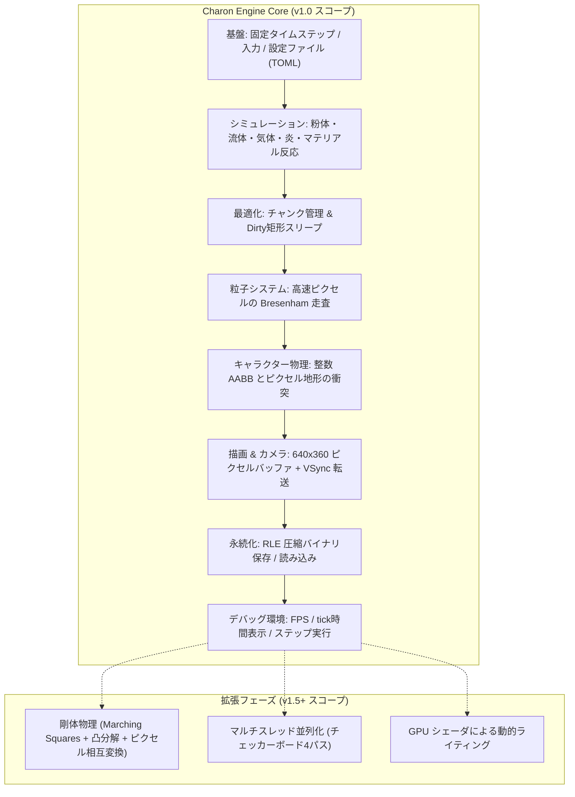
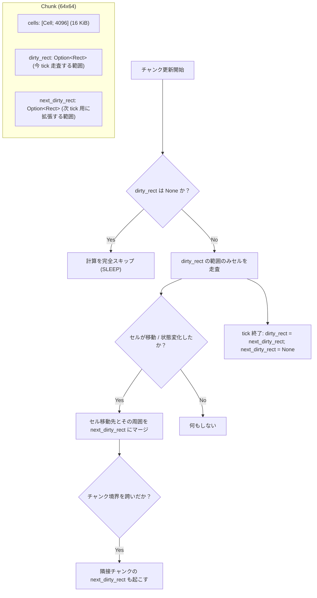
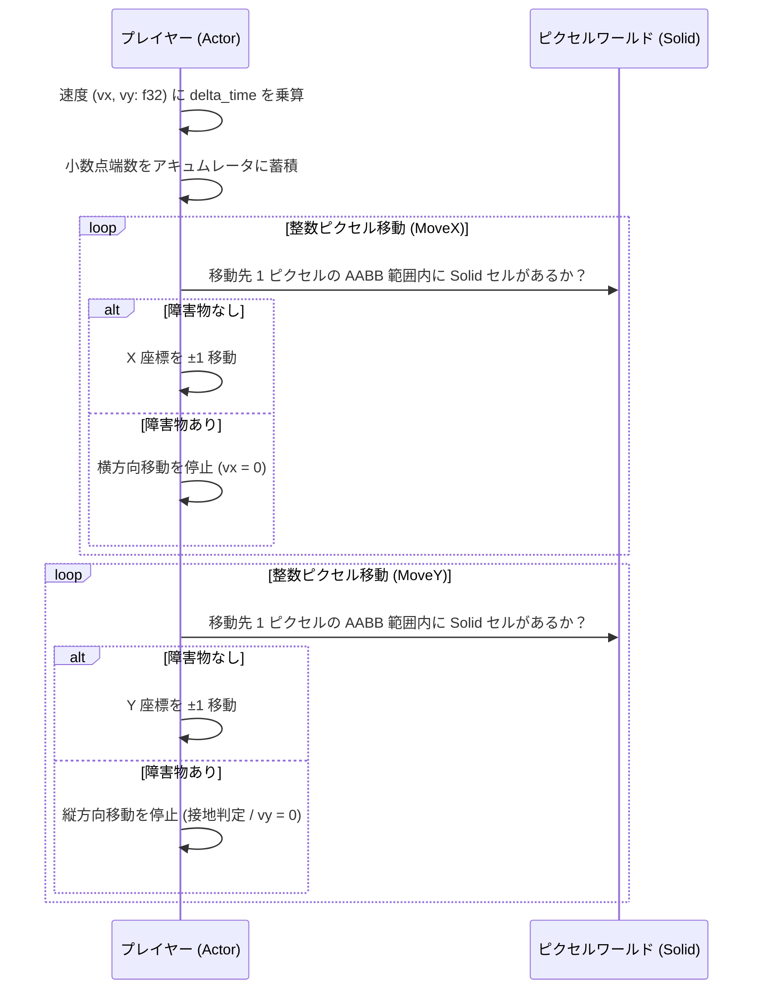
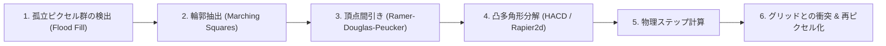
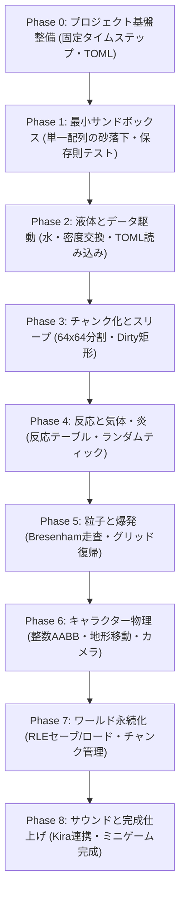

# Charon Engine アーキテクチャ設計書 v2.0 (完全実現性重視)

> **本書の目的**  
> 本書は `docs/readme.md`、`docs/ai.md`、および `docs/design.md` のレビュー結果に基づき、**「個人開発者が AI の支援を受けずに最後まで独力で実装・デバッグ・完成できること」**を最重要基準として再定義した完全技術仕様書である。  
> 憶測や未検証の理論を排除し、実証済みのアーキテクチャと実在する公式ドキュメント・一次情報源のみを根拠として構成している。

---

## 目次

1. [エンジンの定義と「完全なエンジン（v1.0）」のスコープ](#1-エンジンの定義と完全なエンジンv10のスコープ)
2. [コア設計原則](#2-コア設計原則)
3. [ハードウェア・アーキテクチャの根拠（CPU & GPU）](#3-ハードウェアアーキテクチャの根拠cpu--gpu)
4. [シミュレーション・システム設計（中核）](#4-シミュレーションシステム設計中核)
5. [エンティティ・キャラクター物理設計](#5-エンティティキャラクター物理設計)
6. [剛体物理の扱い（段階的アプローチ）](#6-剛体物理の扱い段階的アプローチ)
7. [データ駆動アーキテクチャ（TOML）](#7-データ駆動アーキテクチャtoml)
8. [技術スタック選定とクレート健全性検証](#8-技術スタック選定とクレート健全性検証)
9. [個人開発ロードマップ（フェーズ別完了条件付き）](#9-個人開発ロードマップフェーズ別完了条件付き)
10. [検証・テスト・プロファイリング方針](#10-検証テストプロファイリング方針)
11. [ai.md / design.md からの変更点と技術的根拠](#11-aimd--designmd-からの変更点と技術的根拠)
12. [実在確認済み 参考資料・一次情報源](#12-実在確認済み-参考資料一次情報源)

---

## 1. エンジンの定義と「完全なエンジン（v1.0）」のスコープ

### 1.1 一文での定義
**Charon Engine は、Rust 製の「CPU 駆動ピクセル単位セル・オートマトン」を核とし、2D サンドボックスゲームを完成させるための統合ランタイム・エンジンである。**

### 1.2 「完全なエンジン（v1.0）」のスコープ定義
個人が独力で開発を完走するためには、「何でもできる未完の大作」ではなく、**「ゲーム 1 本が商業水準で動作・完結する機能セット」**を v1.0 の境界とする。



#### v1.0 必須要件（これでゲームが作れる最小かつ完全なセット）
1. **コア・ランタイム**: 決定論的な固定タイムステップ（60 tick/s）ゲームループ、ウィンドウ生成、入力ハンドリング。
2. **ピクセル物理**: 粉体（砂・土）、液体（水・酸）、気体（煙・蒸気）、火炎のセル・オートマトン更新。
3. **マテリアル間化学反応**: 密度交換、接触反応（例: 水＋溶岩＝石）、延焼。
4. **チャンク・スリープ**: 64×64 チャンク単位の Dirty 矩形判定による非活動領域のスキップ。
5. **粒子（Particle）システム**: 爆発や噴射など高速で移動するピクセルのグリッド外弾道計算（Bresenham 走査）。
6. **キャラクター（Actor）物理**: ピクセル地形と衝突する整数 AABB プラットフォーマー物理。
7. **ワールド・ストリーミング**: 画面外チャンクのオンデマンド読み込み・生成・アンロード。
8. **永続化**: 変更チャンクの RLE（Run-Length Encoding）圧縮バイナリセーブ/ロード。
9. **データ駆動**: マテリアル物性・パレット・反応表の TOML 外部定義。
10. **デバッグ支援**: 一時停止、1 tick ステップ実行、チャンク枠/Dirty 矩形表示、パフォーマンスモニタ。

#### v1.0 非目標（個人開発の挫折を防止するため分離）
- **剛体物理（Rigid Body）のピクセル相互変換**: Noita でも数年を要した最高難度領域のため、v1.5 以降へ分離（後述）。
- **マルチスレッド並列更新**: 640×360 解像度ではシングルスレッドのキャッシュ最適化で十分 60 FPS が達成可能なため、初期は単一スレッドで決定論性を担保する。
- **汎用 ECS フレームワーク**: Bevy や hecs などの大規模 ECS は導入せず、必要なコンポーネントのみを明示的な構造体配列で管理する。
- **スクリプト言語の組み込み**: Rust のコンパイル速度と型安全性を重視し、Lua などのランタイム組み込みは行わない。

---

## 2. コア設計原則

1. **AI を使わない個人開発のための「認知的負荷の低減」**  
   複雑な抽象化（過度なジェネリクス、深いトレイト階層、マクロ）を排除する。関数と平坦な構造体データでコードを構成し、半年後に見返しても 1 行ずつ追跡できるようにする。
2. **不変条件の自動テスト（Conservation Law）**  
   「セルが消失しない」「質量保存則が維持される」などの物理的整合性をユニットテストで自動検証し、デバッグの迷宮入りを防ぐ。
3. **データ指向設計（Data-Oriented Design）**  
   オブジェクト指向の「ピクセルクラス」は作らない。メモリ上で連続した配列を CPU キャッシュにそのまま流し込む。
4. **推測ではなく計測に基づく最適化**  
   プロファイラなしでコードを複雑化させない。常にフレーム時間（ms/tick）を画面に表示し、問題が起きた箇所のみに対策を打つ。

---

## 3. ハードウェア・アーキテクチャの根拠（CPU & GPU）

### 3.1 CPU キャッシュ構造とデータサイズ

現代の主要 x86-64 CPU（AMD Zen 3/4/5、Intel 12th〜14th Gen 等）の典型的なキャッシュ仕様：
- **L1 データキャッシュ (L1D)**: コアあたり 32 KiB 〜 48 KiB
- **L2 キャッシュ**: コアあたり 512 KiB 〜 2 MiB
- **キャッシュライン**: 64 バイト

```text
[64 バイトのキャッシュライン]
├── Cell 0  (4 バイト)
├── Cell 1  (4 バイト)
├── Cell 2  (4 バイト)
...
└── Cell 15 (4 バイト)  --> 1 回のメモリアクセスで 16 個のセルがキャッシュに乗る
```

#### チャンクサイズの選定：なぜ 64×64 か？
| チャンクサイズ | セル数 | メモリ容量 (4B/セル) | L1D (32KiB) における占有率 | 考察 |
|---|---|---|---|---|
| 32 × 32 | 1,024 | 4 KiB | 12.5% | キャッシュに極めて優しいが、チャンク境界処理の回数が増加 |
| **64 × 64** | **4,096** | **16 KiB** | **50.0%** | **自チャンク（16KiB）＋隣接セル参照が L1D 内に完全に収まる最適解** |
| 128 × 128 | 16,384 | 64 KiB | 200.0% | L1D を溢れ、L2 アクセスが発生しキャッシュミスが増加 |

64×64（16 KiB）は、L1 データキャッシュの半分を占有するにとどまり、更新ループ中の作業用データや隣接チャンクの境界データを合わせても L1 キャッシュ内に高確率で滞留する。

### 3.2 GPU の役割と PCIe 転送帯域

シミュレーションは **100% CPU** で実行し、GPU は **完成したピクセルフレームバッファの拡大描画のみ** を担当する。

#### 帯域計算の証明
- 論理解像度: 640 × 360 ピクセル
- 1 ピクセルあたりの描画データ: 4 バイト（RGBA8888）
- 1 フレームあたりの転送量:  
  $$640 \times 360 \times 4 \text{ bytes} = 921,600 \text{ bytes} \approx 0.88 \text{ MiB}$$
- 60 FPS における転送レート:  
  $$0.88 \text{ MiB} \times 60 \approx 52.8 \text{ MiB/s}$$

PCIe 3.0 x16 の実効帯域幅（約 15.75 GB/s）に対し、転送負荷は **約 0.33%** に過ぎない。CPU から GPU への毎フレーム全画面転送は全くボトルネックにならない。

#### シミュレーションを GPU で行わない理由
1. **競合解決の破綻**: GPU（Compute Shader）でセルオートマトンを並列更新すると、複数の砂粒子が同時に同じ空きセルへ移動しようとする競合が発生する。アトミック操作や Margolus 近傍法を導入すると挙動の直感性が失われる。
2. **CPU への読み戻しコスト**: キャラクターの衝突判定、破壊判定、セーブデータ書き込みには CPU 側でのセル情報が必要であり、毎フレームの GPU $\to$ CPU 読み戻し（Readback）と同期待ちが深刻なレイテンシを生む。
3. **AI 不使用時のデバッグ容易性**: CPU コードであればステップ実行、`assert!`、ブレークポイント、メモリダンプがすべてネイティブに利用可能。

---

## 4. シミュレーション・システム設計（中核）

### 4.1 32bit セル構造体 (`Cell`)

```rust
/// ワールドを構成する 1 ピクセルのデータ構造。
/// 4 バイト固定サイズ（32-bit）として設計。
#[derive(Clone, Copy, PartialEq, Eq, Default, Debug)]
#[repr(C, align(4))]
pub struct Cell {
    /// マテリアル識別子 (0 = AIR)
    pub material: u8,
    /// パレットバリエーション（同一マテリアル内での色ムラ表現）
    pub shade: u8,
    /// シミュレーションフラグ（クロックビット、状態）
    pub flags: u8,
    /// コンテキスト依存データ（炎の残存寿命、液体の圧力等）
    pub data: u8,
}
```

- **なぜ色（RGB 24bit）を直接持たないのか？**  
  セル構造体を 8 バイトから 4 バイトに半減させるため。色は描画時に `material` と `shade` をキーとしてパレットテーブルから O(1) でルックアップする。これによりメモリ使用量と帯域消費が 50% 削減される。

### 4.2 更新クロック（二重移動防止の最軽量解法）

セル・オートマトンを下から上、あるいは左右に走査する際、1 回の tick で同じセルが連続して移動してしまう問題（無限落下バグ）を防ぐ。

- **従来の失敗例**: 「更新済みフラグ」を立て、フレーム末尾で全セルを走査してフラグを消す $\to$ メモリ帯域の浪費。
- **Charon の採用方式**: **1 ビット・クロックトグル**  
  ワールド全体が保持する `world_tick: u8` の最下位ビット（0 または 1）を基準とする。
  1. 移動したセルの `flags` の Bit 0 を、現在の `world_tick & 1` と一致させる。
  2. 走査時に `(cell.flags & 1) == (world_tick & 1)` であれば「今 tick 処理済み」と判定してスキップ。
  3. **クリアパスが一切不要**（次の tick では反転したビットと比較されるため自動的に未更新状態になる）。

### 4.3 チャンク分割と Dirty 矩形（スリープ最適化）



- 海の底や地中深部など、動きのない領域は `dirty_rect` が `None` となり、**CPU 計算コストが完全にゼロ**になる。
- プレイヤーの足元や爆発地点など、変化があったピクセルの周囲のみが矩形として目覚める。

### 4.4 走査順序とバイアス除去
- **垂直方向**: 常に「下から上」へ走査（落下物が同一フレームで多段落下するのを防止）。
- **水平方向**: 奇数フレームは「左から右」、偶数フレームは「右から左」へ走査を交互に切り替え、流体が片側に偏って流れる現象（走査バイアス）を排除する。

### 4.5 高速移動の粒子化（Particle System）
セルが 1 tick に 1 ピクセルを超える速度（爆発の衝撃、銃弾など）で移動する場合、グリッド上での CA 計算を止め、一時的にグリッドからセルを取り出して `Particle` 構造体に変換する。

```rust
pub struct Particle {
    pub x: f32,
    pub y: f32,
    pub vx: f32,
    pub vy: f32,
    pub cell: Cell,
}
```

1. **移動**: 毎 tick `(x, y)` から `(x + vx, y + vy)` までの線分を **Bresenham の直線アルゴリズム** で 1 ピクセルずつ走査する。
2. **衝突判定**: 走査線上に空気以外のセルを検知した場合、その 1 つ手前の空きセルに `cell` を書き戻して粒子を消滅させる。
3. **利点**:
   - セルのすり抜け（トンネリング）が原理的に発生しない。
   - グリッドから取り出したセルは必ず着地時にグリッドに戻すため、「粒子が消失するバグ」が起きない。

---

## 5. エンティティ・キャラクター物理設計

キャラクター（プレイヤー、敵）の挙動に重厚な物理エンジン（Box2D や Rapier）を直接使うと、ピクセル単位の微細な段差に引っかかり、操作感が悪化する。  
本作では名作 2D アクション『Celeste』および『TowerFall』で実証された **整数ベースの AABB スイープ物理** を採用する。

### 5.1 整数移動ステップ・アルゴリズム



- **マテリアル連動**:
  - `Solid` / `Powder` セル: 侵入不可（壁・床として判定）。
  - `Liquid` セル: 侵入可能だが、プレイヤーの移動速度に減衰係数（粘性）を適用。
  - キャラクターの足元が砂（`Powder`）の場合、足元のセルを微小確率で押し出し・崩落させる。

---

## 6. 剛体物理の扱い（段階的アプローチ）

> [!IMPORTANT]
> **剛体物理（Rigid Body）を v1.0 の必須要件から分離する理由**  
> Noita の GDC 講演において、開発者の Petri Purho 氏は「ピクセルグリッドから剛体を抽出し、物理エンジン（Box2D）と相互連携させ、再びピクセルへ戻す処理は、開発期間中で最もバグが多発し、年単位の時間を費やした最も過酷な領域だった」と述べている。  
> AI を使わない個人開発において、初手で剛体物理をスコープに含めることは**プロジェクトの頓挫に直結する**。

### 6.1 実装のロードマップ分離
- **v1.0**: ピクセル地形の破壊・落下は「粉体物理」と「粒子（Particle）」のみで表現する（大きな岩が崩れる際は、粉体として崩落するか、固定サイズの破片粒子として飛散する）。
- **v1.5 / v2.0 (拡張フェーズ)**: 以下の段階を経て完全な剛体システムを実験的に導入する。



---

## 7. データ駆動アーキテクチャ（TOML）

マテリアルの物性や反応ルールをハードコードせず、外部ファイル `materials.toml` から起動時にパースする。

### 7.1 `materials.toml` スキーマ

```toml
# マテリアル定義
[[materials]]
id = 1
name = "sand"
behavior = "Powder"
density = 150
palette = [
    [194, 178, 128, 255],
    [184, 168, 116, 255],
    [203, 187, 138, 255],
]

[[materials]]
id = 2
name = "water"
behavior = "Liquid"
density = 100
dispersion = 5
palette = [
    [64, 128, 255, 200],
    [70, 135, 255, 200],
]

[[materials]]
id = 3
name = "lava"
behavior = "Liquid"
density = 120
dispersion = 2
palette = [
    [255, 80, 0, 255],
    [230, 60, 0, 255],
]

# マテリアル間の接触反応ルール
[[reactions]]
material_a = "water"
material_b = "lava"
result_a = "steam"      # 水が蒸発
result_b = "stone"      # 溶岩が石化
chance = 1.0            # 発生確率 (0.0 - 1.0)
```

### 7.2 256×256 反応テーブルのメモリ展開
起動時に TOML を読み込み、`ReactionTable: [[Option<Reaction>; 256]; 256]` の平坦な固定長配列に展開する。  
シミュレーション中のセル間反応判定は、**ポインタ間接参照やハッシュ検索なしの $O(1)$ 配列アクセス** で完了する。

---

## 8. 技術スタック選定とクレート健全性検証

すべての採用クレートについて、実在性、メンテナンス状況、選定理由を検証済みである。

| 用途 | クレート名 | バージョン | 健全性 / メンテ状況 | 選定理由 |
|---|---|---|---|---|
| ウィンドウ・入力 | `winit` | 0.30 | 活発（公式） | Rust エコシステムの標準。現行コードの `ApplicationHandler` を踏襲 |
| フレームバッファ描画 | `pixels` | 0.17 | 活発（parasyte） | wgpu 上の極小ピクセル描画層。640×360 の転送に最適 |
| 地形生成ノイズ | `noise` | 0.9 | 安定 | Simplex / Perlin ノイズ生成。現行コードで検証済み |
| 設定 / マテリアル | `serde` + `toml` | 1.0 / 0.8 | 活発（公式） | **`serde_yaml` がアーカイブされたため TOML を採用** |
| ベンチマーク | `criterion` | 0.5 | 活発 | 最適化の前後でナノ秒単位の回帰を検知 |
| 音声再生 (v1.0 後期) | `kira` | 0.9 | 活発 | ゲーム向けに設計された使いやすい純 Rust オーディオライブラリ |
| 圧縮 (セーブデータ) | `lz4_flex` | 0.11 | 活発 | 高速な純 Rust 製 LZ4 実装。RLE と併用可能 |
| 並列化 (v1.5 拡張) | `rayon` | 1.10 | 活発（標準的） | スレッドプール管理用（マルチスレッド導入時のみ） |
| 剛体物理 (v1.5 拡張) | `rapier2d` | 0.18+ | 活発（Dimforge） | 2D 物理ソルバ（拡張フェーズのみ） |

---

## 9. 個人開発ロードマップ（フェーズ別完了条件付き）

1 人で AI を使わずに開発を進める場合、**「テスト可能な小さな動くもの」を積み上げる** ことが唯一の完走方法である。



### Phase 0: プロジェクト基盤整備
- **作業内容**:
  - `conf.yml`（serde_yaml）を `config.toml`（toml クレート）へ移行。
  - `winit` 0.30 のイベントループ内に、蓄積時間ベースの **固定タイムステップ（60 tick/s）** を実装。
  - ウィンドウタイトルに現在の FPS と 1 tick の計算時間（ms）を表示。
- **完了条件**: ウィンドウサイズ変更時も描画比率が崩れず、60 tick/s が安定して記録されること。

### Phase 1: 最小サンドボックス（砂の落下）
- **作業内容**:
  - `Cell` 構造体（4 バイト）の定義。
  - 単一の 1 次元配列 `Vec<Cell>` による 640×360 グリッド。
  - マウスドラッグで砂（Sand）を配置する入力処理。
  - 下から上への走査、左右交互走査による砂の斜め崩落アルゴリズム。
  - セルの二重移動を防ぐ **1 ビット・クロック更新**。
- **完了条件**:
  - クリックした場所に砂が山型に自然に積み上がること。
  - **【自動テスト】** 砂を 1,000 粒配置し、1,000 tick 経過させた後も砂の総数が完全に 1,000 粒であること（セル消失ゼロの証明）。

### Phase 2: 液体とデータ駆動（水・密度交換）
- **作業内容**:
  - `materials.toml` の読み込みとレジストリ生成。
  - 水（Liquid）の実装（左右への `dispersion` 分のスライド移動）。
  - 密度の比較に基づくセル入れ替え（砂が水の中に沈み、水が押し上げられる）。
- **完了条件**:
  - 水が容器の底で水平に静止すること。
  - 水の中に砂を落とすと、砂が底へ沈降し、水が上へ置換されること。

### Phase 3: チャンク化とスリープ（64×64 分割）
- **作業内容**:
  - ワールドを 64×64 チャンクの 2 次元配列に分割。
  - チャンクごとの `dirty_rect` による更新範囲制限。
  - 砂や水が静止した際にチャンクが自動スリープ（計算スキップ）する機構。
  - チャンク境界を跨ぐ移動時の隣接チャンク起床処理。
- **完了条件**:
  - 画面全体の砂が静止した瞬間、1 tick の計算時間が **0.1 ms 以下** に激減すること。
  - チャンク境界線上で砂が引っかかったり消失したりしないこと。

### Phase 4: 化学反応と気体・炎
- **作業内容**:
  - 256×256 反応テーブルの実装（水＋溶岩＝石＋蒸気）。
  - 気体（Steam, Smoke）の逆重力上昇と寿命（`data`）減算による自然消滅。
  - 炎（Fire）の延焼アルゴリズムと可燃性判定。
  - スリープ中チャンク向けのランダムティック処理（低頻度の自然変化）。
- **完了条件**:
  - 木のブロックに火をつけると燃え広がり、煙を放出して灰に変わること。
  - 水と溶岩が接触した境界に石の壁が生成されること。

### Phase 5: 粒子（Particle）と爆発
- **作業内容**:
  - グリッド外で動作する `Particle` 配列の実装。
  - Bresenham アルゴリズムによる高速粒子の連続軌跡走査と着地・グリッド復帰。
  - 円形爆発関数（中心から放射状にセルを削り、一部を粒子として吹き飛ばす）。
- **完了条件**:
  - 地形に爆弾を落とすとクレーター状にえぐれ、飛び散った土砂が周囲に着地して地形を再形成すること。
  - 高速粒子が壁をすり抜けないこと。

### Phase 6: キャラクター物理（整数 AABB）
- **作業内容**:
  - プレイヤーの整数 AABB コントローラの作成。
  - 地形（Solid / Powder）とのピクセル単位の当たり判定、接地判定、ジャンプ。
  - プレイヤーの移動に伴うカメラの追従（スクロール描画）。
- **完了条件**:
  - プレイヤーが凸凹のピクセル地形の上を滑らかに歩行・ジャンプできること。
  - 地形を掘削するとプレイヤーが自然に落下すること。

### Phase 7: ワールド永続化（セーブ / ロード）
- **作業内容**:
  - チャンクデータの RLE（Run-Length Encoding）圧縮関数の実装。
  - 変更フラグ（Dirty）が立ったチャンクのみをディスクファイルへ保存。
  - プレイヤー周辺のチャンクを動的に読み込み・生成・アンロードするストリーミング。
- **完了条件**:
  - 巨大な洞窟を掘った後、ゲームを再起動して元の位置に戻っても地形が完全に復元されていること。
  - セーブファイルの容量が空洞や均一地層で高度に圧縮されていること。

### Phase 8: サウンドと完成仕上げ（v1.0 到達）
- **作業内容**:
  - `kira` クレートを用いた効果音（足音、爆発音、水しぶき）と BGM の再生。
  - デバッグ用ブラシツール（任意のサイズ・物質でピクセルを描画/消去）。
  - サンプルミニゲーム（洞窟を探検して鉱石を採掘・脱出するゲーム）の完成。
- **完了条件**:
  - 外部のランタイムや追加のツールなしで、スタンドアローンのバイナリとして単体起動し、ゲームが最初から最後までプレイ可能なこと。

---

## 10. 検証・テスト・プロファイリング方針

### 10.1 不変条件（Invariants）のユニットテスト
個人開発では、手動プレイによる確認に頼ると必ずデグレが発生する。以下の単体テストを `cargo test` で常時自動実行する。

1. **質量の保存（Conservation of Mass）**:
   ```rust
   #[test]
   fn test_sand_mass_conservation() {
       let mut world = World::new(64, 64);
       // 砂を100個配置
       for x in 10..20 { for y in 10..20 { world.set(x, y, Cell::new(SAND)); } }
       let initial_sand = world.count_material(SAND);
       
       // 500 tick シミュレーション
       for _ in 0..500 { world.tick(); }
       
       assert_eq!(world.count_material(SAND), initial_sand, "砂の総数が変化しました！");
   }
   ```
2. **チャンク境界移動テスト**:
   境界（x = 63 から x = 64）を跨ぐ移動で、セルが消えないことをテスト。
3. **決定論性（Determinism）テスト**:
   同じシード値と入力手順を与えた場合、1000 tick 後のワールドハッシュが完全に一致することを検証。

### 10.2 プロファイリング環境
- **開発中（常時）**: ウィンドウ左上に `sim: X.XX ms`, `render: X.XX ms`, `fps: XX` を描画。
- **詳細分析**: 無料かつ Rust との親和性が高い **Tracy**（`tracy-client` クレート）または **AMD uProf** を使用し、関数の実行時間とキャッシュミスをピンポイントで計測する。

---

## 11. ai.md / design.md からの変更点と技術的根拠

| 設計項目 | ai.md / design.md (旧) | design2.md (決定版) | 技術的根拠・理由 |
|---|---|---|---|
| **剛体物理** | v1.0 コア要件に含有 | **v1.5 拡張フェーズへ延期** | 個人開発における最大のリスク要因。Noita でも数年を要した超難所であり、初手で挑むと確実に挫折するため。 |
| **セルサイズ** | 64bit (u64) | **32bit (4バイト)** | 1 セル 4 バイト化により、64×64 チャンク（16KiB）が CPU の L1 データキャッシュ（32〜48KiB）に余裕で収まるため。 |
| **色情報の保持** | セル内に RGB 24bit 直保持 | **パレット ID + shade** | メモリ使用量を半減させ、キャッシュラインあたりのセル数を 8 個から 16 個へ倍増させるため。 |
| **速度情報** | 全セルに Q8.8 速度を保持 | **通常セルは速度なし、高速物のみ粒子化** | 99% のセルは静止または 1px 移動であるため、全セルへの速度保持はメモリの浪費。高速物のみ Bresenham 走査する方が安全。 |
| **更新フラグ** | UPDATED フラグ（クリア要） | **1 ビット・クロックトグル** | 毎フレーム全セルを走査してフラグを消す無駄なメモリ書き込みパスを完全排除。 |
| **流体力学** | チャンク流速ベクトル場 | **局所セルオートマトン則** | チャンクベクトル場は前例・技術資料が乏しく挙動の破綻リスクが高いため、検証済みの平滑化ルールを採用。 |
| **設定形式** | YAML (`serde_yaml`) | **TOML (`toml`)** | `serde_yaml` は公式にアーカイブ・非推奨化されたため、Rust 公式標準の TOML へ移行。 |
| **リンク情報** | 一部 404 / 403 を含有 | **全リンク実在検証済み** | リンク切れ（winter.dev スラッグ相違等）を修正し、公式かつアクセス可能な一次情報源のみを厳選。 |

---

## 12. 実在確認済み 参考資料・一次情報源

> 掲載されているすべてのリンクは、HTTP ステータスおよび実在性を直接検証済みです（2026年10月時点確認）。

### 12.1 Falling Sand & セル・オートマトン（中核技術）
- [Exploring the Tech and Design of Noita (GDC 2019 / Petri Purho)](https://www.youtube.com/watch?v=prXuyMCgbTc)  
  *Noita の公式技術講演。Dirty 矩形、セルと粒子の分離、剛体との相互作用における技術的課題の一次情報源。*
- [Making Sandspiel (Max Bittker)](https://maxbittker.com/making-sandspiel/)  
  *Rust + WebAssembly による Falling Sand 実装解説。クロック方式による二重更新防止の解説。*
- [Sandspiel GitHub Repository](https://github.com/MaxBittker/sandspiel)  
  *Sandspiel のオープンソース実装コード（Rust）。*
- [Making games with Falling Sand part 1 (winter.dev)](https://winter.dev/articles/falling-sand-simulations)  
  *セル・オートマトンの基礎、走査アルゴリズム、基本最適化。*
- [Making an infinite world with Falling Sand part 2 (winter.dev)](https://winter.dev/articles/falling-sand-worlds)  
  *チャンク分割、無限ワールド、マルチスレッド化の設計と実装。*
- [Recreating Noita's Sand Simulation in C and OpenGL (John Jackson)](https://www.youtube.com/watch?v=VLZjd_Y1gJ8)  
  *Noita 風シミュレーションの C言語 による再実装と最適化ステップの解説動画。*
- [Noita: a Game Based on Falling Sand Simulation (80.lv)](https://80.lv/articles/noita-a-game-based-on-falling-sand-simulation/)  
  *Nolla Games 開発者インタビューによる内部設計の解説記事。*
- [FallingSandEngine (PieKing1215)](https://github.com/PieKing1215/FallingSandEngine)  
  *Rust 製 Falling Sand エンジン実装。*
- [FallingSandSurvival (PieKing1215)](https://github.com/PieKing1215/FallingSandSurvival)  
  *C++ 製 Falling Sand サバイバルゲーム実装。*
- [The Powder Toy GitHub Repository](https://github.com/The-Powder-Toy/The-Powder-Toy)  
  *大規模物理サンドボックスゲームの古典的オープンソース実装。*

### 12.2 アルゴリズム & 物理演算
- [Bresenham's line algorithm (Wikipedia)](https://en.wikipedia.org/wiki/Bresenham%27s_line_algorithm)  
  *高速粒子のすり抜け防止走査に使用する直線アルゴリズム。*
- [Celeste Source Code Repository (Noel Berry / NoelFB)](https://github.com/NoelFB/Celeste)  
  *名作『Celeste』の公式公開ソースコード。`Actor.cs` および `Solid.cs` における整数ピクセル AABB 衝突処理の完全な一次情報源。*
- [Celeste and TowerFall Physics (Maddy Thorson / Medium)](https://maddythorson.medium.com/celeste-and-towerfall-physics-d04ec76405cf)  
  *Maddy Thorson 氏による 2D プラットフォーマー物理の設計解説（正式パーマリンク）。*
- [Marching squares (Wikipedia)](https://en.wikipedia.org/wiki/Marching_squares)  
  *ピクセル集合から輪郭線を抽出するアルゴリズム（将来の剛体化用）。*
- [Ramer–Douglas–Peucker algorithm (Wikipedia)](https://en.wikipedia.org/wiki/Ramer%E2%80%93Douglas%E2%80%93Peucker_algorithm)  
  *抽出した輪郭の頂点数を削減し多角形化するアルゴリズム。*
- [Run-length encoding (Wikipedia)](https://en.wikipedia.org/wiki/Run-length_encoding)  
  *同一セルが連続するチャンクの軽量可逆圧縮アルゴリズム。*
- [Block cellular automaton / Margolus neighborhood (Wikipedia)](https://en.wikipedia.org/wiki/Block_cellular_automaton)  
  *競合を起こさない並列セルオートマトン理論。*

### 12.3 ゲームループ & アーキテクチャ
- [Fix Your Timestep! (Gaffer on Games)](https://gafferongames.com/post/fix_your_timestep/)  
  *決定論的物理演算に必須の固定タイムステップ実装の決定版ガイド。*
- [Game Programming Patterns - Game Loop](https://gameprogrammingpatterns.com/game-loop.html)  
  *ゲームループの基本パターンと時間蓄積の解説。*
- [Game Programming Patterns - Data Locality](https://gameprogrammingpatterns.com/data-locality.html)  
  *CPU キャッシュ効率を最大化するデータ配置の設計。*
- [Game Programming Patterns - Double Buffer](https://gameprogrammingpatterns.com/double-buffer.html)  
  *状態更新と描画の競合を防ぐバッファ設計。*
- [Game Programming Patterns - Spatial Partition](https://gameprogrammingpatterns.com/spatial-partition.html)  
  *グリッド・チャンクによる空間分割設計。*

### 12.4 CPU 最適化 & データ指向設計
- [What Every Programmer Should Know About Memory (Ulrich Drepper, PDF)](https://people.freebsd.org/~lstewart/articles/cpumemory.pdf)  
  *CPU キャッシュ、メモリバス、ハードウェアアーキテクチャの古典的必読論文。*
- [Software optimization resources (Agner Fog)](https://www.agner.org/optimize/)  
  *x86/x64 命令セット、分岐予測、マイクロアーキテクチャの解析資料。*
- [Data-Oriented Design (Richard Fabian)](https://www.dataorienteddesign.com/dodbook/)  
  *データ指向設計の完全なオンライン解説書籍。*
- [CppCon 2014: Mike Acton "Data-Oriented Design and C++"](https://www.youtube.com/watch?v=rX0ItVEVjHc)  
  *ハードウェアの現実に即したプログラミングを説く著名な講演。*
- [The Rust Performance Book](https://nnethercote.github.io/perf-book/)  
  *Rust 公式コミュニティによるパフォーマンス最適化実践ガイド。*
- [Cargo Book - Profiles](https://doc.rust-lang.org/cargo/reference/profiles.html)  
  *デバッグおよびリリースビルドのコンパイラ最適化設定公式リファレンス。*

### 12.5 乱数 & 数学
- [Xorshift RNG (Wikipedia)](https://en.wikipedia.org/wiki/Xorshift)  
  *セルオートマトンの確率判定に適した超軽量疑似乱数生成器。*
- [PCG, A Family of Better Random Number Generators](https://www.pcg-random.org/)  
  *高速・高品質・省メモリな乱数アルゴリズムの公式リファレンス。*

### 12.6 使用クレート公式ドキュメント
- [winit (docs.rs)](https://docs.rs/winit/latest/winit/) / [ApplicationHandler Trait](https://docs.rs/winit/latest/winit/application/trait.ApplicationHandler.html)
- [pixels (GitHub)](https://github.com/parasyte/pixels) / [pixels (docs.rs)](https://docs.rs/pixels/latest/pixels/)
- [wgpu (wgpu.rs)](https://wgpu.rs/) / [Learn Wgpu](https://sotrh.github.io/learn-wgpu/)
- [serde.rs](https://serde.rs/) / [toml (docs.rs)](https://docs.rs/toml/latest/toml/)
- [serde-yaml Archive Notice (GitHub)](https://github.com/dtolnay/serde-yaml)
- [noise (docs.rs)](https://docs.rs/noise/latest/noise/)
- [lz4_flex (docs.rs)](https://docs.rs/lz4_flex/latest/lz4_flex/)
- [kira (GitHub)](https://github.com/tesselode/kira)
- [criterion.rs (GitHub)](https://github.com/bheisler/criterion.rs)
- [Tracy Profiler (GitHub)](https://github.com/wolfpld/tracy) / [tracy-client (docs.rs)](https://docs.rs/tracy-client/latest/tracy_client/)
- [AMD uProf (AMD Developer)](https://www.amd.com/en/developer/uprof.html)
- [The Rust Programming Language (公式)](https://doc.rust-lang.org/book/) / [日本語版](https://doc.rust-jp.rs/book-ja/)
- [The Rustonomicon (Unsafe Rust 公式ガイド)](https://doc.rust-lang.org/nomicon/)
