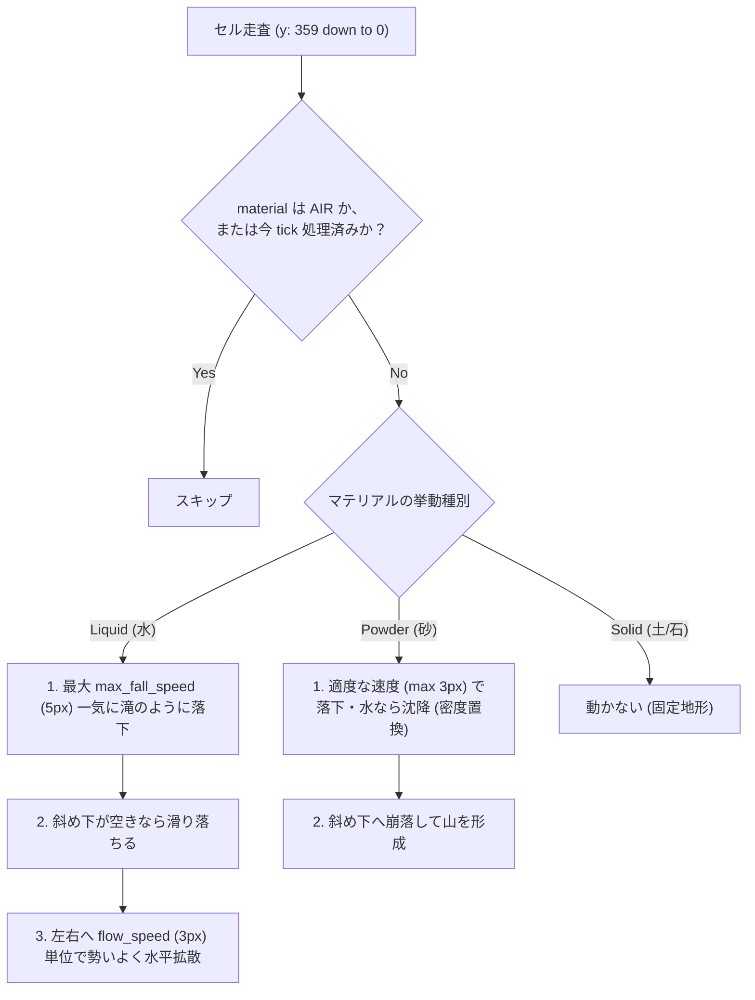

# Charon Engine ディレクトリ & ファイル構成仕様書 (`docs/dir.md`)

> **本書の目的**  
> 本書は、Charon Engine のディレクトリ構成、各ファイルの責務、データフロー、および人間（個人開発者）が AI を介さずに独力でコードを理解・保守・機能拡張できるようにするための構造解説書です。

---

## 1. ディレクトリ全体ツリー

```text
charon-engine/
├── Cargo.toml                  # 依存関係定義（winit, pixels, noise, serde, serde_yaml 等）
├── conf.yml                    # エンジン設定ファイル（解像度、ウィンドウ、プレイヤー初期値）
├── docs/                       # ドキュメントディレクトリ
│   ├── ai.md                   # 初期の構想メモ
│   ├── design.md               # 第1次アーキテクチャ設計書
│   ├── design2.md              # 確定版アーキテクチャ設計書（一次情報源・実在リンク検証済み）
│   ├── dir.md                  # 【本書】ディレクトリ・ファイル構成仕様書
│   └── readme.md               # プロジェクト概要
└── src/                        # Rust ソースコード
    ├── main.rs                 # アプリケーション・エントリーポイント
    ├── core/                   # エンジン基盤モジュール
    │   ├── mod.rs              # core モジュールの公開宣言
    │   ├── config.rs           # 設定ファイル（conf.yml）の読み込み・保存
    │   ├── input.rs            # キーボード・マウス入力管理と座標正規化
    │   └── engine.rs           # CharonEngine（ApplicationHandler 実装・ゲームループ）
    ├── simulation/             # 2D セル・オートマトン物理シミュレーション
    │   ├── mod.rs              # simulation モジュールの公開宣言
    │   ├── cell.rs             # 32bit セル構造体（Cell）とクロック管理
    │   ├── material.rs         # マテリアル定義、物性、8x8 ブロックテクスチャ
    │   ├── particle.rs         # 水しぶき・破片等の自由飛翔パーティクル
    │   └── world.rs            # ワールド全体（地形生成、水の流動、粉体落下、描画）
    └── entities/               # 動的ゲームオブジェクト
        ├── mod.rs              # entities モジュールの公開宣言
        └── player.rs           # プレイヤー（整数 AABB 物理、水中浮力、水しぶき発生）
```

---

## 2. モジュールおよびファイルの責務一覧

### 2.1 エントリーポイント
| ファイル | 責務・役割 |
|---|---|
| `src/main.rs` | アプリケーションの起動点。`winit::event_loop::EventLoop` を生成し、ポーリング型イベントループで `CharonEngine` を実行します。 |

---

### 2.2 コア基盤モジュール (`src/core/`)
| ファイル | 責務・役割 |
|---|---|
| `src/core/mod.rs` | `config`, `engine`, `input` モジュールのエクスポート定義。 |
| `src/core/config.rs` | `conf.yml` の YAML デシリアライズ・シリアライズ。ファイルが存在しない場合のデフォルト生成機能付き。 |
| `src/core/input.rs` | キーボード（A/D/W/Space/矢印）およびマウス（左/右クリック）の押下状態を集約管理。ウィンドウ物理ピクセル座標を論理ゲーム画面（640×360）のピクセル座標へ正規化変換。 |
| `src/core/engine.rs` | `winit 0.30` の `ApplicationHandler` を実装。ウィンドウ生成、`pixels`（wgpu ベースのフレームバッファ）初期化、毎フレームの入力受付、ワールドとプレイヤーの tick 更新、再描画の統括。 |

---

### 2.3 シミュレーションモジュール (`src/simulation/`)
| ファイル | 責務・役割 |
|---|---|
| `src/simulation/mod.rs` | `cell`, `material`, `particle`, `world` モジュールのエクスポート定義。 |
| `src/simulation/cell.rs` | **1 ピクセルを表す 32-bit（4 バイト）構造体 `Cell`**。<br>・`material: u16`: 物質種別（最大 65,535 種対応）<br>・`flags: u8`: 更新クロック、自由落下中（`FLAG_FALLING`）等の直交ビットフラグ<br>・`data: u8`: 8×8 テクスチャ内インデックス（0..63）や汎用状態値 |
| `src/simulation/material.rs` | **データ駆動マテリアルシステム**。<br>・マテリアル ID: `AIR (0)`, `DIRT (1)`, `STONE (2)`, `WATER (3)`, `SAND (4)` 等（`u16`）<br>・挙動種別: `Empty`, `Solid`, `Liquid`, `Powder`<br>・動的レジストリ: `MaterialRegistry`（最大 65,535 種を O(1) 配列引き）<br>・ビルダー API: `MaterialBuilder` による直感的なブロック定義<br>・物理特性: 密度、流速、落下速度、水流押し流しフラグ<br>・**8×8 テクスチャ（64 RGBA カラー配列）** |
| `src/simulation/particle.rs` | セルグリッドから外れて自由軌道運動する `SplashParticle`（水しぶき等）。重力落下、空気抵抗減衰、寿命（フェードアウト）を処理。 |
| `src/simulation/world.rs` | **物理シミュレーションの中核**。<br>・640×360 の全セル配列管理<br>・`noise` による自然な丘陵地・空洞・水たまり・砂山の生成<br>・セル・オートマトン更新ループ（下→上走査、左右交互走査、二重移動防止クロック）<br>・水流動アルゴリズム（下落下 $\to$ 斜め滑り $\to$ 水平拡散）<br>・粉体崩落アルゴリズム（密度置換・斜面滑落）<br>・プレイヤーによる水の攪拌（`displace_water`）<br>・フレームバッファ（RGBA）へのセル、粒子、プレイヤー描画 |

---

### 2.4 エンティティモジュール (`src/entities/`)
| ファイル | 責務・役割 |
|---|---|
| `src/entities/mod.rs` | `player` モジュールのエクスポート定義。 |
| `src/entities/player.rs` | プレイヤーキャラクター。<br>・**Celeste 方式の整数 AABB 衝突判定**（壁・床・天井に吸い付かず正確に移動）<br>・水中判定（浮力による重力軽減、粘性抵抗による減速、水中上昇）<br>・**水面歩行時の足元水しぶき（SplashParticle）噴出**<br>・**移動・ジャンプ時の水流攪拌（波立ち）** |

---

## 3. 重要アーキテクチャの解説

### 3.1 8×8 画像テクスチャと粒子の関係（偏り防止＆適応的再タイリング）
すべてのブロックは **8×8 ピクセル（計 64 粒子）の画像テクスチャ** を基準としてレンダリングされます。

```text
[8x8 ブロックテクスチャ]
(tx = x % 8, ty = y % 8)
Row 0:  00 01 02 03 04 05 06 07  --> 水面ハイライト（直上が空気の時のみ使用）
Row 1:  08 09 10 11 12 13 14 15  --> 水中・地中
...
Row 7:  56 57 58 59 60 61 62 63  --> 深部
```

1. **粒子の集積と適応的ブロック再タイリング（テクスチャ偏り防止）**:
   - 水や砂などの流体が落下・流動して溜まった際、上面用ピクセル（白いハイライト等）が水底に沈んで不自然な白い線や固まりになる現象を防ぐため、`get_adaptive_color` による適応的レンダリングを行います。
   - **水（WATER）の場合**: 直上が空気（AIR）であるセル（＝水面）のみ Row 0 の水面ハイライト色を割り当て、内部に沈んでいるセルは Row 1..7 の美しい水中色を現在のワールド座標 `x % 8, (y % 7) + 1` で再タイリングします。これにより、水たまりがどのように混ざり合っても**水面だけが綺麗に波立ち、内部は均質な水ブロックとして再構成**されます。
   - **固体（DIRT, STONE）の場合**: 地形として連続しているセルは、現在のワールド座標 `x % 8, y % 8` でシームレスなブロックテクスチャとして結合レンダリングされます。
   - **自由粒子の場合**: 空間を飛翔・落下中の粒子は、自身が持つテクスチャ色を保持して粒状感を維持します。

---

### 3.2 セル・オートマトンの更新ルールとマテリアル速度管理



- **マテリアルごとの速度管理（状態管理）**:
  - `MaterialDef` に `max_fall_speed`（最大落下速度）と `flow_speed`（横方向流速）を保持。
  - 水は砂と異なり、**1 tick で最大 5 セル直下を走査して一気に落下**（滝のような急流）し、着地後は **最大 3 セル一気に横へスライド移動**（水たまりの瞬間的な平滑化）します。
- **二重更新防止（クロックビット）**:
  - グローバルな `clock_bit`（0 と 1 を毎 tick トグル）とセルの `flags & 1` を比較し、同一フレーム内での多重移動・無限加速を防止。クリア走査は不要。
- **走査バイアスの除去**:
  - 偶数 tick は左から右、奇数 tick は右から左へ走査順を交互に入れ替え、流体の片寄り偏向を完全に解消。

---

### 3.3 プレイヤーとブロックの当たり判定（4×4 半ブロック密度判定）

1. **4×4 半ブロック密度によるコリジョン（足元のつまずき完全解消）**:
   - 従来の 1px 厳密判定では、砂粒が 1 ピクセル落ちているだけでプレイヤーが壁とみなされて引っかかっていました。
   - 本設計では、接触面が跨ぐ各 **4×4 領域（計 16 セル）内の固体ピクセル数** をカウントします。
     - **固体セル $\ge$ 8 個（過半数・体積の半分以上）**: 床・壁（ブロック）として衝突停止。
     - **固体セル $<$ 8 個（体積の半分未満）**: 当たり判定を持たない「まばらな散乱粒子・破片」として通り抜け可能。
   - これにより、削りカスや小粒子の存在による操作ストレスが完全に解消されます。
2. **水深と浮力・粘性の変化**:
   - 水に入ると浮力により重力が通常の 1/4（`0.05`）に軽減。スペースキーで水面に向かってゆっくり泳ぎ上がれます。
3. **水しぶき（Splash）**:
   - プレイヤーが水面を走ると、足元から移動方向と逆側・斜め上へ `SplashParticle`（水しぶき）が噴出。
4. **水流の攪拌（Displacement）**:
   - 移動やジャンプ時に `world.displace_water` により周囲の水が押しのけられ、水面に動的な波紋が立ちます。

---

### 3.4 構造崩壊システムと水流押し流し（リアリティ物理）

1. **体積不足による構造崩壊（粒子化）**:
   - 土や石などのブロックを削り、4×4 領域内の残存ピクセルが **半数（8 個）未満** になった場合、結合強度を失って `Behavior::Solid` から `Behavior::Powder`（`LOOSE_DIRT` または `LOOSE_STONE`）へと自動変化します。
   - これにより、ブロックを半分以上削ると「残った薄皮や破片が重力でパラパラと粉々になって崩れ落ちる」破壊現象が自動的に発生します。
   - また、上下左右に支持のない「完全な浮遊孤立ピクセル」も自動的に崩落粒子となって落下します。
2. **水流による小粒子の押し流し（Fluid Drag / 侵食）**:
   - 水が横へ高速スライドする際、進行方向に砂（SAND）や崩落土（LOOSE_DIRT）が存在する場合、水流の運動量によってその粒子を横の空きセルへ押し退けます。
   - 4×4 以上の完全な石ブロック（STONE）は水流をせき止めますが、砂や削られた土砂は水と一緒に川のように下流へ押し流されます。

---

## 4. 人間（個人開発者）向け：拡張ガイド

### 新しいマテリアル（例: 溶岩 LAVA）を追加する手順
1. `src/simulation/material.rs`:
   - 定数を追加: `pub const LAVA: u8 = 7;`
   - `MATERIALS` 配列に `MaterialDef` を追加（挙動: `Behavior::Liquid`, 密度: `120`, 8x8 テクスチャ定義）。
2. `src/simulation/world.rs`:
   - 必要に応じて、水と接触した際に石化する反応ロジックを `update_cell` に追加。
3. `src/core/engine.rs`:
   - ブラシ割り当てを追加。

---

## 5. 操作方法一覧

| 操作 | 挙動 |
|---|---|
| **A / D** または **← / →** | プレイヤーの左右移動（4x4半ブロック上を滑らかに歩行） |
| **W / Space / ↑** | ジャンプ（地上では跳躍、水中では浮上・遊泳） |
| **マウス左ドラッグ** | カーソル位置に**水（WATER）**を連続注水 |
| **マウス右ドラッグ** | 地形を**掘削・破壊（AIR）**（体積が半分未満になると破片が崩落） |
| **ホイール中クリック** または **Shift+左** | カーソル位置に**砂（SAND）**を連続配置 |
| **F11** | フルスクリーンの切り替え |
| **ウィンドウ閉じる** | ゲームの終了 |
