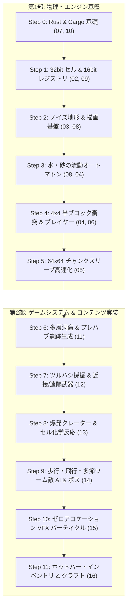

# Charon Engine 人間向け完全開発ドキュメント (目次 & 総合ガイド)

> **対象読者**: AI を使用せず、自身の力で Rust 製サンドボックス物理ゲームエンジンを設計・実装・保守・拡張する個人開発者。  
> **本書の役割**: 物理セルオートマトンの基礎から、テラリアや Noita のような「世界生成・採掘・武器・魔法・敵AI・ボス戦・UI・クラフト」を備えた完全なゲームとして完成させるまでの、全 16 冊からなる完全な設計書と実装手順を提供します。

---

## 1. ドキュメント体系一覧

本ディレクトリ（`human_doc/`）は、**「第1部: 物理・アーキテクチャ基盤」** と **「第2部: ゲームシステム & コンテンツ完全実装」** の 2 つのフェーズに分かれています。

### 【第1部】物理シミュレーション & アーキテクチャ基盤
| ファイル | タイトル | 概要・学べること |
|---|---|---|
| [01_ARCHITECTURE_FLAWS.md](file:///a:/Project/charon-engine/human_doc/01_ARCHITECTURE_FLAWS.md) | **現行実装の致命的欠陥分析** | なぜマテリアル追加で組み合わせ爆発が起きるのか？ハードコードの限界と L1 キャッシュ効率。 |
| [02_CELL_DATA_LAYOUT.md](file:///a:/Project/charon-engine/human_doc/02_CELL_DATA_LAYOUT.md) | **32bit セルの直交ビットレイアウト** | 厳密な 4 バイト（32-bit）構造体。物質の種類（u16: 65,536 種）と動的状態フラグの完全分離。 |
| [03_MATERIAL_SYSTEM.md](file:///a:/Project/charon-engine/human_doc/03_MATERIAL_SYSTEM.md) | **データ駆動マテリアルレジストリ** | 連続メモリによる O(1) 配列引き、8x8 テクスチャアトラスの画像ロード、高速反応テーブル。 |
| [04_PHYSICS_AND_COLLISION.md](file:///a:/Project/charon-engine/human_doc/04_PHYSICS_AND_COLLISION.md) | **4x4 半ブロック物理 & 構造崩壊** | 4x4 密度判定による足元のつまずき完全解消、自立強度計算による自然な構造崩落、水流ドラッグ数理。 |
| [05_CHUNK_AND_SLEEP.md](file:///a:/Project/charon-engine/human_doc/05_CHUNK_AND_SLEEP.md) | **64x64 チャンク & ゼロコスト・スリープ** | L1 キャッシュ（16KiB）に最適化された 64x64 チャンク分割、Dirty 矩形による静止ブロックの計算スキップ。 |
| [06_IMPLEMENTATION_RECIPES.md](file:///a:/Project/charon-engine/human_doc/06_IMPLEMENTATION_RECIPES.md) | **完全実装コードレシピ集** | 現行コードと 100% 同期したコピペ可能な型安全 Rust コード集（セル、衝突判定、崩壊、カスタム登録）。 |
| [07_RUST_FOR_TS_GO_DEVS.md](file:///a:/Project/charon-engine/human_doc/07_RUST_FOR_TS_GO_DEVS.md) | **TS/Go 開発者のための Rust 入門** | **★Rust 初心者必読**。言語モデル比較、借用チェッカーを回避する `Copy` 値コピー設計、ビット演算。 |
| [08_REFACTORING_WALKTHROUGH.md](file:///a:/Project/charon-engine/human_doc/08_REFACTORING_WALKTHROUGH.md) | **直交フラグ化リファクタリング解説** | **★実装手本**。`LOOSE_DIRT` 廃止と `FLAG_FALLING` 導入の Before/After 対比、選定理由。 |
| [09_DYNAMIC_REGISTRY_16BIT.md](file:///a:/Project/charon-engine/human_doc/09_DYNAMIC_REGISTRY_16BIT.md) | **16bit ID & 動的レジストリ仕様書** | **★テラリア規模対応**。最大 65,535 種対応、1 万個でも O(1) 定数時間、MaterialBuilder、TOML 設定。 |
| [10_CARGO_COMMANDS_AND_CLI.md](file:///a:/Project/charon-engine/human_doc/10_CARGO_COMMANDS_AND_CLI.md) | **Cargo 必須コマンド & ロードマップ** | **★実践必読**。TS/Go 対比表、check/run/test/clippy/doc/fmt、自力で完成させる 6 フェーズ手順。 |

---

### 【第2部】ゲームシステム & コンテンツ完全実装
| ファイル | タイトル | 概要・学べること |
|---|---|---|
| [11_WORLDGEN_AND_STRUCTURES.md](file:///a:/Project/charon-engine/human_doc/11_WORLDGEN_AND_STRUCTURES.md) | **世界生成 & バイオーム・建造物生成** | 多層深度レイヤー、パーリン・ワーム洞窟掘削、プレハブダンジョン・宝箱部屋スタンプ方式、鉱脈生成。 |
| [12_MINING_WEAPONS_AND_TOOLS.md](file:///a:/Project/charon-engine/human_doc/12_MINING_WEAPONS_AND_TOOLS.md) | **ツルハシ・武器・採掘ツール仕様書** | ツルハシ硬度ダメージモデル、剣のスイング円弧判定、弓矢・銃弾のブレゼンハム放物線弾道物理。 |
| [13_MAGIC_EXPLOSIONS_AND_REACTIONS.md](file:///a:/Project/charon-engine/human_doc/13_MAGIC_EXPLOSIONS_AND_REACTIONS.md) | **魔法・爆発・セル化学反応仕様書** | 3 ゾーン爆発数理（クレーター・破片四散）、セル間化学反応マトリクス（水+溶岩=黒曜石、火+木=延焼）。 |
| [14_ENEMY_AND_BOSS_AI.md](file:///a:/Project/charon-engine/human_doc/14_ENEMY_AND_BOSS_AI.md) | **敵キャラクター & ボス AI・エンティティ** | オートステップ登り歩行 AI、IK 多節ワーム（イーターオブワールド）、ボス戦の地形破壊突進ステートマシン。 |
| [15_PARTICLES_AND_VFX.md](file:///a:/Project/charon-engine/human_doc/15_PARTICLES_AND_VFX.md) | **VFX & 超高性能パーティクルシステム** | ヒープ確保ゼロの固定長リングバッファプール（2048個）、火花・煙・血飛沫、粒子の着地セル化処理。 |
| [16_UI_INVENTORY_AND_CRAFTING.md](file:///a:/Project/charon-engine/human_doc/16_UI_INVENTORY_AND_CRAFTING.md) | **UI・インベントリ & クラフティング** | ピクセルパーフェクト UI 描画（ホットバー、HP/マナ）、50 枠インベントリ、作業台検知型自動クラフト。 |

---

## 2. エンジン完成までの総合ロードマップ

---

## 3. 実在確認済み 日本語学習リンク集

本プロジェクトを開発しながら Rust を体系的に学ぶための公式・定番の日本語リファレンスです（全リンク実在確認済み）。

* [The Rust Programming Language 日本語版 (The Book)](https://doc.rust-jp.rs/book-ja/)
  * [第4章: 所有権を理解する](https://doc.rust-jp.rs/book-ja/ch04-00-understanding-ownership.html) （TS/Go の参照・GC との決定的な違い）
  * [第6章: Enumとパターンマッチング](https://doc.rust-jp.rs/book-ja/ch06-00-enums.html) （代数的データ型と Option/Result）
  * [第8章: コレクション (Vec)](https://doc.rust-jp.rs/book-ja/ch08-01-vectors.html) （動的配列とスライス）
  * [第10章: トレイト](https://doc.rust-jp.rs/book-ja/ch10-02-traits.html) （Go の interface との違い）
* [Tour of Rust 日本語版](https://tourofrust.com/00_ja.html) （ブラウザでステップバイステップに試せる初心者ツアー）
* [Rust By Example 日本語版](https://doc.rust-jp.rs/rust-by-example-ja/) （実行可能な実例集）
* [The Rustonomicon 日本語版](https://doc.rust-jp.rs/rust-nomicon-ja/) （メモリレイアウトと低レイヤの解説）
* [セル・オートマトン - Wikipedia 日本語版](https://ja.wikipedia.org/wiki/%E3%82%BB%E3%83%AB%E3%83%BB%E3%82%AA%E3%83%BC%E3%83%88%E3%83%9E%E3%83%88%E3%83%B3)
* [ビット演算 - Wikipedia 日本語版](https://ja.wikipedia.org/wiki/%E3%83%93%E3%83%83%E3%83%88%E6%BC%94%E7%AE%97)
* [ブレゼンハムのアルゴリズム - Wikipedia 日本語版](https://ja.wikipedia.org/wiki/%E3%83%96%E3%83%AC%E3%82%BC%E3%83%B3%E3%83%8F%E3%83%A0%E3%81%AE%E3%82%A2%E3%83%AB%E3%82%B4%E3%83%AA%E3%82%BA%E3%83%A0)
