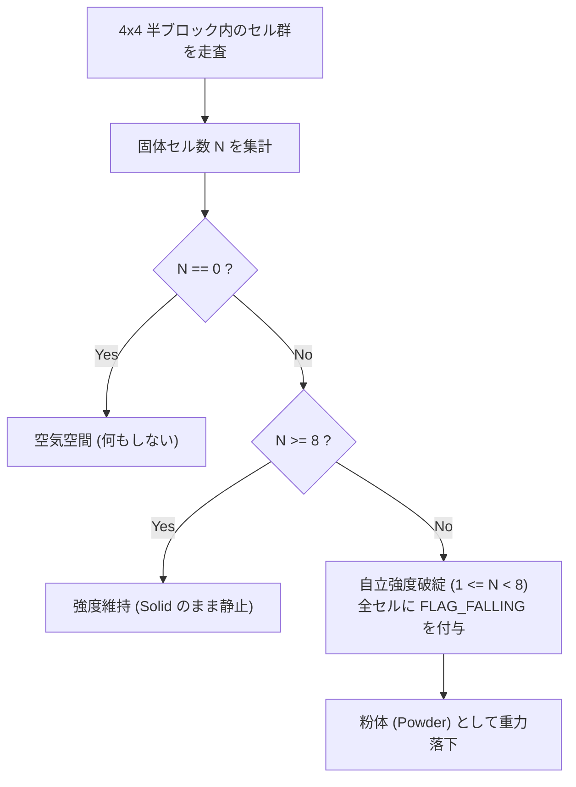

# 4x4 半ブロック物理 & 構造崩壊アルゴリズム (`04_PHYSICS_AND_COLLISION.md`)

> **本書の目的**  
> 1px 単位コリジョンによる「小石へのつまずき」を完全に排除し、4x4（半ブロック）単位での安定した足場判定、体積不足による自然な崩落、および水流ドラッグによる侵食の数理アルゴリズムを詳解します。

---

## 1. 4x4 半ブロック密度コリジョン・アルゴリズム

### 1.1 問題の背景と数学モデル
従来の 1px 判定では、AABB の移動先ピクセルに 1 つでも `Solid` または `Powder` があると速度を 0 にしていました。  
しかし、8x8 ブロックが崩壊して散乱した 1〜2px の削りカスは、ゲーム内では「砂埃」や「小石」に過ぎず、プレイヤーが乗るべき「足場」ではありません。

```text
[従来の 1px 判定]          [4x4 半ブロック密度判定]
┌───┐                      ┌───┐
│   │                      │   │
└───┘                      └───┘
  ↓ つまずいて停止！          ↓ 8px未満なので通り抜け可能！
■                          ■
(1pxの砂粒)                (散乱粒子は無視してスムーズに前進)
```

### 1.2 密度サンプリングの計算手順
プレイヤーの AABB（幅 $W$、高さ $H$）が $(X, Y)$ にあるとき：

1. **接触する 4x4 グリッド境界の算出**:
   $$gx_{\text{start}} = \lfloor X / 4 \rfloor, \quad gx_{\text{end}} = \lfloor (X + W + 3) / 4 \rfloor$$
   $$gy_{\text{start}} = \lfloor Y / 4 \rfloor, \quad gy_{\text{end}} = \lfloor (Y + H + 3) / 4 \rfloor$$

2. **各 4x4 領域内の有効固体セル数 $N$ のカウント**:
   接触している 4x4 領域（計 16 セル）の中で、プレイヤーの AABB 境界と重なっている固体セル数を数える。

3. **過半数判定（閾値 $\theta = 8$）**:
   * **$N \ge 8$ (体積の半分以上)**: 完全な「半ブロック足場/壁」とみなし、移動を停止（衝突）。
   * **$N < 8$ (体積の半分未満)**: 「散乱粒子」とみなし、通り抜ける（衝突なし）。

---

## 2. 構造崩壊システム（Structure Collapse）の数理

### 2.1 自立強度判定（Self-Supporting Threshold）
土や石などの物質（`COLLAPSIBLE` フラグを持つもの）は、**4x4 半ブロック内に最低 8 セル以上の同種結合** が存在することで初めて構造的自立（アーチ・柱としての強度）を維持できます。



### 2.2 インターリーブ・スキャン（計算負荷の平滑化）
全画面の 4x4 ブロックを毎フレーム全走査すると負荷が高まるため、**4 フレームに分散するインターリーブ走査** を行います。

$$\text{frame\_offset} = \text{tick\_count} \pmod 4$$
$$(gx + gy) \pmod 4 == \text{frame\_offset} \text{ のブロックのみを当該フレームで更新}$$

これにより、CPU 負荷を 1/4 に分散しながら、プレイヤーの目には 1/15 秒（瞬時）に崩落が発生しているように見えます。

---

## 3. 水流運動量ドラッグ（流砂・侵食アルゴリズム）

水が左右に水平スライド（`flow_speed`）する際、水流の運動エネルギーによって周囲の小粒子を押し流します。

```text
[水流押し流しステップ]
Tick T:
  [水 (W)] [砂 (S)] [空気 (A)]
     │       │
     └── 押し出し ──┘
Tick T+1:
  [空気 (A)] [水 (W)] [砂 (S)]  --> 砂が 1 歩進み、水がその位置へ進入！
```

### 判定ルール
1. 水セル $(x, y)$ が横方向 $dir \in \{-1, +1\}$ へ流動しようとする。
2. 隣接セル $(x + dir, y)$ のマテリアルを調べる。
3. そのセルが `MaterialFlags::WASHABLE`（砂、崩落土粒子）を持っている場合：
   * さらにその先 $(x + 2 \cdot dir, y)$ が `AIR` であるかをチェック。
   * 空き地があれば、**粒子を $(x + 2 \cdot dir, y)$ へ押し出し、水自身は $(x + dir, y)$ へ進む**。
4. これにより、完全な石（`WASHABLE` なし）は水をせき止め、砂や崩落土だけが水流と一緒に下流へ押し流される。
