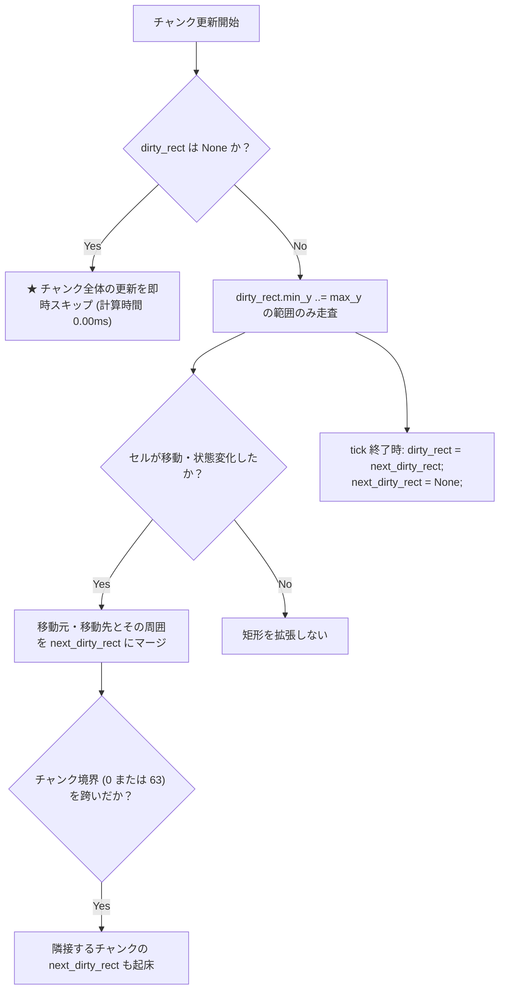

# 64x64 チャンク & ゼロコスト・スリープ設計 (`05_CHUNK_AND_SLEEP.md`)

> **本書の目的**  
> 全画面無条件走査による CPU メモリ帯域の圧迫を解決し、L1 データキャッシュに完全適合する 64x64 チャンク分割と、Dirty 矩形による静止ブロックの計算スキップ（ゼロコスト・スリープ）を設計します。

---

## 1. 64x64 チャンクのハードウェア的根拠

現代の x86-64 CPU（AMD Zen 系、Intel Core 系）の L1 データキャッシュ（L1D）は、コアあたり **32 KiB 〜 48 KiB** です。

```text
[64x64 チャンクのメモリフットプリント]
セル数:       64 × 64 = 4,096 個
セルサイズ:   4 バイト (32-bit)
総データ量:   4,096 × 4 B = 16,384 バイト (厳密に 16 KiB)
```

$$\frac{16 \text{ KiB}}{32 \text{ KiB (L1D 容量)}} = 50\%$$

* **結論**: 64x64 チャンクは、L1D キャッシュの半分を占有するにとどまります。
* チャンク 1 つのシミュレーションループを回している間、**セルの全データと隣接セルの参照が L1D キャッシュから一切追い出されずに完結** します。
* メモリバス（DRAM）への低速アクセスがほぼ発生しないため、極めて高速に処理されます。

---

## 2. チャンク構造体のデータ定義

```rust
/// 2D 矩形範囲（チャンク内のローカル座標: 0..64）
#[derive(Clone, Copy, Debug)]
pub struct LocalRect {
    pub min_x: u8,
    pub min_y: u8,
    pub max_x: u8,
    pub max_y: u8,
}

/// 64x64 セルを管理するチャンク単位
pub struct Chunk {
    /// 16 KiB の連続したセル配列
    pub cells: Box<[Cell; 4096]>,

    /// 今 tick 走査対象となる矩形（None の場合は完全スリープ）
    pub dirty_rect: Option<LocalRect>,

    /// 次 tick 用に拡張されていく矩形
    pub next_dirty_rect: Option<LocalRect>,
}
```

---

## 3. ゼロコスト・スリープ（Dirty 矩形）の動作サイクル

静止したブロック（海の底、地中深部）は、毎フレーム計算する必要がありません。



### スリープの効果
* 水や砂がすべて沈殿して静止すると、ワールド全体の `dirty_rect` が `None` になります。
* 画面全体の 23 万セルを走査していた処理が **数十個のチャンクのポインタ判定（0.01ms 以下）** に短縮され、CPU 使用率がほぼ 0% まで低下します。

---

## 4. チャンク境界の起床ルール（Wake-up Boundary）

セルがチャンクの縁（境界）で動いた場合、隣のチャンクを起こさないと境界で砂や水が凍りついたように止まってしまいます。

```text
Chunk (X, Y)                Chunk (X+1, Y)
┌───────────────────────┐   ┌───────────────────────┐
│                     ■ │-->│ ■ (起こされたセル)    │
│            (x = 63) ─┘│   │└─ (x = 0)             │
└───────────────────────┘   └───────────────────────┘
  境界に触れたら隣接チャンクの next_dirty_rect を起床！
```

### 起床判定ロジック
* `local_x == 63` でセルが動いた $\to$ 右のチャンク $(X+1, Y)$ の `next_dirty_rect` に `min_x = 0` を含めて起床。
* `local_x == 0` でセルが動いた $\to$ 左のチャンク $(X-1, Y)$ の `next_dirty_rect` に `max_x = 63` を含めて起床。
* 上下境界（`local_y == 0`, `local_y == 63`）も同様に処理。
