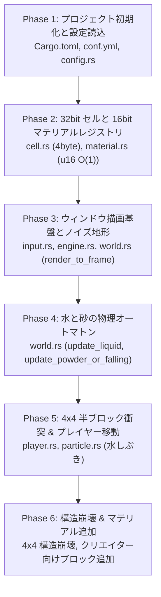

# Cargo 必須コマンド & 完成までの完全ロードマップ (`10_CARGO_COMMANDS_AND_CLI.md`)

> **本書の目的**  
> TypeScript / JavaScript や Go の経験者が、Rust の公式ビルドツール `cargo` を自由自在に使いこなし、  
> 設計書を読みながら **ゼロからエンジン完成まで自力で実装・テスト・デバッグ・実行** できるようになるための実践ハンドブックです。

---

## 1. TS / Go / Rust コマンド対比チートシート

TypeScript (`npm / pnpm`) や Go (`go`) で普段使っている操作が、Rust (`cargo`) でどう対応しているかの早見表です。

| 操作・目的 | TypeScript / Node.js | Go | Rust (`cargo`) |
|---|---|---|---|
| **プロジェクト作成** | `npm init -y` | `go mod init <name>` | `cargo new <name> --bin` |
| **依存ライブラリ追加** | `npm i <pkg>` / `pnpm add` | `go get <pkg>` | **`cargo add <crate>`** |
| **型・構文の超高速チェック** | `tsc --noEmit` | `go vet ./...` | **`cargo check`** (★最重要) |
| **開発実行** | `npm run dev` / `tsx main.ts` | `go run .` | **`cargo run`** |
| **最適化リリース実行** | `npm run build && node dist` | `go build && ./bin` | **`cargo run --release`** (★物理高速化) |
| **単体テスト実行** | `npm test` / `vitest` | `go test ./...` | **`cargo test`** |
| **標準出力付きテスト** | `vitest --reporter=verbose` | `go test -v` | **`cargo test -- --nocapture`** |
| **静的解析 (Linter)** | `npm run lint` (`eslint`) | `golangci-lint run` | **`cargo clippy`** (★超高機能) |
| **コード自動フォーマット** | `npx prettier --write .` | `go fmt ./...` | **`cargo fmt`** |
| **API ドキュメント生成** | `npx typedoc` | `godoc -http=:6060` | **`cargo doc --open`** (★神機能) |
| **ビルドキャッシュ削除** | `rm -rf node_modules dist` | `go clean -cache` | **`cargo clean`** |

---

## 2. 開発で絶対に使う Cargo 必須コマンド解説

### ① `cargo check`（超高速コンパイルチェック）
コードを書いている最中に、バイナリ（exeファイル）を生成せず**「型チェックと借用チェックだけ」**を超高速で行います。
```powershell
cargo check
```
> **★初心者への助言**: コードを数行書くたびに `cargo check` を実行する癖をつけると、コンパイルエラーを即座に潰せます。

---

### ② `cargo run` vs `cargo run --release`（デバッグ実行 vs 最適化実行）
* **通常実行（デバッグビルド）**:
  ```powershell
  cargo run
  ```
  コンパイルが速く、デバッグ情報が含まれますが、物理シミュレーションの計算速度は控えめです。
* **リリース実行（最適化ビルド）**:
  ```powershell
  cargo run --release
  ```
  インライン展開や SIMD 自動ベクトル化が最大適用されます。**セルオートマトンの速度が 10〜30 倍高速化**し、60 FPS が極めて安定します。

---

### ③ `cargo test` の実践テクニック
```powershell
# 1. 全テストを実行
cargo test

# 2. テスト内の println! 出力をコンソールに表示する（超重要！）
cargo test -- --nocapture

# 3. 特定の名前を含むテストだけを実行（例: falling を含むテストのみ）
cargo test falling

# 4. 特定モジュールのテストだけを実行
cargo test simulation::material
```

---

### ④ `cargo clippy`（Rust 最強の教育的静的解析）
Rust 公式の Linter で、「より慣用的な書き方（イディオム）」「無駄なメモリコピーの指摘」「借用チェッカーと仲良くする方法」を親切に教えてくれます。
```powershell
cargo clippy
```
> 初心者は `cargo clippy` の警告に従うだけで、Rust 上級者の綺麗なコードが書けるようになります。

---

### ⑤ `cargo fmt`（自動整形）
プロジェクト全体のコード規約を瞬時に整えます。
```powershell
cargo fmt
```

---

### ⑥ `cargo doc --open`（日本語 Doc のローカル Web 閲覧）
コード内に書いた `///` の日本語 Doc コメントを自動解析し、**美しい HTML ドキュメントサイトを生成して既定のブラウザで自動表示**します。
```powershell
cargo doc --open --no-deps
```
> 自分やチームが定義した関数や構造体の仕様が、公式ドキュメント（`std`）と全く同じ見栄えでオフライン閲覧できます。

---

### ⑦ クラッシュ時のスタックトレース表示（PowerShell）
Rust で配列の範囲外アクセス等でパニック（`panic!`）が起きた際、詳細なスタックトレース（ファイル名と行番号）を表示させるコマンドです。

```powershell
# Windows PowerShell での指定
$env:RUST_BACKTRACE=1
cargo run
```

---

## 3. ゼロから自力で完成させる完全実装ロードマップ（6フェーズ）

設計書を見ながら人間が自力でコードを書いて完成させるための、推奨実装順序と各ステップの合格基準（マイルストーン）です。



---

### 【Phase 1】プロジェクト初期化と設定管理
1. **コマンド**:
   ```powershell
   cargo new charon-engine --bin
   cd charon-engine
   cargo add winit@0.30.5 pixels@0.15.0 noise@0.9.0 serde@1.0 --features serde/derive serde_yaml@0.9
   ```
2. **実装対象**:
   - `conf.yml`: ウィンドウ解像度（640x360）やタイトル
   - `src/core/config.rs`: YAML 読み込みとデフォルト生成
3. **合格基準**:
   `cargo test` または `cargo check` が通り、設定値が読み込めること。

---

### 【Phase 2】32bit セル構造体 & 16bit 動的レジストリ
1. **参照ドキュメント**:
   - [02_CELL_DATA_LAYOUT.md](file:///a:/Project/charon-engine/human_doc/02_CELL_DATA_LAYOUT.md)
   - [09_DYNAMIC_REGISTRY_16BIT.md](file:///a:/Project/charon-engine/human_doc/09_DYNAMIC_REGISTRY_16BIT.md)
2. **実装対象**:
   - `src/simulation/cell.rs`: `material: u16`, `flags: u8`, `data: u8`。`FLAG_CLOCK`, `FLAG_FALLING`。
   - `src/simulation/material.rs`: `Behavior`, `MaterialDef`, `MaterialBuilder`, `MaterialRegistry`。
3. **合格基準**:
   ```powershell
   cargo test simulation::cell
   cargo test simulation::material
   ```
   `size_of::<Cell>() == 4` のテスト、および 10,000 個のマテリアル登録テストがパスすること。

---

### 【Phase 3】ウィンドウ表示とノイズ地形生成
1. **参照ドキュメント**:
   - [03_MATERIAL_SYSTEM.md](file:///a:/Project/charon-engine/human_doc/03_MATERIAL_SYSTEM.md)
   - [08_REFACTORING_WALKTHROUGH.md](file:///a:/Project/charon-engine/human_doc/08_REFACTORING_WALKTHROUGH.md)
2. **実装対象**:
   - `src/core/input.rs`: キー・マウス入力
   - `src/core/engine.rs`: `winit` イベントループと `pixels` フレームバッファ
   - `src/simulation/world.rs`: `cells` 配列、`generate_terrain()`（FBM ノイズ）、`render_to_frame()`
3. **合格基準**:
   ```powershell
   cargo run
   ```
   ウィンドウが開き、画面上に 8x8 テクスチャでタイリングされた土・石の丘陵、水たまり、砂山が綺麗に表示されること。

---

### 【Phase 4】水と砂のセルオートマトン物理
1. **参照ドキュメント**:
   - [04_PHYSICS_AND_COLLISION.md](file:///a:/Project/charon-engine/human_doc/04_PHYSICS_AND_COLLISION.md)
   - [08_REFACTORING_WALKTHROUGH.md](file:///a:/Project/charon-engine/human_doc/08_REFACTORING_WALKTHROUGH.md)
2. **実装対象**:
   - `src/simulation/world.rs`:
     - `update_liquid()`: 多段落下（最大5px/tick）、斜め滑り、水平流動（流速3px/tick）、水流による砂の押し流し
     - `update_powder_or_falling()`: 砂や崩落粒子の重力落下、斜面崩落、着地時の再結合安定化
   - マウス操作での注水（左クリック）と砂配置（Shift+左クリック / 中クリック）
3. **合格基準**:
   クリックで配置した水が勢いよく流れ落ちて溜まり、砂が崩れて山を作り、水流が砂を押し流すこと。

---

### 【Phase 5】4x4 半ブロック衝突 & プレイヤー移動物理
1. **参照ドキュメント**:
   - [04_PHYSICS_AND_COLLISION.md](file:///a:/Project/charon-engine/human_doc/04_PHYSICS_AND_COLLISION.md)
   - [06_IMPLEMENTATION_RECIPES.md](file:///a:/Project/charon-engine/human_doc/06_IMPLEMENTATION_RECIPES.md)
2. **実装対象**:
   - `src/simulation/particle.rs`: `SplashParticle`（水しぶき）
   - `src/entities/player.rs`:
     - `collides_with_half_block()`: 4x4 領域内の接触セルが 8 個以上（過半数）の場合のみ衝突
     - 水中判定（浮力・粘性抵抗減衰）
     - 水面歩行時の水しぶき発生、移動時の水流攪拌
3. **合格基準**:
   ```powershell
   cargo test entities::player
   ```
   A/D で移動、W/Space でジャンプ。地面をスムーズに歩け、1〜2 ピクセルの細かい粒子に足を取られず、水に入るとふわっと浮きながら水しぶきが上がること。

---

### 【Phase 6】構造崩壊システム & クリエイター向けブロック追加
1. **参照ドキュメント**:
   - [08_REFACTORING_WALKTHROUGH.md](file:///a:/Project/charon-engine/human_doc/08_REFACTORING_WALKTHROUGH.md)
   - [09_DYNAMIC_REGISTRY_16BIT.md](file:///a:/Project/charon-engine/human_doc/09_DYNAMIC_REGISTRY_16BIT.md)
2. **実装対象**:
   - `src/simulation/world.rs`:
     - `check_structural_collapse()`: 右クリックで土や石を削り、4x4 内の体積が半分未満になると `cell.set_falling(true)` でパラパラ崩壊
     - `check_isolated_solid()`: 空中に浮遊した孤立ピクセルの重力落下
   - `MaterialBuilder` によるカスタムブロックの追加実験（木材、溶岩、オリハルコン等）
3. **合格基準**:
   右クリックで地面を掘ると上の土が自然に崩落し、着地すると再び地面として固まること。また、新しいブロックをレジストリに追加した際に物理コードを 1 行も修正せずに動作すること。
