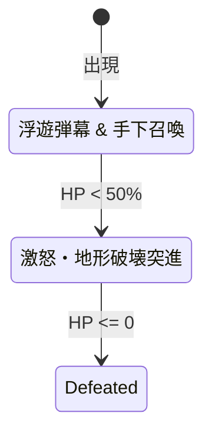

# 敵キャラクター & ボス AI・エンティティ完全仕様書 (`14_ENEMY_AND_BOSS_AI.md`)

> **本書の目的**  
> ピクセル物理グリッド上で動作する敵 AI（スライム、歩行ゾンビ、飛行型、地形貫通ワーム）および、複数フェーズを持つ巨大ボス戦のステートマシン設計を提供します。

---

## 1. 物理グリッドを移動する 4 大敵 AI パターン

ピクセルゲームエンジンにおける敵は、物理ワールドの 4x4 半ブロック当たり判定と調和して移動する必要があります。

```text
1. 歩行型 (Zombie)   : 地面を走り、1〜3px の段差を自動でステップアップ（オートジャンプ）
2. 跳躍型 (Slime)    : 放物線ジャンプで近づき、着地時に変形する
3. 浮遊型 (Bat/Eye)  : 重力を無視し、プレイヤーの方向へ滑らかに旋回追従
4. 掘削型 (Worm)     : 多数の節（Segment）が連なり、地形を自由に貫通して襲いかかる
```

---

## 2. 段差を乗り越える歩行 AI（オートステップ物理）

テラリアのゾンビのように、1〜3 ピクセルのわずかな段差で引っかからず、スムーズに階段状に登るアルゴリズムです。

```rust
pub struct WalkerEnemy {
    pub x: f32,
    pub y: f32,
    pub vx: f32,
    pub vy: f32,
    pub width: f32,
    pub height: f32,
    pub direction: f32, // -1.0: 左, 1.0: 右
    pub hp: f32,
}

impl WalkerEnemy {
    pub fn update(&mut self, player_x: f32, world: &World) {
        // プレイヤーの方向を向く
        self.direction = if player_x > self.x { 1.0 } else { -1.0 };
        self.vx = self.direction * 0.8;
        self.vy += 0.2; // 重力

        // 水平移動の試行
        let next_x = self.x + self.vx;
        if self.collides(next_x, self.y, world) {
            // 前方が壁！1〜3 ピクセル上に空間があれば「段差登り（オートステップ）」
            let mut stepped = false;
            for step_up in 1..=3 {
                if !self.collides(next_x, self.y - step_up as f32, world) {
                    self.y -= step_up as f32;
                    self.x = next_x;
                    stepped = true;
                    break;
                }
            }
            if !stepped {
                // 高い壁ならジャンプを試みる
                if self.is_grounded(world) {
                    self.vy = -3.5;
                }
            }
        } else {
            self.x = next_x;
        }

        self.y += self.vy;
    }
}
```

---

## 3. 多節ワーム型エネミー物理（Inverse Kinematics）

テラリアの「イーターオブワールド（Eater of Worlds）」のように、頭部に追従して無数の胴体パーツが滑らかに連なる物理計算です。

$$ \vec{P}_{\text{seg}} = \vec{P}_{\text{prev}} - \frac{\vec{P}_{\text{prev}} - \vec{P}_{\text{seg}}}{\|\vec{P}_{\text{prev}} - \vec{P}_{\text{seg}}\|} \times \text{Distance} $$

```rust
pub struct WormSegment {
    pub x: f32,
    pub y: f32,
    pub radius: f32,
}

pub struct GiantWorm {
    pub segments: Vec<WormSegment>,
    pub speed: f32,
}

impl GiantWorm {
    pub fn update(&mut self, target_x: f32, target_y: f32) {
        // 1. 頭部はプレイヤーに向かって地形を無視して突進
        let head = &mut self.segments[0];
        let dx = target_x - head.x;
        let dy = target_y - head.y;
        let angle = dy.atan2(dx);
        head.x += angle.cos() * self.speed;
        head.y += angle.sin() * self.speed;

        // 2. 胴体パーツは前のパーツと一定距離（12px）を保って追従
        for i in 1..self.segments.len() {
            let prev_x = self.segments[i - 1].x;
            let prev_y = self.segments[i - 1].y;

            let curr = &mut self.segments[i];
            let seg_dx = curr.x - prev_x;
            let seg_dy = curr.y - prev_y;
            let dist = (seg_dx * seg_dx + seg_dy * seg_dy).sqrt().max(0.001);

            let desired_dist = 12.0;
            curr.x = prev_x + (seg_dx / dist) * desired_dist;
            curr.y = prev_y + (seg_dy / dist) * desired_dist;
        }
    }
}
```

---

## 4. ボス戦のフェーズ移行ステートマシン



```rust
pub enum BossPhase {
    HoverAndShoot { timer: f32 },
    EnragedCharge { target_x: f32, target_y: f32, count: u8 },
    Defeated,
}
```
HP 50% 未満で `Phase2` に移行すると、ボスが突進した軌道のセルを `create_explosion` で削り飛ばしながらプレイヤーを追い詰める演出が可能です。
